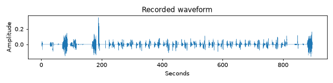

# Device stress harness report

Mode: **owner device run**

Commit: b1d92befa36afca6165217fdb4e1480bbf0e791a · Rate: 48000 Hz · Block: 256 frames
Platform: Linux · CPU: aarch64 · Device: ALSA|pulse

## Protocol and device metrics

| Metric | Value |
|---|---:|
| Acknowledged commands | 27179 |
| Ack p50/p95/p99 (ms) | 0.149 / 0.250 / 0.758 |
| CPU max (%) | 25.033443450927734 |
| Dropouts (latest counter) | 0 |
| Refused replies | 0 |
| Status/telemetry pushes | 8992 / 25712 |

## Recorded signal

| RMS | Peak | DC | Clicks | Dropouts |
|---:|---:|---:|---:|---:|
| 0.032194288 | 1.0 | 1.9663e-05 | 83 | 2 |

## Per-step audio metrics

| Time (s) | Action | RMS | Peak | DC | Clicks | Dropouts |
|---:|---|---:|---:|---:|---:|---:|
| ... | Remaining per-step metrics in analysis.json | ... | ... | ... | ... | ... |
| 0.0 | load_patch | 0.00000 | 0.00000 | 0.00000 | 0 | 0 |
| 2.0001 | noteOn | 0.00000 | 0.00000 | 0.00000 | 0 | 0 |
| 2.0061 | noteOn | 0.00051 | 0.00238 | -0.00017 | 0 | 0 |
| 2.0121 | noteOn | 0.00825 | 0.01361 | 0.00343 | 0 | 0 |
| 2.0181 | noteOn | 0.01518 | 0.02512 | -0.00750 | 0 | 0 |
| 2.0241 | noteOn | 0.02925 | 0.04315 | -0.00365 | 0 | 0 |
| 2.0301 | noteOn | 0.02742 | 0.04657 | 0.01000 | 0 | 0 |
| 2.0361 | noteOn | 0.01282 | 0.02451 | -0.00727 | 0 | 0 |
| 2.0421 | noteOn | 0.03107 | 0.04965 | 0.00000 | 0 | 0 |
| 2.0481 | noteOn | 0.05253 | 0.09033 | 0.00164 | 0 | 0 |
| 2.0541 | noteOn | 0.06049 | 0.08737 | -0.00115 | 0 | 0 |
| 2.0601 | noteOn | 0.03423 | 0.05786 | 0.00304 | 0 | 0 |
| 2.0661 | noteOn | 0.03963 | 0.06735 | 0.01030 | 0 | 0 |
| 2.0721 | noteOn | 0.06048 | 0.09518 | 0.00171 | 0 | 0 |
| 2.0781 | noteOn | 0.05692 | 0.09100 | -0.01515 | 0 | 0 |
| 2.0841 | noteOn | 0.02553 | 0.04211 | 0.00640 | 0 | 0 |
| 2.0901 | noteOn | 0.05446 | 0.15875 | 0.00007 | 0 | 0 |
| 2.3501 | noteOff | 0.03666 | 0.05637 | -0.00473 | 0 | 0 |
| 2.3561 | noteOff | 0.05604 | 0.08926 | -0.00390 | 0 | 0 |
| 2.3621 | noteOff | 0.06393 | 0.09567 | 0.01310 | 0 | 0 |
| 2.3681 | noteOff | 0.05102 | 0.08560 | -0.00695 | 0 | 0 |
| 2.3741 | noteOff | 0.01844 | 0.04089 | 0.00078 | 0 | 0 |
| 2.3801 | noteOff | 0.03123 | 0.05414 | -0.00463 | 0 | 0 |
| 2.3861 | noteOff | 0.04176 | 0.05951 | -0.00065 | 0 | 0 |
| 2.3921 | noteOff | 0.02513 | 0.04434 | 0.00344 | 0 | 0 |
| 2.3981 | noteOff | 0.01938 | 0.03122 | 0.00218 | 0 | 0 |
| 2.4041 | noteOff | 0.02448 | 0.03448 | -0.00113 | 0 | 0 |
| 2.4101 | noteOff | 0.02727 | 0.04825 | -0.00382 | 0 | 0 |
| 2.4161 | noteOff | 0.04896 | 0.08224 | 0.01111 | 0 | 0 |
| 2.4221 | noteOff | 0.06441 | 0.09338 | -0.01020 | 0 | 0 |
| 2.4281 | noteOff | 0.05287 | 0.08905 | -0.00189 | 0 | 0 |
| 2.4341 | noteOff | 0.01756 | 0.03894 | 0.00289 | 0 | 0 |
| 2.4401 | noteOff | 0.02887 | 0.08838 | 0.00008 | 0 | 0 |
| 2.6501 | noteOn | 0.01543 | 0.02365 | -0.00139 | 0 | 0 |
| 2.6561 | noteOn | 0.02161 | 0.03662 | -0.00318 | 0 | 0 |
| 2.6621 | noteOn | 0.03586 | 0.06088 | 0.00525 | 0 | 0 |
| 2.6681 | noteOn | 0.03342 | 0.06235 | 0.00576 | 0 | 0 |
| 2.6741 | noteOn | 0.03792 | 0.06180 | 0.00182 | 0 | 0 |
| 2.6801 | noteOn | 0.05989 | 0.11014 | -0.00940 | 0 | 0 |
| 2.6861 | noteOn | 0.08917 | 0.12952 | -0.01608 | 0 | 0 |
| 2.6921 | noteOn | 0.07148 | 0.10907 | 0.01719 | 0 | 0 |
| 2.6981 | noteOn | 0.06051 | 0.09491 | -0.00294 | 0 | 0 |
| 2.7041 | noteOn | 0.06630 | 0.09760 | -0.00079 | 0 | 0 |
| 2.7101 | noteOn | 0.09400 | 0.14902 | 0.00034 | 0 | 0 |
| 2.7161 | noteOn | 0.09837 | 0.14841 | 0.00950 | 0 | 0 |
| 2.7221 | noteOn | 0.06527 | 0.10980 | -0.01248 | 0 | 0 |
| 2.7281 | noteOn | 0.06793 | 0.11703 | -0.00594 | 0 | 0 |
| 2.7341 | noteOn | 0.10526 | 0.15393 | -0.00099 | 0 | 0 |
| 2.7401 | noteOn | 0.05425 | 0.14050 | 0.00033 | 0 | 0 |
| 3.0001 | noteOff | 0.04188 | 0.06122 | -0.00529 | 0 | 0 |
| 3.0061 | noteOff | 0.01827 | 0.04211 | 0.00279 | 0 | 0 |
| 3.0121 | noteOff | 0.05092 | 0.09586 | -0.00720 | 0 | 0 |
| 3.0181 | noteOff | 0.07339 | 0.10788 | 0.00752 | 0 | 0 |
| 3.0241 | noteOff | 0.04439 | 0.09106 | 0.00126 | 0 | 0 |
| 3.0301 | noteOff | 0.00853 | 0.02072 | -0.00118 | 0 | 0 |
| 3.0361 | noteOff | 0.00722 | 0.01602 | -0.00164 | 0 | 0 |
| 3.0421 | noteOff | 0.03179 | 0.05508 | 0.00459 | 0 | 0 |
| 3.0481 | noteOff | 0.03229 | 0.05582 | -0.00348 | 0 | 0 |
| 3.0541 | noteOff | 0.02125 | 0.05072 | 0.00391 | 0 | 0 |
| 3.0601 | noteOff | 0.06148 | 0.09818 | -0.00612 | 0 | 0 |
| 3.0661 | noteOff | 0.05907 | 0.09613 | -0.00202 | 0 | 0 |
| 3.0721 | noteOff | 0.02696 | 0.05573 | 0.00307 | 0 | 0 |
| 3.0781 | noteOff | 0.01605 | 0.02356 | 0.00192 | 0 | 0 |
| 3.0841 | noteOff | 0.01767 | 0.03616 | -0.00352 | 0 | 0 |
| 3.0901 | noteOff | 0.02991 | 0.08908 | 0.00013 | 0 | 0 |
| 3.3001 | noteOn | 0.02939 | 0.04929 | 0.00029 | 0 | 0 |
| 3.3061 | noteOn | 0.02856 | 0.05090 | -0.00650 | 0 | 0 |
| 3.312 | noteOn | 0.02818 | 0.05658 | 0.00861 | 0 | 0 |
| 3.3181 | noteOn | 0.02410 | 0.04037 | -0.00491 | 0 | 0 |
| 3.3241 | noteOn | 0.04020 | 0.07495 | -0.00260 | 0 | 0 |
| 3.3301 | noteOn | 0.06100 | 0.08832 | 0.00154 | 0 | 0 |
| 3.3361 | noteOn | 0.04784 | 0.07202 | 0.00662 | 0 | 0 |
| 3.3421 | noteOn | 0.06831 | 0.11664 | -0.01082 | 0 | 0 |
| 3.3481 | noteOn | 0.09049 | 0.13217 | -0.00351 | 0 | 0 |
| 3.3541 | noteOn | 0.07234 | 0.11945 | 0.00846 | 0 | 0 |
| 3.3601 | noteOn | 0.05377 | 0.08096 | 0.00071 | 0 | 0 |
| 3.3661 | noteOn | 0.05416 | 0.08063 | 0.00546 | 0 | 0 |
| 3.3721 | noteOn | 0.08455 | 0.14807 | -0.01035 | 0 | 0 |
| 3.3781 | noteOn | 0.10927 | 0.16519 | 0.00580 | 0 | 0 |
| 3.3841 | noteOn | 0.05679 | 0.11609 | -0.00590 | 0 | 0 |
| 3.3901 | noteOn | 0.05435 | 0.17072 | 0.00018 | 0 | 0 |
| 3.6501 | noteOff | 0.04892 | 0.09247 | -0.00314 | 0 | 0 |
| 3.6561 | noteOff | 0.03586 | 0.07971 | -0.00514 | 0 | 0 |
| 3.6621 | noteOff | 0.05477 | 0.08774 | 0.00183 | 0 | 0 |
| 3.6681 | noteOff | 0.01801 | 0.04443 | 0.00206 | 0 | 0 |
| 3.6741 | noteOff | 0.02108 | 0.04822 | -0.00089 | 0 | 0 |
| 3.6801 | noteOff | 0.05615 | 0.08643 | 0.00118 | 0 | 0 |
| 3.6861 | noteOff | 0.03170 | 0.07773 | -0.00055 | 0 | 0 |
| 3.6921 | noteOff | 0.04647 | 0.07904 | -0.00188 | 0 | 0 |
| 3.6981 | noteOff | 0.03972 | 0.07523 | 0.00230 | 0 | 0 |
| 3.7041 | noteOff | 0.02061 | 0.03082 | 0.00021 | 0 | 0 |
| 3.7101 | noteOff | 0.03342 | 0.06644 | -0.00348 | 0 | 0 |
| 3.7161 | noteOff | 0.05027 | 0.07816 | 0.00139 | 0 | 0 |
| 3.7221 | noteOff | 0.02141 | 0.04453 | 0.00337 | 0 | 0 |
| 3.7281 | noteOff | 0.04768 | 0.07315 | 0.00035 | 0 | 0 |
| 3.7341 | noteOff | 0.03248 | 0.05988 | 0.00085 | 0 | 0 |
| 3.7401 | noteOff | 0.02253 | 0.07147 | -0.00003 | 0 | 0 |
| 4.2001 | unheld-note-off | 0.00027 | 0.00525 | 0.00000 | 0 | 0 |
| 6.0001 | setParam | 0.00000 | 0.00000 | 0.00000 | 0 | 0 |
| 6.0501 | setParam | 0.00000 | 0.00000 | 0.00000 | 0 | 0 |
| 8.0001 | setParam | 0.00000 | 0.00000 | 0.00000 | 0 | 0 |
| 8.0051 | setParam | 0.00000 | 0.00000 | 0.00000 | 0 | 0 |
| 8.0101 | setParam | 0.00000 | 0.00000 | 0.00000 | 0 | 0 |
| 8.0151 | setParam | 0.00000 | 0.00000 | 0.00000 | 0 | 0 |
| 8.0201 | setParam | 0.00000 | 0.00000 | 0.00000 | 0 | 0 |
| 8.0251 | setParam | 0.00000 | 0.00000 | 0.00000 | 0 | 0 |
| 8.0301 | setParam | 0.00000 | 0.00000 | 0.00000 | 0 | 0 |
| 8.0351 | setParam | 0.00000 | 0.00000 | 0.00000 | 0 | 0 |
| 8.0401 | setParam | 0.00000 | 0.00000 | 0.00000 | 0 | 0 |
| 8.0451 | setParam | 0.00000 | 0.00000 | 0.00000 | 0 | 0 |
| 8.0501 | setParam | 0.00000 | 0.00000 | 0.00000 | 0 | 0 |
| 12.0001 | setParam | 0.00000 | 0.00000 | 0.00000 | 0 | 0 |
| 12.0005 | setParam | 0.00000 | 0.00000 | 0.00000 | 0 | 0 |
| 12.001 | setParam | 0.00000 | 0.00000 | 0.00000 | 0 | 0 |
| 12.0013 | setParam | 0.00000 | 0.00000 | 0.00000 | 0 | 0 |
| 12.0251 | setParam | 0.00000 | 0.00000 | 0.00000 | 0 | 0 |
| 12.0255 | setParam | 0.00000 | 0.00000 | 0.00000 | 0 | 0 |
| 12.0257 | setParam | 0.00000 | 0.00000 | 0.00000 | 0 | 0 |
| 12.026 | setParam | 0.00000 | 0.00000 | 0.00000 | 0 | 0 |
| 12.0501 | setParam | 0.00000 | 0.00000 | 0.00000 | 0 | 0 |
| 12.0504 | setParam | 0.00000 | 0.00000 | 0.00000 | 0 | 0 |
| 12.0507 | setParam | 0.00000 | 0.00000 | 0.00000 | 0 | 0 |
| 12.051 | setParam | 0.00000 | 0.00000 | 0.00000 | 0 | 0 |
| 12.0751 | setParam | 0.00000 | 0.00000 | 0.00000 | 0 | 0 |
| 12.0754 | setParam | 0.00000 | 0.00000 | 0.00000 | 0 | 0 |
| 12.0757 | setParam | 0.00000 | 0.00000 | 0.00000 | 0 | 0 |
| 12.0759 | setParam | 0.00000 | 0.00000 | 0.00000 | 0 | 0 |
| 12.1001 | setParam | 0.00000 | 0.00000 | 0.00000 | 0 | 0 |
| 12.1004 | setParam | 0.00000 | 0.00000 | 0.00000 | 0 | 0 |
| 12.1014 | setParam | 0.00000 | 0.00000 | 0.00000 | 0 | 0 |
| 12.1017 | setParam | 0.00000 | 0.00000 | 0.00000 | 0 | 0 |
| 12.1251 | setParam | 0.00000 | 0.00000 | 0.00000 | 0 | 0 |
| 12.1254 | setParam | 0.00000 | 0.00000 | 0.00000 | 0 | 0 |
| 12.1256 | setParam | 0.00000 | 0.00000 | 0.00000 | 0 | 0 |
| 12.1259 | setParam | 0.00000 | 0.00000 | 0.00000 | 0 | 0 |
| 12.1501 | setParam | 0.00000 | 0.00000 | 0.00000 | 0 | 0 |
| 12.1504 | setParam | 0.00000 | 0.00000 | 0.00000 | 0 | 0 |
| 12.1507 | setParam | 0.00000 | 0.00000 | 0.00000 | 0 | 0 |
| 12.1509 | setParam | 0.00000 | 0.00000 | 0.00000 | 0 | 0 |
| 12.1751 | setParam | 0.00000 | 0.00000 | 0.00000 | 0 | 0 |
| 12.1754 | setParam | 0.00000 | 0.00000 | 0.00000 | 0 | 0 |
| 12.176 | setParam | 0.00000 | 0.00000 | 0.00000 | 0 | 0 |
| 12.1763 | setParam | 0.00000 | 0.00000 | 0.00000 | 0 | 0 |
| 12.2001 | setParam | 0.00000 | 0.00000 | 0.00000 | 0 | 0 |
| 12.2004 | setParam | 0.00000 | 0.00000 | 0.00000 | 0 | 0 |
| 12.2015 | setParam | 0.00000 | 0.00000 | 0.00000 | 0 | 0 |
| 12.2018 | setParam | 0.00000 | 0.00000 | 0.00000 | 0 | 0 |
| 12.2251 | setParam | 0.00000 | 0.00000 | 0.00000 | 0 | 0 |
| 12.2254 | setParam | 0.00000 | 0.00000 | 0.00000 | 0 | 0 |
| 12.2257 | setParam | 0.00000 | 0.00000 | 0.00000 | 0 | 0 |
| 12.2259 | setParam | 0.00000 | 0.00000 | 0.00000 | 0 | 0 |
| 12.2501 | setParam | 0.00000 | 0.00000 | 0.00000 | 0 | 0 |
| 12.2504 | setParam | 0.00000 | 0.00000 | 0.00000 | 0 | 0 |
| 12.2507 | setParam | 0.00000 | 0.00000 | 0.00000 | 0 | 0 |
| 12.251 | setParam | 0.00000 | 0.00000 | 0.00000 | 0 | 0 |
| 12.2751 | setParam | 0.00000 | 0.00000 | 0.00000 | 0 | 0 |
| 12.2754 | setParam | 0.00000 | 0.00000 | 0.00000 | 0 | 0 |
| 12.2756 | setParam | 0.00000 | 0.00000 | 0.00000 | 0 | 0 |
| 12.2759 | setParam | 0.00000 | 0.00000 | 0.00000 | 0 | 0 |
| 12.3001 | setParam | 0.00000 | 0.00000 | 0.00000 | 0 | 0 |
| 12.3004 | setParam | 0.00000 | 0.00000 | 0.00000 | 0 | 0 |
| 12.3006 | setParam | 0.00000 | 0.00000 | 0.00000 | 0 | 0 |
| 12.3016 | setParam | 0.00000 | 0.00000 | 0.00000 | 0 | 0 |
| 12.3251 | setParam | 0.00000 | 0.00000 | 0.00000 | 0 | 0 |
| 12.3254 | setParam | 0.00000 | 0.00000 | 0.00000 | 0 | 0 |
| 12.3257 | setParam | 0.00000 | 0.00000 | 0.00000 | 0 | 0 |
| 12.3259 | setParam | 0.00000 | 0.00000 | 0.00000 | 0 | 0 |
| 12.3501 | setParam | 0.00000 | 0.00000 | 0.00000 | 0 | 0 |
| 12.3504 | setParam | 0.00000 | 0.00000 | 0.00000 | 0 | 0 |
| 12.3506 | setParam | 0.00000 | 0.00000 | 0.00000 | 0 | 0 |
| 12.3509 | setParam | 0.00000 | 0.00000 | 0.00000 | 0 | 0 |
| 12.3751 | setParam | 0.00000 | 0.00000 | 0.00000 | 0 | 0 |
| 12.3754 | setParam | 0.00000 | 0.00000 | 0.00000 | 0 | 0 |
| 12.3756 | setParam | 0.00000 | 0.00000 | 0.00000 | 0 | 0 |
| 12.3759 | setParam | 0.00000 | 0.00000 | 0.00000 | 0 | 0 |
| 12.4 | setParam | 0.00000 | 0.00000 | 0.00000 | 0 | 0 |
| 12.4004 | setParam | 0.00000 | 0.00000 | 0.00000 | 0 | 0 |
| 12.4006 | setParam | 0.00000 | 0.00000 | 0.00000 | 0 | 0 |
| 12.4008 | setParam | 0.00000 | 0.00000 | 0.00000 | 0 | 0 |
| 12.4251 | setParam | 0.00000 | 0.00000 | 0.00000 | 0 | 0 |
| 12.4254 | setParam | 0.00000 | 0.00000 | 0.00000 | 0 | 0 |
| 12.4256 | setParam | 0.00000 | 0.00000 | 0.00000 | 0 | 0 |
| 12.4259 | setParam | 0.00000 | 0.00000 | 0.00000 | 0 | 0 |
| 12.4501 | setParam | 0.00000 | 0.00000 | 0.00000 | 0 | 0 |
| 12.4504 | setParam | 0.00000 | 0.00000 | 0.00000 | 0 | 0 |
| 12.4506 | setParam | 0.00000 | 0.00000 | 0.00000 | 0 | 0 |
| 12.4509 | setParam | 0.00000 | 0.00000 | 0.00000 | 0 | 0 |
| 12.4751 | setParam | 0.00000 | 0.00000 | 0.00000 | 0 | 0 |
| 12.4754 | setParam | 0.00000 | 0.00000 | 0.00000 | 0 | 0 |
| 12.4756 | setParam | 0.00000 | 0.00000 | 0.00000 | 0 | 0 |
| 12.4759 | setParam | 0.00000 | 0.00000 | 0.00000 | 0 | 0 |
| 12.5001 | setParam | 0.00000 | 0.00000 | 0.00000 | 0 | 0 |
| 12.5004 | setParam | 0.00000 | 0.00000 | 0.00000 | 0 | 0 |
| 12.5006 | setParam | 0.00000 | 0.00000 | 0.00000 | 0 | 0 |
| 12.5009 | setParam | 0.00000 | 0.00000 | 0.00000 | 0 | 0 |
| 12.5251 | setParam | 0.00000 | 0.00000 | 0.00000 | 0 | 0 |
| 12.5254 | setParam | 0.00000 | 0.00000 | 0.00000 | 0 | 0 |
| 12.526 | setParam | 0.00000 | 0.00000 | 0.00000 | 0 | 0 |
| 12.5262 | setParam | 0.00000 | 0.00000 | 0.00000 | 0 | 0 |
| 12.5501 | setParam | 0.00000 | 0.00000 | 0.00000 | 0 | 0 |
| 12.5504 | setParam | 0.00000 | 0.00000 | 0.00000 | 0 | 0 |
| 12.5506 | setParam | 0.00000 | 0.00000 | 0.00000 | 0 | 0 |
| 12.5509 | setParam | 0.00000 | 0.00000 | 0.00000 | 0 | 0 |
| 12.5751 | setParam | 0.00000 | 0.00000 | 0.00000 | 0 | 0 |
| 12.5754 | setParam | 0.00000 | 0.00000 | 0.00000 | 0 | 0 |
| 12.5756 | setParam | 0.00000 | 0.00000 | 0.00000 | 0 | 0 |
| 12.5759 | setParam | 0.00000 | 0.00000 | 0.00000 | 0 | 0 |
| 12.6001 | setParam | 0.00000 | 0.00000 | 0.00000 | 0 | 0 |
| 12.6004 | setParam | 0.00000 | 0.00000 | 0.00000 | 0 | 0 |
| 12.6006 | setParam | 0.00000 | 0.00000 | 0.00000 | 0 | 0 |
| 12.6009 | setParam | 0.00000 | 0.00000 | 0.00000 | 0 | 0 |
| 12.6251 | setParam | 0.00000 | 0.00000 | 0.00000 | 0 | 0 |
| 12.6254 | setParam | 0.00000 | 0.00000 | 0.00000 | 0 | 0 |
| 12.6257 | setParam | 0.00000 | 0.00000 | 0.00000 | 0 | 0 |
| 12.6259 | setParam | 0.00000 | 0.00000 | 0.00000 | 0 | 0 |
| 12.6501 | setParam | 0.00000 | 0.00000 | 0.00000 | 0 | 0 |
| 12.6504 | setParam | 0.00000 | 0.00000 | 0.00000 | 0 | 0 |
| 12.6507 | setParam | 0.00000 | 0.00000 | 0.00000 | 0 | 0 |
| 12.651 | setParam | 0.00000 | 0.00000 | 0.00000 | 0 | 0 |
| 12.6751 | setParam | 0.00000 | 0.00000 | 0.00000 | 0 | 0 |
| 12.6754 | setParam | 0.00000 | 0.00000 | 0.00000 | 0 | 0 |
| 12.6757 | setParam | 0.00000 | 0.00000 | 0.00000 | 0 | 0 |
| 12.6759 | setParam | 0.00000 | 0.00000 | 0.00000 | 0 | 0 |
| 12.7001 | setParam | 0.00000 | 0.00000 | 0.00000 | 0 | 0 |
| 12.7004 | setParam | 0.00000 | 0.00000 | 0.00000 | 0 | 0 |
| 12.7006 | setParam | 0.00000 | 0.00000 | 0.00000 | 0 | 0 |
| 12.7012 | setParam | 0.00000 | 0.00000 | 0.00000 | 0 | 0 |
| 12.7251 | setParam | 0.00000 | 0.00000 | 0.00000 | 0 | 0 |
| 12.7254 | setParam | 0.00000 | 0.00000 | 0.00000 | 0 | 0 |
| 12.7256 | setParam | 0.00000 | 0.00000 | 0.00000 | 0 | 0 |
| 12.7259 | setParam | 0.00000 | 0.00000 | 0.00000 | 0 | 0 |
| 12.7501 | setParam | 0.00000 | 0.00000 | 0.00000 | 0 | 0 |
| 12.7504 | setParam | 0.00000 | 0.00000 | 0.00000 | 0 | 0 |
| 12.7507 | setParam | 0.00000 | 0.00000 | 0.00000 | 0 | 0 |
| 12.7509 | setParam | 0.00000 | 0.00000 | 0.00000 | 0 | 0 |
| 12.7751 | setParam | 0.00000 | 0.00000 | 0.00000 | 0 | 0 |
| 12.7754 | setParam | 0.00000 | 0.00000 | 0.00000 | 0 | 0 |
| 12.7757 | setParam | 0.00000 | 0.00000 | 0.00000 | 0 | 0 |
| 12.7759 | setParam | 0.00000 | 0.00000 | 0.00000 | 0 | 0 |
| 12.8001 | setParam | 0.00000 | 0.00000 | 0.00000 | 0 | 0 |
| 12.8004 | setParam | 0.00000 | 0.00000 | 0.00000 | 0 | 0 |
| 12.8007 | setParam | 0.00000 | 0.00000 | 0.00000 | 0 | 0 |
| 12.801 | setParam | 0.00000 | 0.00000 | 0.00000 | 0 | 0 |
| 12.8251 | setParam | 0.00000 | 0.00000 | 0.00000 | 0 | 0 |
| 12.8254 | setParam | 0.00000 | 0.00000 | 0.00000 | 0 | 0 |
| 12.8257 | setParam | 0.00000 | 0.00000 | 0.00000 | 0 | 0 |
| 12.8259 | setParam | 0.00000 | 0.00000 | 0.00000 | 0 | 0 |
| 12.8501 | setParam | 0.00000 | 0.00000 | 0.00000 | 0 | 0 |
| 12.8504 | setParam | 0.00000 | 0.00000 | 0.00000 | 0 | 0 |
| 12.8506 | setParam | 0.00000 | 0.00000 | 0.00000 | 0 | 0 |
| 12.8509 | setParam | 0.00000 | 0.00000 | 0.00000 | 0 | 0 |
| 12.8751 | setParam | 0.00000 | 0.00000 | 0.00000 | 0 | 0 |
| 12.8754 | setParam | 0.00000 | 0.00000 | 0.00000 | 0 | 0 |
| 12.8759 | setParam | 0.00000 | 0.00000 | 0.00000 | 0 | 0 |
| 12.8762 | setParam | 0.00000 | 0.00000 | 0.00000 | 0 | 0 |
| 12.9001 | setParam | 0.00000 | 0.00000 | 0.00000 | 0 | 0 |
| 12.9004 | setParam | 0.00000 | 0.00000 | 0.00000 | 0 | 0 |
| 12.9007 | setParam | 0.00000 | 0.00000 | 0.00000 | 0 | 0 |
| 12.9009 | setParam | 0.00000 | 0.00000 | 0.00000 | 0 | 0 |
| 12.9251 | setParam | 0.00000 | 0.00000 | 0.00000 | 0 | 0 |
| 12.9254 | setParam | 0.00000 | 0.00000 | 0.00000 | 0 | 0 |
| 12.9257 | setParam | 0.00000 | 0.00000 | 0.00000 | 0 | 0 |
| 12.926 | setParam | 0.00000 | 0.00000 | 0.00000 | 0 | 0 |
| 12.95 | setParam | 0.00000 | 0.00000 | 0.00000 | 0 | 0 |
| 12.9504 | setParam | 0.00000 | 0.00000 | 0.00000 | 0 | 0 |
| 12.9507 | setParam | 0.00000 | 0.00000 | 0.00000 | 0 | 0 |
| 12.9509 | setParam | 0.00000 | 0.00000 | 0.00000 | 0 | 0 |
| 12.9751 | setParam | 0.00000 | 0.00000 | 0.00000 | 0 | 0 |
| 12.9755 | setParam | 0.00000 | 0.00000 | 0.00000 | 0 | 0 |
| 12.9759 | setParam | 0.00000 | 0.00000 | 0.00000 | 0 | 0 |
| 12.9762 | setParam | 0.00000 | 0.00000 | 0.00000 | 0 | 0 |
| 13.0001 | setParam | 0.00000 | 0.00000 | 0.00000 | 0 | 0 |
| 13.0004 | setParam | 0.00000 | 0.00000 | 0.00000 | 0 | 0 |
| 13.0007 | setParam | 0.00000 | 0.00000 | 0.00000 | 0 | 0 |
| 13.0009 | setParam | 0.00000 | 0.00000 | 0.00000 | 0 | 0 |
| 13.0251 | setParam | 0.00000 | 0.00000 | 0.00000 | 0 | 0 |
| 13.0254 | setParam | 0.00000 | 0.00000 | 0.00000 | 0 | 0 |
| 13.0257 | setParam | 0.00000 | 0.00000 | 0.00000 | 0 | 0 |
| 13.026 | setParam | 0.00000 | 0.00000 | 0.00000 | 0 | 0 |
| 13.0501 | setParam | 0.00000 | 0.00000 | 0.00000 | 0 | 0 |
| 13.0504 | setParam | 0.00000 | 0.00000 | 0.00000 | 0 | 0 |
| 13.0507 | setParam | 0.00000 | 0.00000 | 0.00000 | 0 | 0 |
| 13.051 | setParam | 0.00000 | 0.00000 | 0.00000 | 0 | 0 |
| 13.0751 | setParam | 0.00000 | 0.00000 | 0.00000 | 0 | 0 |
| 13.0754 | setParam | 0.00000 | 0.00000 | 0.00000 | 0 | 0 |
| 13.0758 | setParam | 0.00000 | 0.00000 | 0.00000 | 0 | 0 |
| 13.0761 | setParam | 0.00000 | 0.00000 | 0.00000 | 0 | 0 |
| 13.1001 | setParam | 0.00000 | 0.00000 | 0.00000 | 0 | 0 |
| 13.1004 | setParam | 0.00000 | 0.00000 | 0.00000 | 0 | 0 |
| 13.1007 | setParam | 0.00000 | 0.00000 | 0.00000 | 0 | 0 |
| 13.1009 | setParam | 0.00000 | 0.00000 | 0.00000 | 0 | 0 |
| 13.1251 | setParam | 0.00000 | 0.00000 | 0.00000 | 0 | 0 |
| 13.1254 | setParam | 0.00000 | 0.00000 | 0.00000 | 0 | 0 |
| 13.1256 | setParam | 0.00000 | 0.00000 | 0.00000 | 0 | 0 |
| 13.1259 | setParam | 0.00000 | 0.00000 | 0.00000 | 0 | 0 |
| 13.1501 | setParam | 0.00000 | 0.00000 | 0.00000 | 0 | 0 |
| 13.1504 | setParam | 0.00000 | 0.00000 | 0.00000 | 0 | 0 |
| 13.1506 | setParam | 0.00000 | 0.00000 | 0.00000 | 0 | 0 |
| 13.1509 | setParam | 0.00000 | 0.00000 | 0.00000 | 0 | 0 |
| 13.1751 | setParam | 0.00000 | 0.00000 | 0.00000 | 0 | 0 |
| 13.1754 | setParam | 0.00000 | 0.00000 | 0.00000 | 0 | 0 |
| 13.1757 | setParam | 0.00000 | 0.00000 | 0.00000 | 0 | 0 |
| 13.1759 | setParam | 0.00000 | 0.00000 | 0.00000 | 0 | 0 |
| 13.2001 | setParam | 0.00000 | 0.00000 | 0.00000 | 0 | 0 |
| 13.2004 | setParam | 0.00000 | 0.00000 | 0.00000 | 0 | 0 |
| 13.2007 | setParam | 0.00000 | 0.00000 | 0.00000 | 0 | 0 |
| 13.2009 | setParam | 0.00000 | 0.00000 | 0.00000 | 0 | 0 |
| 13.2251 | setParam | 0.00000 | 0.00000 | 0.00000 | 0 | 0 |
| 13.2254 | setParam | 0.00000 | 0.00000 | 0.00000 | 0 | 0 |
| 13.226 | setParam | 0.00000 | 0.00000 | 0.00000 | 0 | 0 |
| 13.2262 | setParam | 0.00000 | 0.00000 | 0.00000 | 0 | 0 |
| 13.2501 | setParam | 0.00000 | 0.00000 | 0.00000 | 0 | 0 |
| 13.2504 | setParam | 0.00000 | 0.00000 | 0.00000 | 0 | 0 |
| 13.2507 | setParam | 0.00000 | 0.00000 | 0.00000 | 0 | 0 |
| 13.251 | setParam | 0.00000 | 0.00000 | 0.00000 | 0 | 0 |
| 13.2751 | setParam | 0.00000 | 0.00000 | 0.00000 | 0 | 0 |
| 13.2754 | setParam | 0.00000 | 0.00000 | 0.00000 | 0 | 0 |
| 13.2757 | setParam | 0.00000 | 0.00000 | 0.00000 | 0 | 0 |
| 13.276 | setParam | 0.00000 | 0.00000 | 0.00000 | 0 | 0 |
| 13.3001 | setParam | 0.00000 | 0.00000 | 0.00000 | 0 | 0 |
| 13.3004 | setParam | 0.00000 | 0.00000 | 0.00000 | 0 | 0 |
| 13.3007 | setParam | 0.00000 | 0.00000 | 0.00000 | 0 | 0 |
| 13.3009 | setParam | 0.00000 | 0.00000 | 0.00000 | 0 | 0 |
| 13.3251 | setParam | 0.00000 | 0.00000 | 0.00000 | 0 | 0 |
| 13.3254 | setParam | 0.00000 | 0.00000 | 0.00000 | 0 | 0 |
| 13.3257 | setParam | 0.00000 | 0.00000 | 0.00000 | 0 | 0 |
| 13.3259 | setParam | 0.00000 | 0.00000 | 0.00000 | 0 | 0 |
| 13.3501 | setParam | 0.00000 | 0.00000 | 0.00000 | 0 | 0 |
| 13.3504 | setParam | 0.00000 | 0.00000 | 0.00000 | 0 | 0 |
| 13.3507 | setParam | 0.00000 | 0.00000 | 0.00000 | 0 | 0 |
| 13.351 | setParam | 0.00000 | 0.00000 | 0.00000 | 0 | 0 |
| 13.3751 | setParam | 0.00000 | 0.00000 | 0.00000 | 0 | 0 |
| 13.3754 | setParam | 0.00000 | 0.00000 | 0.00000 | 0 | 0 |
| 13.3757 | setParam | 0.00000 | 0.00000 | 0.00000 | 0 | 0 |
| 13.3761 | setParam | 0.00000 | 0.00000 | 0.00000 | 0 | 0 |
| 13.4001 | setParam | 0.00000 | 0.00000 | 0.00000 | 0 | 0 |
| 13.4004 | setParam | 0.00000 | 0.00000 | 0.00000 | 0 | 0 |
| 13.4007 | setParam | 0.00000 | 0.00000 | 0.00000 | 0 | 0 |
| 13.4013 | setParam | 0.00000 | 0.00000 | 0.00000 | 0 | 0 |
| 13.4251 | setParam | 0.00000 | 0.00000 | 0.00000 | 0 | 0 |
| 13.4254 | setParam | 0.00000 | 0.00000 | 0.00000 | 0 | 0 |
| 13.4257 | setParam | 0.00000 | 0.00000 | 0.00000 | 0 | 0 |
| 13.426 | setParam | 0.00000 | 0.00000 | 0.00000 | 0 | 0 |
| 13.4501 | setParam | 0.00000 | 0.00000 | 0.00000 | 0 | 0 |
| 13.4504 | setParam | 0.00000 | 0.00000 | 0.00000 | 0 | 0 |
| 13.4507 | setParam | 0.00000 | 0.00000 | 0.00000 | 0 | 0 |
| 13.451 | setParam | 0.00000 | 0.00000 | 0.00000 | 0 | 0 |
| 13.4751 | setParam | 0.00000 | 0.00000 | 0.00000 | 0 | 0 |
| 13.4754 | setParam | 0.00000 | 0.00000 | 0.00000 | 0 | 0 |
| 13.4757 | setParam | 0.00000 | 0.00000 | 0.00000 | 0 | 0 |
| 13.4759 | setParam | 0.00000 | 0.00000 | 0.00000 | 0 | 0 |
| 13.5001 | setParam | 0.00000 | 0.00000 | 0.00000 | 0 | 0 |
| 13.5004 | setParam | 0.00000 | 0.00000 | 0.00000 | 0 | 0 |
| 13.5007 | setParam | 0.00000 | 0.00000 | 0.00000 | 0 | 0 |
| 13.501 | setParam | 0.00000 | 0.00000 | 0.00000 | 0 | 0 |
| 13.5251 | setParam | 0.00000 | 0.00000 | 0.00000 | 0 | 0 |
| 13.5254 | setParam | 0.00000 | 0.00000 | 0.00000 | 0 | 0 |
| 13.5257 | setParam | 0.00000 | 0.00000 | 0.00000 | 0 | 0 |
| 13.526 | setParam | 0.00000 | 0.00000 | 0.00000 | 0 | 0 |
| 13.5501 | setParam | 0.00000 | 0.00000 | 0.00000 | 0 | 0 |
| 13.5504 | setParam | 0.00000 | 0.00000 | 0.00000 | 0 | 0 |
| 13.5507 | setParam | 0.00000 | 0.00000 | 0.00000 | 0 | 0 |
| 13.5509 | setParam | 0.00000 | 0.00000 | 0.00000 | 0 | 0 |
| 13.5751 | setParam | 0.00000 | 0.00000 | 0.00000 | 0 | 0 |
| 13.5754 | setParam | 0.00000 | 0.00000 | 0.00000 | 0 | 0 |
| 13.5757 | setParam | 0.00000 | 0.00000 | 0.00000 | 0 | 0 |
| 13.5762 | setParam | 0.00000 | 0.00000 | 0.00000 | 0 | 0 |
| 13.6001 | setParam | 0.00000 | 0.00000 | 0.00000 | 0 | 0 |
| 13.6004 | setParam | 0.00000 | 0.00000 | 0.00000 | 0 | 0 |
| 13.6006 | setParam | 0.00000 | 0.00000 | 0.00000 | 0 | 0 |
| 13.6009 | setParam | 0.00000 | 0.00000 | 0.00000 | 0 | 0 |
| 13.6251 | setParam | 0.00000 | 0.00000 | 0.00000 | 0 | 0 |
| 13.6254 | setParam | 0.00000 | 0.00000 | 0.00000 | 0 | 0 |
| 13.6264 | setParam | 0.00000 | 0.00000 | 0.00000 | 0 | 0 |
| 13.6267 | setParam | 0.00000 | 0.00000 | 0.00000 | 0 | 0 |
| 13.6501 | setParam | 0.00000 | 0.00000 | 0.00000 | 0 | 0 |
| 13.6504 | setParam | 0.00000 | 0.00000 | 0.00000 | 0 | 0 |
| 13.6507 | setParam | 0.00000 | 0.00000 | 0.00000 | 0 | 0 |
| 13.651 | setParam | 0.00000 | 0.00000 | 0.00000 | 0 | 0 |
| 13.6751 | setParam | 0.00000 | 0.00000 | 0.00000 | 0 | 0 |
| 13.6754 | setParam | 0.00000 | 0.00000 | 0.00000 | 0 | 0 |
| 13.6757 | setParam | 0.00000 | 0.00000 | 0.00000 | 0 | 0 |
| 13.676 | setParam | 0.00000 | 0.00000 | 0.00000 | 0 | 0 |
| 13.7001 | setParam | 0.00000 | 0.00000 | 0.00000 | 0 | 0 |
| 13.7004 | setParam | 0.00000 | 0.00000 | 0.00000 | 0 | 0 |
| 13.7007 | setParam | 0.00000 | 0.00000 | 0.00000 | 0 | 0 |
| 13.701 | setParam | 0.00000 | 0.00000 | 0.00000 | 0 | 0 |
| 13.7251 | setParam | 0.00000 | 0.00000 | 0.00000 | 0 | 0 |
| 13.7254 | setParam | 0.00000 | 0.00000 | 0.00000 | 0 | 0 |
| 13.7265 | setParam | 0.00000 | 0.00000 | 0.00000 | 0 | 0 |
| 13.7268 | setParam | 0.00000 | 0.00000 | 0.00000 | 0 | 0 |
| 13.7501 | setParam | 0.00000 | 0.00000 | 0.00000 | 0 | 0 |
| 13.7504 | setParam | 0.00000 | 0.00000 | 0.00000 | 0 | 0 |
| 13.7507 | setParam | 0.00000 | 0.00000 | 0.00000 | 0 | 0 |
| 13.7512 | setParam | 0.00000 | 0.00000 | 0.00000 | 0 | 0 |
| 13.7751 | setParam | 0.00000 | 0.00000 | 0.00000 | 0 | 0 |
| 13.7754 | setParam | 0.00000 | 0.00000 | 0.00000 | 0 | 0 |
| 13.7757 | setParam | 0.00000 | 0.00000 | 0.00000 | 0 | 0 |
| 13.776 | setParam | 0.00000 | 0.00000 | 0.00000 | 0 | 0 |
| 13.8001 | setParam | 0.00000 | 0.00000 | 0.00000 | 0 | 0 |
| 13.8004 | setParam | 0.00000 | 0.00000 | 0.00000 | 0 | 0 |
| 13.8007 | setParam | 0.00000 | 0.00000 | 0.00000 | 0 | 0 |
| 13.8009 | setParam | 0.00000 | 0.00000 | 0.00000 | 0 | 0 |
| 13.8251 | setParam | 0.00000 | 0.00000 | 0.00000 | 0 | 0 |
| 13.8254 | setParam | 0.00000 | 0.00000 | 0.00000 | 0 | 0 |
| 13.8256 | setParam | 0.00000 | 0.00000 | 0.00000 | 0 | 0 |
| 13.8266 | setParam | 0.00000 | 0.00000 | 0.00000 | 0 | 0 |
| 13.8501 | setParam | 0.00000 | 0.00000 | 0.00000 | 0 | 0 |
| 13.8505 | setParam | 0.00000 | 0.00000 | 0.00000 | 0 | 0 |
| 13.8508 | setParam | 0.00000 | 0.00000 | 0.00000 | 0 | 0 |
| 13.8511 | setParam | 0.00000 | 0.00000 | 0.00000 | 0 | 0 |
| 13.8751 | setParam | 0.00000 | 0.00000 | 0.00000 | 0 | 0 |
| 13.8754 | setParam | 0.00000 | 0.00000 | 0.00000 | 0 | 0 |
| 13.8757 | setParam | 0.00000 | 0.00000 | 0.00000 | 0 | 0 |
| 13.8759 | setParam | 0.00000 | 0.00000 | 0.00000 | 0 | 0 |
| 13.9001 | setParam | 0.00000 | 0.00000 | 0.00000 | 0 | 0 |
| 13.9004 | setParam | 0.00000 | 0.00000 | 0.00000 | 0 | 0 |
| 13.9007 | setParam | 0.00000 | 0.00000 | 0.00000 | 0 | 0 |
| 13.901 | setParam | 0.00000 | 0.00000 | 0.00000 | 0 | 0 |
| 13.9251 | setParam | 0.00000 | 0.00000 | 0.00000 | 0 | 0 |
| 13.9254 | setParam | 0.00000 | 0.00000 | 0.00000 | 0 | 0 |
| 13.9257 | setParam | 0.00000 | 0.00000 | 0.00000 | 0 | 0 |
| 13.9271 | setParam | 0.00000 | 0.00000 | 0.00000 | 0 | 0 |
| 13.9501 | setParam | 0.00000 | 0.00000 | 0.00000 | 0 | 0 |
| 13.9504 | setParam | 0.00000 | 0.00000 | 0.00000 | 0 | 0 |
| 13.9506 | setParam | 0.00000 | 0.00000 | 0.00000 | 0 | 0 |
| 13.9509 | setParam | 0.00000 | 0.00000 | 0.00000 | 0 | 0 |
| 13.9751 | setParam | 0.00000 | 0.00000 | 0.00000 | 0 | 0 |
| 13.9755 | setParam | 0.00000 | 0.00000 | 0.00000 | 0 | 0 |
| 13.9758 | setParam | 0.00000 | 0.00000 | 0.00000 | 0 | 0 |
| 13.976 | setParam | 0.00000 | 0.00000 | 0.00000 | 0 | 0 |
| 16.0001 | disconnect | 0.00000 | 0.00000 | 0.00000 | 0 | 0 |
| 16.1601 | connect | 0.00000 | 0.00000 | 0.00000 | 0 | 0 |
| 20.0001 | addModule | 0.00000 | 0.00000 | 0.00000 | 0 | 0 |
| 20.2501 | removeModule | 0.00000 | 0.00000 | 0.00000 | 0 | 0 |
| 24.0001 | setBufferFrames | 0.00000 | 0.00000 | 0.00000 | 0 | 0 |
| 27.0001 | panic | 0.00001 | 0.00018 | 0.00000 | 0 | 0 |
| 29.0001 | noteOn | 0.00021 | 0.00052 | -0.00000 | 0 | 0 |
| 29.0061 | noteOn | 0.00036 | 0.00089 | 0.00000 | 0 | 0 |
| 29.0121 | noteOn | 0.00051 | 0.00125 | 0.00000 | 0 | 0 |
| 29.0181 | noteOn | 0.00074 | 0.00192 | -0.00000 | 0 | 0 |
| 29.0241 | noteOn | 0.00092 | 0.00253 | -0.00000 | 0 | 0 |
| 29.0301 | noteOn | 0.00114 | 0.00314 | 0.00000 | 0 | 0 |
| 29.0361 | noteOn | 0.00124 | 0.00281 | -0.00000 | 0 | 0 |
| 29.0421 | noteOn | 0.00148 | 0.00366 | 0.00000 | 0 | 0 |
| 29.0481 | noteOn | 0.00171 | 0.00394 | -0.00000 | 0 | 0 |
| 29.0541 | noteOn | 0.00190 | 0.00510 | 0.00001 | 0 | 0 |
| 29.0601 | noteOn | 0.00203 | 0.00558 | -0.00000 | 0 | 0 |
| 29.0661 | noteOn | 0.00228 | 0.00549 | -0.00001 | 0 | 0 |
| 29.0721 | noteOn | 0.00265 | 0.00592 | 0.00000 | 0 | 0 |
| 29.0781 | noteOn | 0.00298 | 0.00513 | -0.00001 | 0 | 0 |
| 29.0841 | noteOn | 0.00374 | 0.00549 | -0.00000 | 0 | 0 |
| 29.0901 | noteOn | 0.01354 | 0.03003 | 0.00000 | 0 | 0 |
| 29.4801 | noteOff | 0.02162 | 0.03043 | -0.00003 | 0 | 0 |
| 29.4861 | noteOff | 0.02134 | 0.03076 | -0.00001 | 0 | 0 |
| 29.4921 | noteOff | 0.02164 | 0.03113 | 0.00001 | 0 | 0 |
| 29.4981 | noteOff | 0.02248 | 0.03152 | 0.00004 | 0 | 0 |
| 29.5041 | noteOff | 0.02270 | 0.03192 | -0.00002 | 0 | 0 |
| 29.5102 | noteOff | 0.02255 | 0.03232 | 0.00008 | 0 | 0 |
| 29.5161 | noteOff | 0.02262 | 0.03265 | -0.00001 | 0 | 0 |
| 29.5221 | noteOff | 0.02347 | 0.03305 | -0.00004 | 0 | 0 |
| 29.5281 | noteOff | 0.02392 | 0.03345 | -0.00004 | 0 | 0 |
| 29.5341 | noteOff | 0.02363 | 0.03384 | -0.00002 | 0 | 0 |
| 29.5401 | noteOff | 0.02362 | 0.03415 | 0.00001 | 0 | 0 |
| 29.5461 | noteOff | 0.02443 | 0.03455 | 0.00003 | 0 | 0 |
| 29.5521 | noteOff | 0.02497 | 0.03476 | 0.00004 | 0 | 0 |
| 29.5581 | noteOff | 0.02457 | 0.03485 | 0.00003 | 0 | 0 |
| 29.5641 | noteOff | 0.02417 | 0.03485 | -0.00000 | 0 | 0 |
| 29.5701 | noteOff | 0.02451 | 0.03485 | -0.00000 | 0 | 0 |
| 29.8001 | unheld-note-off | 0.02140 | 0.03445 | 0.00000 | 0 | 0 |
| 35.0001 | load_patch | 0.00047 | 0.01788 | 0.00000 | 0 | 0 |
| 37.0001 | noteOn | 0.00022 | 0.00040 | -0.00014 | 0 | 0 |
| 37.0061 | noteOn | 0.00026 | 0.00052 | -0.00000 | 0 | 0 |
| 37.0121 | noteOn | 0.00043 | 0.00070 | 0.00029 | 0 | 0 |
| 37.0181 | noteOn | 0.00075 | 0.00122 | -0.00057 | 0 | 0 |
| 37.0241 | noteOn | 0.00092 | 0.00146 | 0.00069 | 0 | 0 |
| 37.0301 | noteOn | 0.00106 | 0.00165 | -0.00088 | 0 | 0 |
| 37.0361 | noteOn | 0.00132 | 0.00214 | 0.00097 | 0 | 0 |
| 37.0421 | noteOn | 0.00172 | 0.00266 | -0.00060 | 0 | 0 |
| 37.0481 | noteOn | 0.00168 | 0.00259 | -0.00009 | 0 | 0 |
| 37.0541 | noteOn | 0.00193 | 0.00333 | 0.00077 | 0 | 0 |
| 37.0601 | noteOn | 0.00183 | 0.00333 | -0.00099 | 0 | 0 |
| 37.0661 | noteOn | 0.00235 | 0.00391 | -0.00017 | 0 | 0 |
| 37.0721 | noteOn | 0.00216 | 0.00400 | 0.00085 | 0 | 0 |
| 37.0781 | noteOn | 0.00254 | 0.00482 | 0.00045 | 0 | 0 |
| 37.0841 | noteOn | 0.00233 | 0.00439 | -0.00066 | 0 | 0 |
| 37.0901 | noteOn | 0.01718 | 0.06473 | 0.00003 | 0 | 0 |
| 37.4801 | noteOff | 0.02397 | 0.03867 | -0.00385 | 0 | 0 |
| 37.4861 | noteOff | 0.02287 | 0.03510 | -0.00149 | 0 | 0 |
| 37.4921 | noteOff | 0.02594 | 0.05023 | -0.00077 | 0 | 0 |
| 37.4981 | noteOff | 0.05460 | 0.06662 | 0.05405 | 0 | 0 |
| 37.5001 | noteOn | 0.05651 | 0.08353 | -0.04095 | 0 | 0 |
| 37.5041 | noteOff | 0.02740 | 0.05060 | 0.00118 | 0 | 0 |
| 37.5061 | noteOn | 0.04066 | 0.06403 | 0.03756 | 0 | 0 |
| 37.5101 | noteOff | 0.01235 | 0.02347 | -0.00899 | 0 | 0 |
| 37.5121 | noteOn | 0.02691 | 0.03522 | -0.02521 | 0 | 0 |
| 37.5161 | noteOff | 0.01770 | 0.03613 | 0.01257 | 0 | 0 |
| 37.5181 | noteOn | 0.02250 | 0.03915 | 0.01583 | 0 | 0 |
| 37.5221 | noteOff | 0.03205 | 0.03928 | -0.03113 | 0 | 0 |
| 37.5241 | noteOn | 0.02624 | 0.03925 | 0.00724 | 0 | 0 |

## Source and owner review

This run used local patched test commit b1d92befa36afca6165217fdb4e1480bbf0e791a over lab main cd9a6a5d447bf6c078df0c9b9f9f5df869e71ff2. The included source.patch enables virtual MIDI input enumeration. It is patched-build evidence.

The owner initially reported silence at the powered-speaker listening path, then confirmed audible sound. At completion the owner reported no unexpected glitches noticed; full-run listening coverage was not established. The LPD8 was detected, but this scripted run used Wirescape Bench MIDI and did not test physical LPD8 playing.

Signal diagnostics flagged 83 click-like events, two silence gaps and 1258 possible-stuck-note steps. These are heuristic flags, not confirmed audible faults. The silence gaps at 124.981 s and 129.979 s occur near the scripted buffer change at 125 s and panic at 130 s. The recording reached full scale; 8652 channel samples (0.010017 percent) were at or near full scale. See review.json and analysis.json.

Absolute device paths were removed from the shared stderr copy; raw evidence remains preserved locally. The recording and numeric measurements are unchanged.
