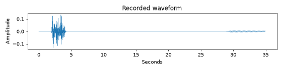

<!-- SPDX-License-Identifier: GPL-3.0-only -->

# Device stress harness report

Mode: **owner device run**

Commit: ab7ce364e704d2a189717699b903a54daae3d579 · Rate: 48000 Hz · Block: 64 frames
Platform: Linux · CPU: aarch64 · Device: ALSA|pulse

## Protocol and device metrics

| Metric | Value |
|---|---:|
| Acknowledged commands | 470 |
| Ack p50/p95/p99 (ms) | 0.177 / 0.467 / 3.484 |
| CPU max (%) | 3.2207999229431152 |
| Dropouts (latest counter) | 0 |
| Refused replies | 0 |
| Status/telemetry pushes | 350 / 1002 |

## Recorded signal

| RMS | Peak | DC | Clicks | Dropouts |
|---:|---:|---:|---:|---:|
| 0.010301116 | 0.170684814 | -4.4e-07 | 0 | 0 |

## Per-step audio metrics

| Time (s) | Action | RMS | Peak | DC | Clicks | Dropouts |
|---:|---|---:|---:|---:|---:|---:|
| 0.0 | load_patch | 0.00012 | 0.00497 | 0.00000 | 0 | 0 |
| 2.0001 | noteOn | 0.00811 | 0.01297 | -0.00491 | 0 | 0 |
| 2.0061 | noteOn | 0.02061 | 0.03098 | 0.00027 | 0 | 0 |
| 2.0121 | noteOn | 0.02617 | 0.04233 | 0.01070 | 0 | 0 |
| 2.0181 | noteOn | 0.03674 | 0.05005 | -0.00368 | 0 | 0 |
| 2.0241 | noteOn | 0.01066 | 0.02112 | -0.00575 | 0 | 0 |
| 2.0301 | noteOn | 0.01825 | 0.02957 | 0.00816 | 0 | 0 |
| 2.0361 | noteOn | 0.02952 | 0.04510 | -0.00175 | 0 | 0 |
| 2.0421 | noteOn | 0.03046 | 0.04266 | -0.00247 | 0 | 0 |
| 2.0481 | noteOn | 0.02053 | 0.03564 | -0.00471 | 0 | 0 |
| 2.0541 | noteOn | 0.00993 | 0.01831 | -0.00409 | 0 | 0 |
| 2.0601 | noteOn | 0.03060 | 0.05112 | 0.00442 | 0 | 0 |
| 2.0661 | noteOn | 0.05022 | 0.07971 | 0.00687 | 0 | 0 |
| 2.0721 | noteOn | 0.04610 | 0.07376 | -0.01291 | 0 | 0 |
| 2.0781 | noteOn | 0.01484 | 0.02908 | 0.00280 | 0 | 0 |
| 2.0841 | noteOn | 0.04149 | 0.07635 | 0.00856 | 0 | 0 |
| 2.0901 | noteOn | 0.05497 | 0.16422 | -0.00002 | 0 | 0 |
| 2.3501 | noteOff | 0.03478 | 0.06461 | -0.00685 | 0 | 0 |
| 2.3561 | noteOff | 0.02682 | 0.04355 | 0.00213 | 0 | 0 |
| 2.3621 | noteOff | 0.02894 | 0.04395 | 0.00195 | 0 | 0 |
| 2.3681 | noteOff | 0.01010 | 0.02325 | -0.00187 | 0 | 0 |
| 2.3741 | noteOff | 0.02283 | 0.04175 | 0.00227 | 0 | 0 |
| 2.3801 | noteOff | 0.03039 | 0.04602 | -0.00494 | 0 | 0 |
| 2.3861 | noteOff | 0.02760 | 0.04077 | -0.00117 | 0 | 0 |
| 2.3921 | noteOff | 0.04537 | 0.07614 | -0.00130 | 0 | 0 |
| 2.3981 | noteOff | 0.05876 | 0.08963 | 0.01181 | 0 | 0 |
| 2.4041 | noteOff | 0.05655 | 0.08725 | -0.00691 | 0 | 0 |
| 2.4101 | noteOff | 0.03394 | 0.06137 | -0.00203 | 0 | 0 |
| 2.4161 | noteOff | 0.03231 | 0.04993 | 0.00609 | 0 | 0 |
| 2.4221 | noteOff | 0.03150 | 0.05051 | -0.00700 | 0 | 0 |
| 2.4281 | noteOff | 0.01488 | 0.03271 | 0.00328 | 0 | 0 |
| 2.4341 | noteOff | 0.02068 | 0.04050 | -0.00446 | 0 | 0 |
| 2.4401 | noteOff | 0.02932 | 0.07211 | 0.00021 | 0 | 0 |
| 2.6501 | noteOn | 0.02604 | 0.03915 | -0.00148 | 0 | 0 |
| 2.6561 | noteOn | 0.04844 | 0.07999 | -0.00535 | 0 | 0 |
| 2.6621 | noteOn | 0.04151 | 0.06702 | -0.00191 | 0 | 0 |
| 2.6681 | noteOn | 0.04228 | 0.07333 | -0.00418 | 0 | 0 |
| 2.6741 | noteOn | 0.06183 | 0.08832 | 0.01527 | 0 | 0 |
| 2.6801 | noteOn | 0.04842 | 0.07318 | -0.01172 | 0 | 0 |
| 2.6861 | noteOn | 0.04871 | 0.08264 | 0.00947 | 0 | 0 |
| 2.6921 | noteOn | 0.02960 | 0.05777 | -0.00031 | 0 | 0 |
| 2.6981 | noteOn | 0.04962 | 0.06989 | 0.00023 | 0 | 0 |
| 2.7041 | noteOn | 0.05320 | 0.08704 | -0.00663 | 0 | 0 |
| 2.7101 | noteOn | 0.06288 | 0.09961 | -0.00183 | 0 | 0 |
| 2.7161 | noteOn | 0.03906 | 0.06644 | 0.00321 | 0 | 0 |
| 2.7221 | noteOn | 0.04960 | 0.07611 | -0.00215 | 0 | 0 |
| 2.7281 | noteOn | 0.06505 | 0.10330 | -0.00400 | 0 | 0 |
| 2.7341 | noteOn | 0.06631 | 0.10043 | 0.01256 | 0 | 0 |
| 2.7401 | noteOn | 0.05177 | 0.13461 | 0.00001 | 0 | 0 |
| 3.0001 | noteOff | 0.07455 | 0.10913 | -0.00761 | 0 | 0 |
| 3.0061 | noteOff | 0.05307 | 0.09903 | -0.00194 | 0 | 0 |
| 3.0121 | noteOff | 0.01997 | 0.03555 | 0.00116 | 0 | 0 |
| 3.0181 | noteOff | 0.01752 | 0.02881 | 0.00281 | 0 | 0 |
| 3.0241 | noteOff | 0.02220 | 0.04385 | -0.00401 | 0 | 0 |
| 3.0301 | noteOff | 0.03339 | 0.05078 | 0.00417 | 0 | 0 |
| 3.0361 | noteOff | 0.01945 | 0.03848 | -0.00401 | 0 | 0 |
| 3.0421 | noteOff | 0.05454 | 0.09320 | 0.00562 | 0 | 0 |
| 3.0481 | noteOff | 0.06051 | 0.09470 | 0.00199 | 0 | 0 |
| 3.0541 | noteOff | 0.03581 | 0.06595 | -0.00341 | 0 | 0 |
| 3.0601 | noteOff | 0.02938 | 0.04196 | -0.00314 | 0 | 0 |
| 3.0661 | noteOff | 0.01825 | 0.03403 | 0.00330 | 0 | 0 |
| 3.0721 | noteOff | 0.02922 | 0.04965 | -0.00338 | 0 | 0 |
| 3.0781 | noteOff | 0.02826 | 0.04880 | 0.00239 | 0 | 0 |
| 3.0841 | noteOff | 0.03059 | 0.06293 | -0.00273 | 0 | 0 |
| 3.0901 | noteOff | 0.02974 | 0.08209 | 0.00014 | 0 | 0 |
| 3.3001 | noteOn | 0.03602 | 0.06909 | -0.00581 | 0 | 0 |
| 3.3061 | noteOn | 0.03452 | 0.05768 | 0.00712 | 0 | 0 |
| 3.3121 | noteOn | 0.05363 | 0.09848 | -0.00266 | 0 | 0 |
| 3.3181 | noteOn | 0.06400 | 0.09839 | 0.00361 | 0 | 0 |
| 3.3241 | noteOn | 0.03146 | 0.05884 | -0.00285 | 0 | 0 |
| 3.3301 | noteOn | 0.01383 | 0.02969 | -0.00151 | 0 | 0 |
| 3.3361 | noteOn | 0.04333 | 0.09097 | -0.00300 | 0 | 0 |
| 3.3421 | noteOn | 0.05504 | 0.08932 | 0.00148 | 0 | 0 |
| 3.3481 | noteOn | 0.03236 | 0.06326 | 0.00714 | 0 | 0 |
| 3.3541 | noteOn | 0.05177 | 0.07632 | -0.00685 | 0 | 0 |
| 3.3601 | noteOn | 0.02665 | 0.06458 | 0.00150 | 0 | 0 |
| 3.3661 | noteOn | 0.03212 | 0.05157 | 0.00186 | 0 | 0 |
| 3.3721 | noteOn | 0.04932 | 0.08813 | 0.00377 | 0 | 0 |
| 3.3781 | noteOn | 0.08176 | 0.13589 | 0.00248 | 0 | 0 |
| 3.3841 | noteOn | 0.05247 | 0.12375 | -0.00771 | 0 | 0 |
| 3.3901 | noteOn | 0.05133 | 0.17068 | -0.00001 | 0 | 0 |
| 3.6501 | noteOff | 0.02226 | 0.03278 | -0.00031 | 0 | 0 |
| 3.6561 | noteOff | 0.04414 | 0.08536 | -0.00077 | 0 | 0 |
| 3.6621 | noteOff | 0.05338 | 0.08875 | 0.00099 | 0 | 0 |
| 3.6681 | noteOff | 0.02624 | 0.06268 | 0.00462 | 0 | 0 |
| 3.6741 | noteOff | 0.05101 | 0.07895 | -0.00035 | 0 | 0 |
| 3.6801 | noteOff | 0.02194 | 0.05151 | -0.00311 | 0 | 0 |
| 3.6861 | noteOff | 0.01416 | 0.03409 | 0.00161 | 0 | 0 |
| 3.6921 | noteOff | 0.05163 | 0.08594 | 0.00068 | 0 | 0 |
| 3.6981 | noteOff | 0.04092 | 0.08374 | -0.00175 | 0 | 0 |
| 3.7041 | noteOff | 0.03764 | 0.07596 | 0.00074 | 0 | 0 |
| 3.7101 | noteOff | 0.04393 | 0.07614 | -0.00037 | 0 | 0 |
| 3.7161 | noteOff | 0.00964 | 0.02698 | -0.00074 | 0 | 0 |
| 3.7221 | noteOff | 0.02738 | 0.06223 | 0.00339 | 0 | 0 |
| 3.7281 | noteOff | 0.05479 | 0.08347 | 0.00014 | 0 | 0 |
| 3.7341 | noteOff | 0.02502 | 0.06128 | -0.00488 | 0 | 0 |
| 3.7401 | noteOff | 0.02145 | 0.07523 | 0.00002 | 0 | 0 |
| 4.2001 | unheld-note-off | 0.00013 | 0.00235 | -0.00000 | 0 | 0 |
| 6.0001 | setParam | 0.00000 | 0.00000 | 0.00000 | 0 | 0 |
| 6.0501 | setParam | 0.00000 | 0.00000 | 0.00000 | 0 | 0 |
| 8.0001 | setParam | 0.00000 | 0.00000 | 0.00000 | 0 | 0 |
| 8.0051 | setParam | 0.00000 | 0.00000 | 0.00000 | 0 | 0 |
| 8.0101 | setParam | 0.00000 | 0.00000 | 0.00000 | 0 | 0 |
| 8.0151 | setParam | 0.00000 | 0.00000 | 0.00000 | 0 | 0 |
| 8.0201 | setParam | 0.00000 | 0.00000 | 0.00000 | 0 | 0 |
| 8.0251 | setParam | 0.00000 | 0.00000 | 0.00000 | 0 | 0 |
| 8.0301 | setParam | 0.00000 | 0.00000 | 0.00000 | 0 | 0 |
| 8.0351 | setParam | 0.00000 | 0.00000 | 0.00000 | 0 | 0 |
| 8.0401 | setParam | 0.00000 | 0.00000 | 0.00000 | 0 | 0 |
| 8.0451 | setParam | 0.00000 | 0.00000 | 0.00000 | 0 | 0 |
| 8.0501 | setParam | 0.00000 | 0.00000 | 0.00000 | 0 | 0 |
| 12.0001 | setParam | 0.00000 | 0.00000 | 0.00000 | 0 | 0 |
| 12.0005 | setParam | 0.00000 | 0.00000 | 0.00000 | 0 | 0 |
| 12.0008 | setParam | 0.00000 | 0.00000 | 0.00000 | 0 | 0 |
| 12.0011 | setParam | 0.00000 | 0.00000 | 0.00000 | 0 | 0 |
| 12.0251 | setParam | 0.00000 | 0.00000 | 0.00000 | 0 | 0 |
| 12.0254 | setParam | 0.00000 | 0.00000 | 0.00000 | 0 | 0 |
| 12.0257 | setParam | 0.00000 | 0.00000 | 0.00000 | 0 | 0 |
| 12.0259 | setParam | 0.00000 | 0.00000 | 0.00000 | 0 | 0 |
| 12.0501 | setParam | 0.00000 | 0.00000 | 0.00000 | 0 | 0 |
| 12.0504 | setParam | 0.00000 | 0.00000 | 0.00000 | 0 | 0 |
| 12.0507 | setParam | 0.00000 | 0.00000 | 0.00000 | 0 | 0 |
| 12.0512 | setParam | 0.00000 | 0.00000 | 0.00000 | 0 | 0 |
| 12.0751 | setParam | 0.00000 | 0.00000 | 0.00000 | 0 | 0 |
| 12.0754 | setParam | 0.00000 | 0.00000 | 0.00000 | 0 | 0 |
| 12.0756 | setParam | 0.00000 | 0.00000 | 0.00000 | 0 | 0 |
| 12.0759 | setParam | 0.00000 | 0.00000 | 0.00000 | 0 | 0 |
| 12.1001 | setParam | 0.00000 | 0.00000 | 0.00000 | 0 | 0 |
| 12.1004 | setParam | 0.00000 | 0.00000 | 0.00000 | 0 | 0 |
| 12.1007 | setParam | 0.00000 | 0.00000 | 0.00000 | 0 | 0 |
| 12.1009 | setParam | 0.00000 | 0.00000 | 0.00000 | 0 | 0 |
| 12.1251 | setParam | 0.00000 | 0.00000 | 0.00000 | 0 | 0 |
| 12.1254 | setParam | 0.00000 | 0.00000 | 0.00000 | 0 | 0 |
| 12.1264 | setParam | 0.00000 | 0.00000 | 0.00000 | 0 | 0 |
| 12.1267 | setParam | 0.00000 | 0.00000 | 0.00000 | 0 | 0 |
| 12.1501 | setParam | 0.00000 | 0.00000 | 0.00000 | 0 | 0 |
| 12.1504 | setParam | 0.00000 | 0.00000 | 0.00000 | 0 | 0 |
| 12.1507 | setParam | 0.00000 | 0.00000 | 0.00000 | 0 | 0 |
| 12.1509 | setParam | 0.00000 | 0.00000 | 0.00000 | 0 | 0 |
| 12.1751 | setParam | 0.00000 | 0.00000 | 0.00000 | 0 | 0 |
| 12.1754 | setParam | 0.00000 | 0.00000 | 0.00000 | 0 | 0 |
| 12.1757 | setParam | 0.00000 | 0.00000 | 0.00000 | 0 | 0 |
| 12.176 | setParam | 0.00000 | 0.00000 | 0.00000 | 0 | 0 |
| 12.2001 | setParam | 0.00000 | 0.00000 | 0.00000 | 0 | 0 |
| 12.2004 | setParam | 0.00000 | 0.00000 | 0.00000 | 0 | 0 |
| 12.2007 | setParam | 0.00000 | 0.00000 | 0.00000 | 0 | 0 |
| 12.201 | setParam | 0.00000 | 0.00000 | 0.00000 | 0 | 0 |
| 12.2251 | setParam | 0.00000 | 0.00000 | 0.00000 | 0 | 0 |
| 12.2254 | setParam | 0.00000 | 0.00000 | 0.00000 | 0 | 0 |
| 12.2264 | setParam | 0.00000 | 0.00000 | 0.00000 | 0 | 0 |
| 12.227 | setParam | 0.00000 | 0.00000 | 0.00000 | 0 | 0 |
| 12.2501 | setParam | 0.00000 | 0.00000 | 0.00000 | 0 | 0 |
| 12.2504 | setParam | 0.00000 | 0.00000 | 0.00000 | 0 | 0 |
| 12.2507 | setParam | 0.00000 | 0.00000 | 0.00000 | 0 | 0 |
| 12.251 | setParam | 0.00000 | 0.00000 | 0.00000 | 0 | 0 |
| 12.2751 | setParam | 0.00000 | 0.00000 | 0.00000 | 0 | 0 |
| 12.2755 | setParam | 0.00000 | 0.00000 | 0.00000 | 0 | 0 |
| 12.2757 | setParam | 0.00000 | 0.00000 | 0.00000 | 0 | 0 |
| 12.276 | setParam | 0.00000 | 0.00000 | 0.00000 | 0 | 0 |
| 12.3001 | setParam | 0.00000 | 0.00000 | 0.00000 | 0 | 0 |
| 12.3004 | setParam | 0.00000 | 0.00000 | 0.00000 | 0 | 0 |
| 12.3006 | setParam | 0.00000 | 0.00000 | 0.00000 | 0 | 0 |
| 12.3009 | setParam | 0.00000 | 0.00000 | 0.00000 | 0 | 0 |
| 12.3251 | setParam | 0.00000 | 0.00000 | 0.00000 | 0 | 0 |
| 12.3254 | setParam | 0.00000 | 0.00000 | 0.00000 | 0 | 0 |
| 12.3257 | setParam | 0.00000 | 0.00000 | 0.00000 | 0 | 0 |
| 12.3266 | setParam | 0.00000 | 0.00000 | 0.00000 | 0 | 0 |
| 12.3501 | setParam | 0.00000 | 0.00000 | 0.00000 | 0 | 0 |
| 12.3504 | setParam | 0.00000 | 0.00000 | 0.00000 | 0 | 0 |
| 12.3507 | setParam | 0.00000 | 0.00000 | 0.00000 | 0 | 0 |
| 12.3509 | setParam | 0.00000 | 0.00000 | 0.00000 | 0 | 0 |
| 12.3751 | setParam | 0.00000 | 0.00000 | 0.00000 | 0 | 0 |
| 12.3754 | setParam | 0.00000 | 0.00000 | 0.00000 | 0 | 0 |
| 12.3757 | setParam | 0.00000 | 0.00000 | 0.00000 | 0 | 0 |
| 12.3759 | setParam | 0.00000 | 0.00000 | 0.00000 | 0 | 0 |
| 12.4001 | setParam | 0.00000 | 0.00000 | 0.00000 | 0 | 0 |
| 12.4004 | setParam | 0.00000 | 0.00000 | 0.00000 | 0 | 0 |
| 12.401 | setParam | 0.00000 | 0.00000 | 0.00000 | 0 | 0 |
| 12.4012 | setParam | 0.00000 | 0.00000 | 0.00000 | 0 | 0 |
| 12.4251 | setParam | 0.00000 | 0.00000 | 0.00000 | 0 | 0 |
| 12.4254 | setParam | 0.00000 | 0.00000 | 0.00000 | 0 | 0 |
| 12.4257 | setParam | 0.00000 | 0.00000 | 0.00000 | 0 | 0 |
| 12.4259 | setParam | 0.00000 | 0.00000 | 0.00000 | 0 | 0 |
| 12.4501 | setParam | 0.00000 | 0.00000 | 0.00000 | 0 | 0 |
| 12.4504 | setParam | 0.00000 | 0.00000 | 0.00000 | 0 | 0 |
| 12.4507 | setParam | 0.00000 | 0.00000 | 0.00000 | 0 | 0 |
| 12.4509 | setParam | 0.00000 | 0.00000 | 0.00000 | 0 | 0 |
| 12.4751 | setParam | 0.00000 | 0.00000 | 0.00000 | 0 | 0 |
| 12.4754 | setParam | 0.00000 | 0.00000 | 0.00000 | 0 | 0 |
| 12.4757 | setParam | 0.00000 | 0.00000 | 0.00000 | 0 | 0 |
| 12.476 | setParam | 0.00000 | 0.00000 | 0.00000 | 0 | 0 |
| 12.5001 | setParam | 0.00000 | 0.00000 | 0.00000 | 0 | 0 |
| 12.5005 | setParam | 0.00000 | 0.00000 | 0.00000 | 0 | 0 |
| 12.5008 | setParam | 0.00000 | 0.00000 | 0.00000 | 0 | 0 |
| 12.501 | setParam | 0.00000 | 0.00000 | 0.00000 | 0 | 0 |
| 12.5251 | setParam | 0.00000 | 0.00000 | 0.00000 | 0 | 0 |
| 12.5255 | setParam | 0.00000 | 0.00000 | 0.00000 | 0 | 0 |
| 12.5258 | setParam | 0.00000 | 0.00000 | 0.00000 | 0 | 0 |
| 12.5261 | setParam | 0.00000 | 0.00000 | 0.00000 | 0 | 0 |
| 12.5501 | setParam | 0.00000 | 0.00000 | 0.00000 | 0 | 0 |
| 12.5505 | setParam | 0.00000 | 0.00000 | 0.00000 | 0 | 0 |
| 12.5508 | setParam | 0.00000 | 0.00000 | 0.00000 | 0 | 0 |
| 12.551 | setParam | 0.00000 | 0.00000 | 0.00000 | 0 | 0 |
| 12.5751 | setParam | 0.00000 | 0.00000 | 0.00000 | 0 | 0 |
| 12.5755 | setParam | 0.00000 | 0.00000 | 0.00000 | 0 | 0 |
| 12.5758 | setParam | 0.00000 | 0.00000 | 0.00000 | 0 | 0 |
| 12.5764 | setParam | 0.00000 | 0.00000 | 0.00000 | 0 | 0 |
| 12.6001 | setParam | 0.00000 | 0.00000 | 0.00000 | 0 | 0 |
| 12.6004 | setParam | 0.00000 | 0.00000 | 0.00000 | 0 | 0 |
| 12.6007 | setParam | 0.00000 | 0.00000 | 0.00000 | 0 | 0 |
| 12.601 | setParam | 0.00000 | 0.00000 | 0.00000 | 0 | 0 |
| 12.6251 | setParam | 0.00000 | 0.00000 | 0.00000 | 0 | 0 |
| 12.6254 | setParam | 0.00000 | 0.00000 | 0.00000 | 0 | 0 |
| 12.6257 | setParam | 0.00000 | 0.00000 | 0.00000 | 0 | 0 |
| 12.626 | setParam | 0.00000 | 0.00000 | 0.00000 | 0 | 0 |
| 12.6501 | setParam | 0.00000 | 0.00000 | 0.00000 | 0 | 0 |
| 12.6504 | setParam | 0.00000 | 0.00000 | 0.00000 | 0 | 0 |
| 12.6507 | setParam | 0.00000 | 0.00000 | 0.00000 | 0 | 0 |
| 12.651 | setParam | 0.00000 | 0.00000 | 0.00000 | 0 | 0 |
| 12.6751 | setParam | 0.00000 | 0.00000 | 0.00000 | 0 | 0 |
| 12.6754 | setParam | 0.00000 | 0.00000 | 0.00000 | 0 | 0 |
| 12.6757 | setParam | 0.00000 | 0.00000 | 0.00000 | 0 | 0 |
| 12.6759 | setParam | 0.00000 | 0.00000 | 0.00000 | 0 | 0 |
| 12.7001 | setParam | 0.00000 | 0.00000 | 0.00000 | 0 | 0 |
| 12.7005 | setParam | 0.00000 | 0.00000 | 0.00000 | 0 | 0 |
| 12.7007 | setParam | 0.00000 | 0.00000 | 0.00000 | 0 | 0 |
| 12.701 | setParam | 0.00000 | 0.00000 | 0.00000 | 0 | 0 |
| 12.7251 | setParam | 0.00000 | 0.00000 | 0.00000 | 0 | 0 |
| 12.7255 | setParam | 0.00000 | 0.00000 | 0.00000 | 0 | 0 |
| 12.7258 | setParam | 0.00000 | 0.00000 | 0.00000 | 0 | 0 |
| 12.7261 | setParam | 0.00000 | 0.00000 | 0.00000 | 0 | 0 |
| 12.7501 | setParam | 0.00000 | 0.00000 | 0.00000 | 0 | 0 |
| 12.7504 | setParam | 0.00000 | 0.00000 | 0.00000 | 0 | 0 |
| 12.7507 | setParam | 0.00000 | 0.00000 | 0.00000 | 0 | 0 |
| 12.7513 | setParam | 0.00000 | 0.00000 | 0.00000 | 0 | 0 |
| 12.7751 | setParam | 0.00000 | 0.00000 | 0.00000 | 0 | 0 |
| 12.7754 | setParam | 0.00000 | 0.00000 | 0.00000 | 0 | 0 |
| 12.7758 | setParam | 0.00000 | 0.00000 | 0.00000 | 0 | 0 |
| 12.776 | setParam | 0.00000 | 0.00000 | 0.00000 | 0 | 0 |
| 12.8001 | setParam | 0.00000 | 0.00000 | 0.00000 | 0 | 0 |
| 12.8004 | setParam | 0.00000 | 0.00000 | 0.00000 | 0 | 0 |
| 12.8007 | setParam | 0.00000 | 0.00000 | 0.00000 | 0 | 0 |
| 12.8009 | setParam | 0.00000 | 0.00000 | 0.00000 | 0 | 0 |
| 12.8251 | setParam | 0.00000 | 0.00000 | 0.00000 | 0 | 0 |
| 12.8254 | setParam | 0.00000 | 0.00000 | 0.00000 | 0 | 0 |
| 12.8256 | setParam | 0.00000 | 0.00000 | 0.00000 | 0 | 0 |
| 12.8259 | setParam | 0.00000 | 0.00000 | 0.00000 | 0 | 0 |
| 12.8501 | setParam | 0.00000 | 0.00000 | 0.00000 | 0 | 0 |
| 12.8504 | setParam | 0.00000 | 0.00000 | 0.00000 | 0 | 0 |
| 12.8506 | setParam | 0.00000 | 0.00000 | 0.00000 | 0 | 0 |
| 12.8509 | setParam | 0.00000 | 0.00000 | 0.00000 | 0 | 0 |
| 12.8751 | setParam | 0.00000 | 0.00000 | 0.00000 | 0 | 0 |
| 12.8754 | setParam | 0.00000 | 0.00000 | 0.00000 | 0 | 0 |
| 12.8756 | setParam | 0.00000 | 0.00000 | 0.00000 | 0 | 0 |
| 12.8759 | setParam | 0.00000 | 0.00000 | 0.00000 | 0 | 0 |
| 12.9001 | setParam | 0.00000 | 0.00000 | 0.00000 | 0 | 0 |
| 12.9004 | setParam | 0.00000 | 0.00000 | 0.00000 | 0 | 0 |
| 12.9006 | setParam | 0.00000 | 0.00000 | 0.00000 | 0 | 0 |
| 12.9009 | setParam | 0.00000 | 0.00000 | 0.00000 | 0 | 0 |
| 12.9251 | setParam | 0.00000 | 0.00000 | 0.00000 | 0 | 0 |
| 12.9254 | setParam | 0.00000 | 0.00000 | 0.00000 | 0 | 0 |
| 12.926 | setParam | 0.00000 | 0.00000 | 0.00000 | 0 | 0 |
| 12.9262 | setParam | 0.00000 | 0.00000 | 0.00000 | 0 | 0 |
| 12.9501 | setParam | 0.00000 | 0.00000 | 0.00000 | 0 | 0 |
| 12.9504 | setParam | 0.00000 | 0.00000 | 0.00000 | 0 | 0 |
| 12.9506 | setParam | 0.00000 | 0.00000 | 0.00000 | 0 | 0 |
| 12.9509 | setParam | 0.00000 | 0.00000 | 0.00000 | 0 | 0 |
| 12.9751 | setParam | 0.00000 | 0.00000 | 0.00000 | 0 | 0 |
| 12.9754 | setParam | 0.00000 | 0.00000 | 0.00000 | 0 | 0 |
| 12.9756 | setParam | 0.00000 | 0.00000 | 0.00000 | 0 | 0 |
| 12.9759 | setParam | 0.00000 | 0.00000 | 0.00000 | 0 | 0 |
| 13.0001 | setParam | 0.00000 | 0.00000 | 0.00000 | 0 | 0 |
| 13.0004 | setParam | 0.00000 | 0.00000 | 0.00000 | 0 | 0 |
| 13.0007 | setParam | 0.00000 | 0.00000 | 0.00000 | 0 | 0 |
| 13.0009 | setParam | 0.00000 | 0.00000 | 0.00000 | 0 | 0 |
| 13.0251 | setParam | 0.00000 | 0.00000 | 0.00000 | 0 | 0 |
| 13.0254 | setParam | 0.00000 | 0.00000 | 0.00000 | 0 | 0 |
| 13.0257 | setParam | 0.00000 | 0.00000 | 0.00000 | 0 | 0 |
| 13.0259 | setParam | 0.00000 | 0.00000 | 0.00000 | 0 | 0 |
| 13.0501 | setParam | 0.00000 | 0.00000 | 0.00000 | 0 | 0 |
| 13.0504 | setParam | 0.00000 | 0.00000 | 0.00000 | 0 | 0 |
| 13.0507 | setParam | 0.00000 | 0.00000 | 0.00000 | 0 | 0 |
| 13.051 | setParam | 0.00000 | 0.00000 | 0.00000 | 0 | 0 |
| 13.0751 | setParam | 0.00000 | 0.00000 | 0.00000 | 0 | 0 |
| 13.0754 | setParam | 0.00000 | 0.00000 | 0.00000 | 0 | 0 |
| 13.0757 | setParam | 0.00000 | 0.00000 | 0.00000 | 0 | 0 |
| 13.076 | setParam | 0.00000 | 0.00000 | 0.00000 | 0 | 0 |
| 13.1001 | setParam | 0.00000 | 0.00000 | 0.00000 | 0 | 0 |
| 13.1004 | setParam | 0.00000 | 0.00000 | 0.00000 | 0 | 0 |
| 13.1006 | setParam | 0.00000 | 0.00000 | 0.00000 | 0 | 0 |
| 13.1012 | setParam | 0.00000 | 0.00000 | 0.00000 | 0 | 0 |
| 13.1251 | setParam | 0.00000 | 0.00000 | 0.00000 | 0 | 0 |
| 13.1254 | setParam | 0.00000 | 0.00000 | 0.00000 | 0 | 0 |
| 13.1257 | setParam | 0.00000 | 0.00000 | 0.00000 | 0 | 0 |
| 13.126 | setParam | 0.00000 | 0.00000 | 0.00000 | 0 | 0 |
| 13.1501 | setParam | 0.00000 | 0.00000 | 0.00000 | 0 | 0 |
| 13.1504 | setParam | 0.00000 | 0.00000 | 0.00000 | 0 | 0 |
| 13.1507 | setParam | 0.00000 | 0.00000 | 0.00000 | 0 | 0 |
| 13.1509 | setParam | 0.00000 | 0.00000 | 0.00000 | 0 | 0 |
| 13.1751 | setParam | 0.00000 | 0.00000 | 0.00000 | 0 | 0 |
| 13.1754 | setParam | 0.00000 | 0.00000 | 0.00000 | 0 | 0 |
| 13.1757 | setParam | 0.00000 | 0.00000 | 0.00000 | 0 | 0 |
| 13.1759 | setParam | 0.00000 | 0.00000 | 0.00000 | 0 | 0 |
| 13.2001 | setParam | 0.00000 | 0.00000 | 0.00000 | 0 | 0 |
| 13.2004 | setParam | 0.00000 | 0.00000 | 0.00000 | 0 | 0 |
| 13.2007 | setParam | 0.00000 | 0.00000 | 0.00000 | 0 | 0 |
| 13.201 | setParam | 0.00000 | 0.00000 | 0.00000 | 0 | 0 |
| 13.2251 | setParam | 0.00000 | 0.00000 | 0.00000 | 0 | 0 |
| 13.2254 | setParam | 0.00000 | 0.00000 | 0.00000 | 0 | 0 |
| 13.2256 | setParam | 0.00000 | 0.00000 | 0.00000 | 0 | 0 |
| 13.2259 | setParam | 0.00000 | 0.00000 | 0.00000 | 0 | 0 |
| 13.2501 | setParam | 0.00000 | 0.00000 | 0.00000 | 0 | 0 |
| 13.2504 | setParam | 0.00000 | 0.00000 | 0.00000 | 0 | 0 |
| 13.2507 | setParam | 0.00000 | 0.00000 | 0.00000 | 0 | 0 |
| 13.2509 | setParam | 0.00000 | 0.00000 | 0.00000 | 0 | 0 |
| 13.2751 | setParam | 0.00000 | 0.00000 | 0.00000 | 0 | 0 |
| 13.2754 | setParam | 0.00000 | 0.00000 | 0.00000 | 0 | 0 |
| 13.276 | setParam | 0.00000 | 0.00000 | 0.00000 | 0 | 0 |
| 13.2762 | setParam | 0.00000 | 0.00000 | 0.00000 | 0 | 0 |
| 13.3001 | setParam | 0.00000 | 0.00000 | 0.00000 | 0 | 0 |
| 13.3004 | setParam | 0.00000 | 0.00000 | 0.00000 | 0 | 0 |
| 13.3006 | setParam | 0.00000 | 0.00000 | 0.00000 | 0 | 0 |
| 13.3009 | setParam | 0.00000 | 0.00000 | 0.00000 | 0 | 0 |
| 13.3251 | setParam | 0.00000 | 0.00000 | 0.00000 | 0 | 0 |
| 13.3254 | setParam | 0.00000 | 0.00000 | 0.00000 | 0 | 0 |
| 13.3257 | setParam | 0.00000 | 0.00000 | 0.00000 | 0 | 0 |
| 13.326 | setParam | 0.00000 | 0.00000 | 0.00000 | 0 | 0 |
| 13.3501 | setParam | 0.00000 | 0.00000 | 0.00000 | 0 | 0 |
| 13.3504 | setParam | 0.00000 | 0.00000 | 0.00000 | 0 | 0 |
| 13.3507 | setParam | 0.00000 | 0.00000 | 0.00000 | 0 | 0 |
| 13.3509 | setParam | 0.00000 | 0.00000 | 0.00000 | 0 | 0 |
| 13.3751 | setParam | 0.00000 | 0.00000 | 0.00000 | 0 | 0 |
| 13.3754 | setParam | 0.00000 | 0.00000 | 0.00000 | 0 | 0 |
| 13.3757 | setParam | 0.00000 | 0.00000 | 0.00000 | 0 | 0 |
| 13.376 | setParam | 0.00000 | 0.00000 | 0.00000 | 0 | 0 |
| 13.4001 | setParam | 0.00000 | 0.00000 | 0.00000 | 0 | 0 |
| 13.4004 | setParam | 0.00000 | 0.00000 | 0.00000 | 0 | 0 |
| 13.4007 | setParam | 0.00000 | 0.00000 | 0.00000 | 0 | 0 |
| 13.401 | setParam | 0.00000 | 0.00000 | 0.00000 | 0 | 0 |
| 13.4251 | setParam | 0.00000 | 0.00000 | 0.00000 | 0 | 0 |
| 13.4254 | setParam | 0.00000 | 0.00000 | 0.00000 | 0 | 0 |
| 13.4256 | setParam | 0.00000 | 0.00000 | 0.00000 | 0 | 0 |
| 13.4259 | setParam | 0.00000 | 0.00000 | 0.00000 | 0 | 0 |
| 13.4501 | setParam | 0.00000 | 0.00000 | 0.00000 | 0 | 0 |
| 13.4504 | setParam | 0.00000 | 0.00000 | 0.00000 | 0 | 0 |
| 13.451 | setParam | 0.00000 | 0.00000 | 0.00000 | 0 | 0 |
| 13.4513 | setParam | 0.00000 | 0.00000 | 0.00000 | 0 | 0 |
| 13.4751 | setParam | 0.00000 | 0.00000 | 0.00000 | 0 | 0 |
| 13.4755 | setParam | 0.00000 | 0.00000 | 0.00000 | 0 | 0 |
| 13.4757 | setParam | 0.00000 | 0.00000 | 0.00000 | 0 | 0 |
| 13.476 | setParam | 0.00000 | 0.00000 | 0.00000 | 0 | 0 |
| 13.5001 | setParam | 0.00000 | 0.00000 | 0.00000 | 0 | 0 |
| 13.5005 | setParam | 0.00000 | 0.00000 | 0.00000 | 0 | 0 |
| 13.5008 | setParam | 0.00000 | 0.00000 | 0.00000 | 0 | 0 |
| 13.5011 | setParam | 0.00000 | 0.00000 | 0.00000 | 0 | 0 |
| 13.5251 | setParam | 0.00000 | 0.00000 | 0.00000 | 0 | 0 |
| 13.5254 | setParam | 0.00000 | 0.00000 | 0.00000 | 0 | 0 |
| 13.5258 | setParam | 0.00000 | 0.00000 | 0.00000 | 0 | 0 |
| 13.526 | setParam | 0.00000 | 0.00000 | 0.00000 | 0 | 0 |
| 13.5501 | setParam | 0.00000 | 0.00000 | 0.00000 | 0 | 0 |
| 13.5504 | setParam | 0.00000 | 0.00000 | 0.00000 | 0 | 0 |
| 13.5507 | setParam | 0.00000 | 0.00000 | 0.00000 | 0 | 0 |
| 13.5509 | setParam | 0.00000 | 0.00000 | 0.00000 | 0 | 0 |
| 13.5751 | setParam | 0.00000 | 0.00000 | 0.00000 | 0 | 0 |
| 13.5755 | setParam | 0.00000 | 0.00000 | 0.00000 | 0 | 0 |
| 13.5757 | setParam | 0.00000 | 0.00000 | 0.00000 | 0 | 0 |
| 13.576 | setParam | 0.00000 | 0.00000 | 0.00000 | 0 | 0 |
| 13.6001 | setParam | 0.00000 | 0.00000 | 0.00000 | 0 | 0 |
| 13.6004 | setParam | 0.00000 | 0.00000 | 0.00000 | 0 | 0 |
| 13.6007 | setParam | 0.00000 | 0.00000 | 0.00000 | 0 | 0 |
| 13.601 | setParam | 0.00000 | 0.00000 | 0.00000 | 0 | 0 |
| 13.6251 | setParam | 0.00000 | 0.00000 | 0.00000 | 0 | 0 |
| 13.6254 | setParam | 0.00000 | 0.00000 | 0.00000 | 0 | 0 |
| 13.6257 | setParam | 0.00000 | 0.00000 | 0.00000 | 0 | 0 |
| 13.6263 | setParam | 0.00000 | 0.00000 | 0.00000 | 0 | 0 |
| 13.6501 | setParam | 0.00000 | 0.00000 | 0.00000 | 0 | 0 |
| 13.6504 | setParam | 0.00000 | 0.00000 | 0.00000 | 0 | 0 |
| 13.6507 | setParam | 0.00000 | 0.00000 | 0.00000 | 0 | 0 |
| 13.651 | setParam | 0.00000 | 0.00000 | 0.00000 | 0 | 0 |
| 13.6751 | setParam | 0.00000 | 0.00000 | 0.00000 | 0 | 0 |
| 13.6754 | setParam | 0.00000 | 0.00000 | 0.00000 | 0 | 0 |
| 13.6757 | setParam | 0.00000 | 0.00000 | 0.00000 | 0 | 0 |
| 13.676 | setParam | 0.00000 | 0.00000 | 0.00000 | 0 | 0 |
| 13.7001 | setParam | 0.00000 | 0.00000 | 0.00000 | 0 | 0 |
| 13.7004 | setParam | 0.00000 | 0.00000 | 0.00000 | 0 | 0 |
| 13.7007 | setParam | 0.00000 | 0.00000 | 0.00000 | 0 | 0 |
| 13.701 | setParam | 0.00000 | 0.00000 | 0.00000 | 0 | 0 |
| 13.7251 | setParam | 0.00000 | 0.00000 | 0.00000 | 0 | 0 |
| 13.7254 | setParam | 0.00000 | 0.00000 | 0.00000 | 0 | 0 |
| 13.7258 | setParam | 0.00000 | 0.00000 | 0.00000 | 0 | 0 |
| 13.7261 | setParam | 0.00000 | 0.00000 | 0.00000 | 0 | 0 |
| 13.7501 | setParam | 0.00000 | 0.00000 | 0.00000 | 0 | 0 |
| 13.7504 | setParam | 0.00000 | 0.00000 | 0.00000 | 0 | 0 |
| 13.7514 | setParam | 0.00000 | 0.00000 | 0.00000 | 0 | 0 |
| 13.7517 | setParam | 0.00000 | 0.00000 | 0.00000 | 0 | 0 |
| 13.7751 | setParam | 0.00000 | 0.00000 | 0.00000 | 0 | 0 |
| 13.7754 | setParam | 0.00000 | 0.00000 | 0.00000 | 0 | 0 |
| 13.7757 | setParam | 0.00000 | 0.00000 | 0.00000 | 0 | 0 |
| 13.776 | setParam | 0.00000 | 0.00000 | 0.00000 | 0 | 0 |
| 13.8001 | setParam | 0.00000 | 0.00000 | 0.00000 | 0 | 0 |
| 13.8004 | setParam | 0.00000 | 0.00000 | 0.00000 | 0 | 0 |
| 13.8007 | setParam | 0.00000 | 0.00000 | 0.00000 | 0 | 0 |
| 13.801 | setParam | 0.00000 | 0.00000 | 0.00000 | 0 | 0 |
| 13.8251 | setParam | 0.00000 | 0.00000 | 0.00000 | 0 | 0 |
| 13.8254 | setParam | 0.00000 | 0.00000 | 0.00000 | 0 | 0 |
| 13.8256 | setParam | 0.00000 | 0.00000 | 0.00000 | 0 | 0 |
| 13.8258 | setParam | 0.00000 | 0.00000 | 0.00000 | 0 | 0 |
| 13.8501 | setParam | 0.00000 | 0.00000 | 0.00000 | 0 | 0 |
| 13.8504 | setParam | 0.00000 | 0.00000 | 0.00000 | 0 | 0 |
| 13.8506 | setParam | 0.00000 | 0.00000 | 0.00000 | 0 | 0 |
| 13.8516 | setParam | 0.00000 | 0.00000 | 0.00000 | 0 | 0 |
| 13.8751 | setParam | 0.00000 | 0.00000 | 0.00000 | 0 | 0 |
| 13.8754 | setParam | 0.00000 | 0.00000 | 0.00000 | 0 | 0 |
| 13.8756 | setParam | 0.00000 | 0.00000 | 0.00000 | 0 | 0 |
| 13.8758 | setParam | 0.00000 | 0.00000 | 0.00000 | 0 | 0 |
| 13.9001 | setParam | 0.00000 | 0.00000 | 0.00000 | 0 | 0 |
| 13.9004 | setParam | 0.00000 | 0.00000 | 0.00000 | 0 | 0 |
| 13.9007 | setParam | 0.00000 | 0.00000 | 0.00000 | 0 | 0 |
| 13.9009 | setParam | 0.00000 | 0.00000 | 0.00000 | 0 | 0 |
| 13.9251 | setParam | 0.00000 | 0.00000 | 0.00000 | 0 | 0 |
| 13.9254 | setParam | 0.00000 | 0.00000 | 0.00000 | 0 | 0 |
| 13.9258 | setParam | 0.00000 | 0.00000 | 0.00000 | 0 | 0 |
| 13.9261 | setParam | 0.00000 | 0.00000 | 0.00000 | 0 | 0 |
| 13.9501 | setParam | 0.00000 | 0.00000 | 0.00000 | 0 | 0 |
| 13.9504 | setParam | 0.00000 | 0.00000 | 0.00000 | 0 | 0 |
| 13.9507 | setParam | 0.00000 | 0.00000 | 0.00000 | 0 | 0 |
| 13.9517 | setParam | 0.00000 | 0.00000 | 0.00000 | 0 | 0 |
| 13.9751 | setParam | 0.00000 | 0.00000 | 0.00000 | 0 | 0 |
| 13.9754 | setParam | 0.00000 | 0.00000 | 0.00000 | 0 | 0 |
| 13.9757 | setParam | 0.00000 | 0.00000 | 0.00000 | 0 | 0 |
| 13.9763 | setParam | 0.00000 | 0.00000 | 0.00000 | 0 | 0 |
| 16.0001 | disconnect | 0.00000 | 0.00000 | 0.00000 | 0 | 0 |
| 16.1601 | connect | 0.00000 | 0.00000 | 0.00000 | 0 | 0 |
| 20.0001 | addModule | 0.00000 | 0.00000 | 0.00000 | 0 | 0 |
| 20.2501 | removeModule | 0.00000 | 0.00000 | 0.00000 | 0 | 0 |
| 24.0001 | setBufferFrames | 0.00000 | 0.00000 | 0.00000 | 0 | 0 |
| 27.0001 | panic | 0.00001 | 0.00040 | -0.00000 | 0 | 0 |
| 29.0001 | noteOn | 0.00034 | 0.00085 | 0.00000 | 0 | 0 |
| 29.0061 | noteOn | 0.00054 | 0.00137 | -0.00000 | 0 | 0 |
| 29.0121 | noteOn | 0.00070 | 0.00174 | 0.00000 | 0 | 0 |
| 29.0181 | noteOn | 0.00091 | 0.00244 | 0.00000 | 0 | 0 |
| 29.0241 | noteOn | 0.00106 | 0.00269 | 0.00000 | 0 | 0 |
| 29.0301 | noteOn | 0.00128 | 0.00278 | 0.00000 | 0 | 0 |
| 29.0361 | noteOn | 0.00149 | 0.00409 | 0.00000 | 0 | 0 |
| 29.0421 | noteOn | 0.00165 | 0.00378 | -0.00001 | 0 | 0 |
| 29.0481 | noteOn | 0.00190 | 0.00491 | 0.00001 | 0 | 0 |
| 29.0541 | noteOn | 0.00203 | 0.00510 | 0.00000 | 0 | 0 |
| 29.0601 | noteOn | 0.00242 | 0.00558 | -0.00000 | 0 | 0 |
| 29.0661 | noteOn | 0.00257 | 0.00589 | 0.00000 | 0 | 0 |
| 29.0721 | noteOn | 0.00148 | 0.00308 | -0.00000 | 0 | 0 |
| 29.0781 | noteOn | 0.00050 | 0.00073 | 0.00000 | 0 | 0 |
| 29.0841 | noteOn | 0.00053 | 0.00079 | 0.00000 | 0 | 0 |
| 29.0901 | noteOn | 0.00233 | 0.00528 | -0.00000 | 0 | 0 |
| 29.4801 | noteOff | 0.00382 | 0.00534 | 0.00001 | 0 | 0 |
| 29.4861 | noteOff | 0.00378 | 0.00543 | 0.00000 | 0 | 0 |
| 29.4921 | noteOff | 0.00379 | 0.00549 | -0.00000 | 0 | 0 |
| 29.4981 | noteOff | 0.00393 | 0.00555 | -0.00001 | 0 | 0 |
| 29.5041 | noteOff | 0.00402 | 0.00562 | -0.00001 | 0 | 0 |
| 29.5101 | noteOff | 0.00400 | 0.00571 | -0.00001 | 0 | 0 |
| 29.5161 | noteOff | 0.00398 | 0.00577 | 0.00000 | 0 | 0 |
| 29.5221 | noteOff | 0.00411 | 0.00583 | 0.00000 | 0 | 0 |
| 29.5281 | noteOff | 0.00423 | 0.00592 | 0.00001 | 0 | 0 |
| 29.5341 | noteOff | 0.00423 | 0.00607 | 0.00001 | 0 | 0 |
| 29.5401 | noteOff | 0.00428 | 0.00623 | 0.00000 | 0 | 0 |
| 29.5461 | noteOff | 0.00447 | 0.00644 | -0.00000 | 0 | 0 |
| 29.5521 | noteOff | 0.00469 | 0.00656 | -0.00001 | 0 | 0 |
| 29.5581 | noteOff | 0.00468 | 0.00656 | -0.00001 | 0 | 0 |
| 29.5641 | noteOff | 0.00456 | 0.00656 | -0.00000 | 0 | 0 |
| 29.5701 | noteOff | 0.00461 | 0.00656 | 0.00000 | 0 | 0 |
| 29.8001 | unheld-note-off | 0.00403 | 0.00650 | -0.00000 | 0 | 0 |

