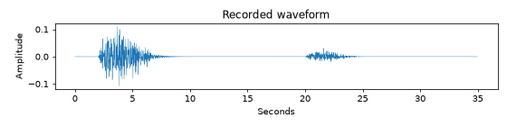

# Device stress harness report

Mode: **owner device run**

Commit: ab7ce364e704d2a189717699b903a54daae3d579 · Rate: 48000 Hz · Block: 128 frames
Platform: Linux · CPU: aarch64 · Device: ALSA|pulse

## Protocol and device metrics

| Metric | Value |
|---|---:|
| Acknowledged commands | 2518 |
| Ack p50/p95/p99 (ms) | 0.181 / 0.236 / 0.788 |
| CPU max (%) | 14.500012397766113 |
| Dropouts (latest counter) | 0 |
| Refused replies | 0 |
| Status/telemetry pushes | 354 / 1011 |

## Recorded signal

| RMS | Peak | DC | Clicks | Dropouts |
|---:|---:|---:|---:|---:|
| 0.010162051 | 0.124206543 | 4.83e-07 | 0 | 0 |

## Per-step audio metrics

| Time (s) | Action | RMS | Peak | DC | Clicks | Dropouts |
|---:|---|---:|---:|---:|---:|---:|
| ... | Remaining per-step metrics in analysis.json | ... | ... | ... | ... | ... |
| 0.0 | load_patch | 0.00000 | 0.00000 | 0.00000 | 0 | 0 |
| 2.0001 | noteOn | 0.00008 | 0.00021 | 0.00004 | 0 | 0 |
| 2.0061 | noteOn | 0.00017 | 0.00034 | 0.00001 | 0 | 0 |
| 2.0121 | noteOn | 0.00025 | 0.00040 | -0.00018 | 0 | 0 |
| 2.0181 | noteOn | 0.00044 | 0.00070 | 0.00038 | 0 | 0 |
| 2.0241 | noteOn | 0.00076 | 0.00119 | -0.00059 | 0 | 0 |
| 2.0301 | noteOn | 0.00077 | 0.00116 | 0.00064 | 0 | 0 |
| 2.0361 | noteOn | 0.00108 | 0.00183 | -0.00079 | 0 | 0 |
| 2.0421 | noteOn | 0.00137 | 0.00229 | 0.00097 | 0 | 0 |
| 2.0481 | noteOn | 0.00165 | 0.00278 | -0.00102 | 0 | 0 |
| 2.0541 | noteOn | 0.00172 | 0.00278 | 0.00089 | 0 | 0 |
| 2.0601 | noteOn | 0.00209 | 0.00357 | -0.00018 | 0 | 0 |
| 2.0661 | noteOn | 0.00231 | 0.00406 | -0.00083 | 0 | 0 |
| 2.0721 | noteOn | 0.00288 | 0.00446 | 0.00055 | 0 | 0 |
| 2.0781 | noteOn | 0.00222 | 0.00369 | 0.00079 | 0 | 0 |
| 2.0841 | noteOn | 0.00338 | 0.00595 | -0.00045 | 0 | 0 |
| 2.0901 | noteOn | 0.01705 | 0.06723 | 0.00004 | 0 | 0 |
| 2.4801 | noteOff | 0.01444 | 0.02899 | -0.00388 | 0 | 0 |
| 2.4861 | noteOff | 0.01759 | 0.03021 | -0.00263 | 0 | 0 |
| 2.4921 | noteOff | 0.01787 | 0.03094 | 0.00001 | 0 | 0 |
| 2.4981 | noteOff | 0.01651 | 0.02618 | 0.01494 | 0 | 0 |
| 2.5001 | noteOn | 0.02596 | 0.04141 | -0.02189 | 0 | 0 |
| 2.5041 | noteOff | 0.05338 | 0.07834 | 0.04987 | 0 | 0 |
| 2.5061 | noteOn | 0.05147 | 0.07718 | -0.00215 | 0 | 0 |
| 2.5101 | noteOff | 0.04268 | 0.07306 | -0.03584 | 0 | 0 |
| 2.5121 | noteOn | 0.01997 | 0.03268 | 0.01702 | 0 | 0 |
| 2.516 | noteOff | 0.00699 | 0.01559 | 0.00350 | 0 | 0 |
| 2.5181 | noteOn | 0.01072 | 0.02206 | 0.00230 | 0 | 0 |
| 2.5221 | noteOff | 0.02103 | 0.02853 | -0.01988 | 0 | 0 |
| 2.5241 | noteOn | 0.01117 | 0.02780 | 0.00192 | 0 | 0 |
| 2.5281 | noteOff | 0.01689 | 0.02802 | 0.01393 | 0 | 0 |
| 2.5301 | noteOn | 0.01074 | 0.02274 | -0.00912 | 0 | 0 |
| 2.5341 | noteOff | 0.01041 | 0.01953 | 0.00914 | 0 | 0 |
| 2.5361 | noteOn | 0.00754 | 0.01468 | 0.00239 | 0 | 0 |
| 2.5401 | noteOff | 0.01236 | 0.02383 | -0.01008 | 0 | 0 |
| 2.5421 | noteOn | 0.01444 | 0.02859 | 0.00416 | 0 | 0 |
| 2.5461 | noteOff | 0.01254 | 0.02545 | 0.00830 | 0 | 0 |
| 2.5481 | noteOn | 0.01412 | 0.02707 | -0.00851 | 0 | 0 |
| 2.5521 | noteOff | 0.01394 | 0.02048 | 0.01275 | 0 | 0 |
| 2.5541 | noteOn | 0.01368 | 0.02634 | -0.00943 | 0 | 0 |
| 2.5581 | noteOff | 0.02489 | 0.03442 | 0.02384 | 0 | 0 |
| 2.5601 | noteOn | 0.01998 | 0.03812 | -0.01282 | 0 | 0 |
| 2.5641 | noteOff | 0.02272 | 0.03485 | 0.01935 | 0 | 0 |
| 2.5661 | noteOn | 0.01328 | 0.02625 | -0.00418 | 0 | 0 |
| 2.5701 | noteOff | 0.01684 | 0.02832 | -0.01012 | 0 | 0 |
| 2.5721 | noteOn | 0.01700 | 0.02844 | 0.00048 | 0 | 0 |
| 2.5781 | noteOn | 0.01925 | 0.03305 | 0.00255 | 0 | 0 |
| 2.5841 | noteOn | 0.01425 | 0.02652 | 0.00280 | 0 | 0 |
| 2.5901 | noteOn | 0.03455 | 0.08771 | 0.00002 | 0 | 0 |
| 2.9801 | noteOff | 0.03172 | 0.05627 | 0.00307 | 0 | 0 |
| 2.9861 | noteOff | 0.04743 | 0.08386 | 0.00394 | 0 | 0 |
| 2.9921 | noteOff | 0.05839 | 0.09189 | -0.00490 | 0 | 0 |
| 2.9981 | noteOff | 0.05778 | 0.08627 | -0.04732 | 0 | 0 |
| 3.0001 | noteOn | 0.03722 | 0.05713 | 0.00357 | 0 | 0 |
| 3.0041 | noteOff | 0.03950 | 0.06699 | 0.02520 | 0 | 0 |
| 3.0061 | noteOn | 0.03934 | 0.06876 | -0.00970 | 0 | 0 |
| 3.0101 | noteOff | 0.01258 | 0.02667 | 0.00046 | 0 | 0 |
| 3.0121 | noteOn | 0.02317 | 0.04642 | 0.02058 | 0 | 0 |
| 3.0161 | noteOff | 0.02352 | 0.04468 | -0.01840 | 0 | 0 |
| 3.0181 | noteOn | 0.02552 | 0.04324 | -0.00607 | 0 | 0 |
| 3.0221 | noteOff | 0.03882 | 0.05811 | 0.03522 | 0 | 0 |
| 3.0241 | noteOn | 0.03599 | 0.06723 | -0.02636 | 0 | 0 |
| 3.0281 | noteOff | 0.03228 | 0.05307 | 0.02808 | 0 | 0 |
| 3.0301 | noteOn | 0.03936 | 0.06778 | -0.01272 | 0 | 0 |
| 3.0341 | noteOff | 0.03555 | 0.06104 | 0.00911 | 0 | 0 |
| 3.0361 | noteOn | 0.03500 | 0.06302 | 0.00424 | 0 | 0 |
| 3.0401 | noteOff | 0.02439 | 0.04514 | -0.01081 | 0 | 0 |
| 3.0421 | noteOn | 0.02919 | 0.04901 | 0.01022 | 0 | 0 |
| 3.0461 | noteOff | 0.03112 | 0.05136 | -0.02100 | 0 | 0 |
| 3.0481 | noteOn | 0.02382 | 0.04086 | 0.00666 | 0 | 0 |
| 3.0521 | noteOff | 0.02711 | 0.04810 | -0.00634 | 0 | 0 |
| 3.0541 | noteOn | 0.03467 | 0.05658 | -0.00157 | 0 | 0 |
| 3.0581 | noteOff | 0.03006 | 0.05417 | 0.01496 | 0 | 0 |
| 3.0601 | noteOn | 0.03078 | 0.05560 | -0.01116 | 0 | 0 |
| 3.0641 | noteOff | 0.04295 | 0.06891 | 0.03966 | 0 | 0 |
| 3.0661 | noteOn | 0.03854 | 0.07727 | -0.01344 | 0 | 0 |
| 3.0701 | noteOff | 0.04054 | 0.07339 | 0.02225 | 0 | 0 |
| 3.0721 | noteOn | 0.03651 | 0.06985 | -0.00913 | 0 | 0 |
| 3.0781 | noteOn | 0.03957 | 0.07089 | 0.00624 | 0 | 0 |
| 3.0841 | noteOn | 0.03733 | 0.06802 | -0.00260 | 0 | 0 |
| 3.0901 | noteOn | 0.02911 | 0.09109 | 0.00003 | 0 | 0 |
| 3.4801 | noteOff | 0.03981 | 0.07620 | -0.00241 | 0 | 0 |
| 3.4861 | noteOff | 0.02952 | 0.06091 | -0.00316 | 0 | 0 |
| 3.4921 | noteOff | 0.02726 | 0.04443 | 0.00665 | 0 | 0 |
| 3.4981 | noteOff | 0.03543 | 0.06097 | -0.00512 | 0 | 0 |
| 3.5041 | noteOff | 0.02443 | 0.05688 | 0.00108 | 0 | 0 |
| 3.5101 | noteOff | 0.02061 | 0.04031 | 0.00385 | 0 | 0 |
| 3.5161 | noteOff | 0.03338 | 0.06354 | -0.00646 | 0 | 0 |
| 3.5221 | noteOff | 0.03778 | 0.06573 | 0.00533 | 0 | 0 |
| 3.5281 | noteOff | 0.03049 | 0.05435 | -0.00486 | 0 | 0 |
| 3.5341 | noteOff | 0.03800 | 0.06955 | 0.00818 | 0 | 0 |
| 3.5401 | noteOff | 0.04917 | 0.08749 | -0.01169 | 0 | 0 |
| 3.5461 | noteOff | 0.05114 | 0.09250 | 0.01284 | 0 | 0 |
| 3.5521 | noteOff | 0.03683 | 0.07919 | -0.00704 | 0 | 0 |
| 3.5581 | noteOff | 0.02953 | 0.05154 | -0.00173 | 0 | 0 |
| 3.5641 | noteOff | 0.03534 | 0.06250 | 0.00735 | 0 | 0 |
| 3.5701 | noteOff | 0.04203 | 0.12421 | -0.00000 | 0 | 0 |
| 4.2001 | unheld-note-off | 0.02437 | 0.08893 | -0.00002 | 0 | 0 |
| 6.0001 | setParam | 0.01091 | 0.02554 | 0.00037 | 0 | 0 |
| 6.0501 | setParam | 0.00666 | 0.04309 | -0.00000 | 0 | 0 |
| 8.0001 | setParam | 0.00074 | 0.00146 | -0.00007 | 0 | 0 |
| 8.0051 | setParam | 0.00046 | 0.00104 | -0.00005 | 0 | 0 |
| 8.0101 | setParam | 0.00079 | 0.00192 | -0.00010 | 0 | 0 |
| 8.0151 | setParam | 0.00118 | 0.00256 | 0.00004 | 0 | 0 |
| 8.0201 | setParam | 0.00152 | 0.00287 | 0.00020 | 0 | 0 |
| 8.0251 | setParam | 0.00141 | 0.00284 | 0.00002 | 0 | 0 |
| 8.0301 | setParam | 0.00116 | 0.00229 | -0.00013 | 0 | 0 |
| 8.0351 | setParam | 0.00068 | 0.00116 | -0.00005 | 0 | 0 |
| 8.0401 | setParam | 0.00046 | 0.00092 | -0.00004 | 0 | 0 |
| 8.0451 | setParam | 0.00078 | 0.00177 | 0.00001 | 0 | 0 |
| 8.0501 | setParam | 0.00036 | 0.00269 | 0.00000 | 0 | 0 |
| 12.0001 | setParam | 0.00000 | 0.00000 | 0.00000 | 0 | 0 |
| 12.0005 | setParam | 0.00000 | 0.00000 | 0.00000 | 0 | 0 |
| 12.0008 | setParam | 0.00000 | 0.00000 | 0.00000 | 0 | 0 |
| 12.0011 | setParam | 0.00000 | 0.00000 | 0.00000 | 0 | 0 |
| 12.0014 | setParam | 0.00000 | 0.00000 | 0.00000 | 0 | 0 |
| 12.0017 | setParam | 0.00000 | 0.00000 | 0.00000 | 0 | 0 |
| 12.002 | setParam | 0.00000 | 0.00000 | 0.00000 | 0 | 0 |
| 12.0023 | setParam | 0.00000 | 0.00000 | 0.00000 | 0 | 0 |
| 12.0026 | setParam | 0.00000 | 0.00000 | 0.00000 | 0 | 0 |
| 12.0029 | setParam | 0.00000 | 0.00000 | 0.00000 | 0 | 0 |
| 12.0031 | setParam | 0.00000 | 0.00000 | 0.00000 | 0 | 0 |
| 12.0034 | setParam | 0.00000 | 0.00000 | 0.00000 | 0 | 0 |
| 12.0037 | setParam | 0.00000 | 0.00000 | 0.00000 | 0 | 0 |
| 12.004 | setParam | 0.00000 | 0.00000 | 0.00000 | 0 | 0 |
| 12.0043 | setParam | 0.00000 | 0.00000 | 0.00000 | 0 | 0 |
| 12.0046 | setParam | 0.00000 | 0.00000 | 0.00000 | 0 | 0 |
| 12.0049 | setParam | 0.00000 | 0.00000 | 0.00000 | 0 | 0 |
| 12.0051 | setParam | 0.00000 | 0.00000 | 0.00000 | 0 | 0 |
| 12.0054 | setParam | 0.00000 | 0.00000 | 0.00000 | 0 | 0 |
| 12.0057 | setParam | 0.00000 | 0.00000 | 0.00000 | 0 | 0 |
| 12.006 | setParam | 0.00000 | 0.00000 | 0.00000 | 0 | 0 |
| 12.0063 | setParam | 0.00000 | 0.00000 | 0.00000 | 0 | 0 |
| 12.0065 | setParam | 0.00000 | 0.00000 | 0.00000 | 0 | 0 |
| 12.0068 | setParam | 0.00000 | 0.00000 | 0.00000 | 0 | 0 |
| 12.0071 | setParam | 0.00002 | 0.00003 | -0.00001 | 0 | 0 |
| 12.0074 | setParam | 0.00002 | 0.00003 | 0.00000 | 0 | 0 |
| 12.0334 | setParam | 0.00000 | 0.00000 | 0.00000 | 0 | 0 |
| 12.0337 | setParam | 0.00000 | 0.00000 | 0.00000 | 0 | 0 |
| 12.034 | setParam | 0.00000 | 0.00000 | 0.00000 | 0 | 0 |
| 12.0343 | setParam | 0.00000 | 0.00000 | 0.00000 | 0 | 0 |
| 12.0346 | setParam | 0.00000 | 0.00000 | 0.00000 | 0 | 0 |
| 12.0349 | setParam | 0.00000 | 0.00000 | 0.00000 | 0 | 0 |
| 12.0351 | setParam | 0.00000 | 0.00000 | 0.00000 | 0 | 0 |
| 12.0354 | setParam | 0.00000 | 0.00000 | 0.00000 | 0 | 0 |
| 12.0357 | setParam | 0.00000 | 0.00000 | 0.00000 | 0 | 0 |
| 12.036 | setParam | 0.00000 | 0.00000 | 0.00000 | 0 | 0 |
| 12.0363 | setParam | 0.00000 | 0.00000 | 0.00000 | 0 | 0 |
| 12.0366 | setParam | 0.00000 | 0.00000 | 0.00000 | 0 | 0 |
| 12.0369 | setParam | 0.00000 | 0.00000 | 0.00000 | 0 | 0 |
| 12.0371 | setParam | 0.00000 | 0.00000 | 0.00000 | 0 | 0 |
| 12.0374 | setParam | 0.00000 | 0.00000 | 0.00000 | 0 | 0 |
| 12.0378 | setParam | 0.00000 | 0.00000 | 0.00000 | 0 | 0 |
| 12.038 | setParam | 0.00000 | 0.00000 | 0.00000 | 0 | 0 |
| 12.0383 | setParam | 0.00000 | 0.00000 | 0.00000 | 0 | 0 |
| 12.0386 | setParam | 0.00000 | 0.00000 | 0.00000 | 0 | 0 |
| 12.0389 | setParam | 0.00000 | 0.00000 | 0.00000 | 0 | 0 |
| 12.0392 | setParam | 0.00000 | 0.00000 | 0.00000 | 0 | 0 |
| 12.0395 | setParam | 0.00000 | 0.00000 | 0.00000 | 0 | 0 |
| 12.0397 | setParam | 0.00000 | 0.00000 | 0.00000 | 0 | 0 |
| 12.04 | setParam | 0.00000 | 0.00000 | 0.00000 | 0 | 0 |
| 12.0403 | setParam | 0.00000 | 0.00000 | 0.00000 | 0 | 0 |
| 12.0406 | setParam | 0.00002 | 0.00003 | -0.00000 | 0 | 0 |
| 12.0667 | setParam | 0.00000 | 0.00000 | 0.00000 | 0 | 0 |
| 12.0671 | setParam | 0.00000 | 0.00000 | 0.00000 | 0 | 0 |
| 12.0674 | setParam | 0.00000 | 0.00000 | 0.00000 | 0 | 0 |
| 12.0676 | setParam | 0.00000 | 0.00000 | 0.00000 | 0 | 0 |
| 12.0679 | setParam | 0.00000 | 0.00000 | 0.00000 | 0 | 0 |
| 12.0682 | setParam | 0.00000 | 0.00000 | 0.00000 | 0 | 0 |
| 12.0685 | setParam | 0.00000 | 0.00000 | 0.00000 | 0 | 0 |
| 12.0688 | setParam | 0.00000 | 0.00000 | 0.00000 | 0 | 0 |
| 12.0691 | setParam | 0.00000 | 0.00000 | 0.00000 | 0 | 0 |
| 12.0693 | setParam | 0.00000 | 0.00000 | 0.00000 | 0 | 0 |
| 12.0696 | setParam | 0.00000 | 0.00000 | 0.00000 | 0 | 0 |
| 12.07 | setParam | 0.00000 | 0.00000 | 0.00000 | 0 | 0 |
| 12.0702 | setParam | 0.00000 | 0.00000 | 0.00000 | 0 | 0 |
| 12.0705 | setParam | 0.00000 | 0.00000 | 0.00000 | 0 | 0 |
| 12.0708 | setParam | 0.00000 | 0.00000 | 0.00000 | 0 | 0 |
| 12.0711 | setParam | 0.00000 | 0.00000 | 0.00000 | 0 | 0 |
| 12.0713 | setParam | 0.00000 | 0.00000 | 0.00000 | 0 | 0 |
| 12.0716 | setParam | 0.00000 | 0.00000 | 0.00000 | 0 | 0 |
| 12.0718 | setParam | 0.00000 | 0.00000 | 0.00000 | 0 | 0 |
| 12.072 | setParam | 0.00000 | 0.00000 | 0.00000 | 0 | 0 |
| 12.0723 | setParam | 0.00000 | 0.00000 | 0.00000 | 0 | 0 |
| 12.0725 | setParam | 0.00000 | 0.00000 | 0.00000 | 0 | 0 |
| 12.0728 | setParam | 0.00000 | 0.00000 | 0.00000 | 0 | 0 |
| 12.073 | setParam | 0.00000 | 0.00000 | 0.00000 | 0 | 0 |
| 12.0732 | setParam | 0.00000 | 0.00000 | 0.00000 | 0 | 0 |
| 12.0735 | setParam | 0.00002 | 0.00003 | -0.00000 | 0 | 0 |
| 12.1001 | setParam | 0.00000 | 0.00000 | 0.00000 | 0 | 0 |
| 12.1004 | setParam | 0.00000 | 0.00000 | 0.00000 | 0 | 0 |
| 12.1012 | setParam | 0.00000 | 0.00000 | 0.00000 | 0 | 0 |
| 12.1015 | setParam | 0.00000 | 0.00000 | 0.00000 | 0 | 0 |
| 12.1018 | setParam | 0.00000 | 0.00000 | 0.00000 | 0 | 0 |
| 12.1021 | setParam | 0.00000 | 0.00000 | 0.00000 | 0 | 0 |
| 12.1024 | setParam | 0.00000 | 0.00000 | 0.00000 | 0 | 0 |
| 12.1026 | setParam | 0.00000 | 0.00000 | 0.00000 | 0 | 0 |
| 12.1029 | setParam | 0.00000 | 0.00000 | 0.00000 | 0 | 0 |
| 12.1031 | setParam | 0.00000 | 0.00000 | 0.00000 | 0 | 0 |
| 12.1034 | setParam | 0.00000 | 0.00000 | 0.00000 | 0 | 0 |
| 12.1036 | setParam | 0.00000 | 0.00000 | 0.00000 | 0 | 0 |
| 12.1038 | setParam | 0.00000 | 0.00000 | 0.00000 | 0 | 0 |
| 12.1044 | setParam | 0.00000 | 0.00000 | 0.00000 | 0 | 0 |
| 12.1047 | setParam | 0.00000 | 0.00000 | 0.00000 | 0 | 0 |
| 12.105 | setParam | 0.00000 | 0.00000 | 0.00000 | 0 | 0 |
| 12.1053 | setParam | 0.00000 | 0.00000 | 0.00000 | 0 | 0 |
| 12.1056 | setParam | 0.00000 | 0.00000 | 0.00000 | 0 | 0 |
| 12.1059 | setParam | 0.00000 | 0.00000 | 0.00000 | 0 | 0 |
| 12.1061 | setParam | 0.00000 | 0.00000 | 0.00000 | 0 | 0 |
| 12.1065 | setParam | 0.00000 | 0.00000 | 0.00000 | 0 | 0 |
| 12.1067 | setParam | 0.00000 | 0.00000 | 0.00000 | 0 | 0 |
| 12.107 | setParam | 0.00000 | 0.00000 | 0.00000 | 0 | 0 |
| 12.1073 | setParam | 0.00000 | 0.00000 | 0.00000 | 0 | 0 |
| 12.1076 | setParam | 0.00000 | 0.00000 | 0.00000 | 0 | 0 |
| 12.1079 | setParam | 0.00002 | 0.00003 | 0.00000 | 0 | 0 |
| 12.1334 | setParam | 0.00000 | 0.00000 | 0.00000 | 0 | 0 |
| 12.1337 | setParam | 0.00000 | 0.00000 | 0.00000 | 0 | 0 |
| 12.134 | setParam | 0.00000 | 0.00000 | 0.00000 | 0 | 0 |
| 12.1343 | setParam | 0.00000 | 0.00000 | 0.00000 | 0 | 0 |
| 12.1346 | setParam | 0.00000 | 0.00000 | 0.00000 | 0 | 0 |
| 12.1354 | setParam | 0.00000 | 0.00000 | 0.00000 | 0 | 0 |
| 12.1356 | setParam | 0.00000 | 0.00000 | 0.00000 | 0 | 0 |
| 12.1359 | setParam | 0.00000 | 0.00000 | 0.00000 | 0 | 0 |
| 12.1361 | setParam | 0.00000 | 0.00000 | 0.00000 | 0 | 0 |
| 12.1364 | setParam | 0.00000 | 0.00000 | 0.00000 | 0 | 0 |
| 12.1366 | setParam | 0.00000 | 0.00000 | 0.00000 | 0 | 0 |
| 12.1368 | setParam | 0.00000 | 0.00000 | 0.00000 | 0 | 0 |
| 12.137 | setParam | 0.00000 | 0.00000 | 0.00000 | 0 | 0 |
| 12.1373 | setParam | 0.00000 | 0.00000 | 0.00000 | 0 | 0 |
| 12.1375 | setParam | 0.00000 | 0.00000 | 0.00000 | 0 | 0 |
| 12.1378 | setParam | 0.00000 | 0.00000 | 0.00000 | 0 | 0 |
| 12.1381 | setParam | 0.00000 | 0.00000 | 0.00000 | 0 | 0 |
| 12.1384 | setParam | 0.00000 | 0.00000 | 0.00000 | 0 | 0 |
| 12.1386 | setParam | 0.00000 | 0.00000 | 0.00000 | 0 | 0 |
| 12.1389 | setParam | 0.00000 | 0.00000 | 0.00000 | 0 | 0 |
| 12.1392 | setParam | 0.00000 | 0.00000 | 0.00000 | 0 | 0 |
| 12.1394 | setParam | 0.00000 | 0.00000 | 0.00000 | 0 | 0 |
| 12.1397 | setParam | 0.00000 | 0.00000 | 0.00000 | 0 | 0 |
| 12.14 | setParam | 0.00000 | 0.00000 | 0.00000 | 0 | 0 |
| 12.1402 | setParam | 0.00000 | 0.00000 | 0.00000 | 0 | 0 |
| 12.1405 | setParam | 0.00002 | 0.00003 | 0.00000 | 0 | 0 |
| 12.1667 | setParam | 0.00002 | 0.00003 | 0.00002 | 0 | 0 |
| 12.1671 | setParam | 0.00001 | 0.00003 | 0.00000 | 0 | 0 |
| 12.1673 | setParam | 0.00000 | 0.00000 | 0.00000 | 0 | 0 |
| 12.1675 | setParam | 0.00000 | 0.00000 | 0.00000 | 0 | 0 |
| 12.1678 | setParam | 0.00000 | 0.00000 | 0.00000 | 0 | 0 |
| 12.168 | setParam | 0.00000 | 0.00000 | 0.00000 | 0 | 0 |
| 12.1683 | setParam | 0.00000 | 0.00000 | 0.00000 | 0 | 0 |
| 12.1685 | setParam | 0.00000 | 0.00000 | 0.00000 | 0 | 0 |
| 12.1687 | setParam | 0.00000 | 0.00000 | 0.00000 | 0 | 0 |
| 12.1695 | setParam | 0.00000 | 0.00000 | 0.00000 | 0 | 0 |
| 12.1697 | setParam | 0.00000 | 0.00000 | 0.00000 | 0 | 0 |
| 12.17 | setParam | 0.00000 | 0.00000 | 0.00000 | 0 | 0 |
| 12.1702 | setParam | 0.00000 | 0.00000 | 0.00000 | 0 | 0 |
| 12.1704 | setParam | 0.00000 | 0.00000 | 0.00000 | 0 | 0 |
| 12.1707 | setParam | 0.00000 | 0.00000 | 0.00000 | 0 | 0 |
| 12.171 | setParam | 0.00000 | 0.00000 | 0.00000 | 0 | 0 |
| 12.1713 | setParam | 0.00000 | 0.00000 | 0.00000 | 0 | 0 |
| 12.1716 | setParam | 0.00000 | 0.00000 | 0.00000 | 0 | 0 |
| 12.1719 | setParam | 0.00000 | 0.00000 | 0.00000 | 0 | 0 |
| 12.1721 | setParam | 0.00000 | 0.00000 | 0.00000 | 0 | 0 |
| 12.1724 | setParam | 0.00000 | 0.00000 | 0.00000 | 0 | 0 |
| 12.1726 | setParam | 0.00000 | 0.00000 | 0.00000 | 0 | 0 |
| 12.1729 | setParam | 0.00000 | 0.00000 | 0.00000 | 0 | 0 |
| 12.1731 | setParam | 0.00000 | 0.00000 | 0.00000 | 0 | 0 |
| 12.1734 | setParam | 0.00000 | 0.00000 | 0.00000 | 0 | 0 |
| 12.1737 | setParam | 0.00001 | 0.00003 | -0.00000 | 0 | 0 |
| 12.2001 | setParam | 0.00000 | 0.00000 | 0.00000 | 0 | 0 |
| 12.2004 | setParam | 0.00001 | 0.00003 | 0.00000 | 0 | 0 |
| 12.2007 | setParam | 0.00002 | 0.00003 | 0.00002 | 0 | 0 |
| 12.201 | setParam | 0.00002 | 0.00003 | 0.00002 | 0 | 0 |
| 12.2012 | setParam | 0.00001 | 0.00003 | 0.00000 | 0 | 0 |
| 12.2015 | setParam | 0.00000 | 0.00000 | 0.00000 | 0 | 0 |
| 12.2018 | setParam | 0.00000 | 0.00000 | 0.00000 | 0 | 0 |
| 12.2021 | setParam | 0.00000 | 0.00000 | 0.00000 | 0 | 0 |
| 12.2023 | setParam | 0.00000 | 0.00000 | 0.00000 | 0 | 0 |
| 12.2026 | setParam | 0.00000 | 0.00000 | 0.00000 | 0 | 0 |
| 12.2029 | setParam | 0.00000 | 0.00000 | 0.00000 | 0 | 0 |
| 12.2037 | setParam | 0.00000 | 0.00000 | 0.00000 | 0 | 0 |
| 12.204 | setParam | 0.00000 | 0.00000 | 0.00000 | 0 | 0 |
| 12.2042 | setParam | 0.00000 | 0.00000 | 0.00000 | 0 | 0 |
| 12.2045 | setParam | 0.00000 | 0.00000 | 0.00000 | 0 | 0 |
| 12.2047 | setParam | 0.00000 | 0.00000 | 0.00000 | 0 | 0 |
| 12.205 | setParam | 0.00000 | 0.00000 | 0.00000 | 0 | 0 |
| 12.2052 | setParam | 0.00000 | 0.00000 | 0.00000 | 0 | 0 |
| 12.2054 | setParam | 0.00000 | 0.00000 | 0.00000 | 0 | 0 |
| 12.2057 | setParam | 0.00000 | 0.00000 | 0.00000 | 0 | 0 |
| 12.2059 | setParam | 0.00000 | 0.00000 | 0.00000 | 0 | 0 |
| 12.2062 | setParam | 0.00000 | 0.00000 | 0.00000 | 0 | 0 |
| 12.2064 | setParam | 0.00000 | 0.00000 | 0.00000 | 0 | 0 |
| 12.2066 | setParam | 0.00000 | 0.00000 | 0.00000 | 0 | 0 |
| 12.2069 | setParam | 0.00000 | 0.00000 | 0.00000 | 0 | 0 |
| 12.2071 | setParam | 0.00001 | 0.00003 | 0.00000 | 0 | 0 |
| 12.2334 | setParam | 0.00002 | 0.00003 | -0.00001 | 0 | 0 |
| 12.2338 | setParam | 0.00000 | 0.00000 | 0.00000 | 0 | 0 |
| 12.2341 | setParam | 0.00000 | 0.00000 | 0.00000 | 0 | 0 |
| 12.2343 | setParam | 0.00000 | 0.00000 | 0.00000 | 0 | 0 |
| 12.2346 | setParam | 0.00000 | 0.00000 | 0.00000 | 0 | 0 |
| 12.2349 | setParam | 0.00002 | 0.00003 | 0.00001 | 0 | 0 |
| 12.2353 | setParam | 0.00002 | 0.00003 | 0.00001 | 0 | 0 |
| 12.2356 | setParam | 0.00000 | 0.00000 | 0.00000 | 0 | 0 |
| 12.2359 | setParam | 0.00000 | 0.00000 | 0.00000 | 0 | 0 |
| 12.2362 | setParam | 0.00000 | 0.00000 | 0.00000 | 0 | 0 |
| 12.2364 | setParam | 0.00000 | 0.00000 | 0.00000 | 0 | 0 |
| 12.2366 | setParam | 0.00000 | 0.00000 | 0.00000 | 0 | 0 |
| 12.2368 | setParam | 0.00000 | 0.00000 | 0.00000 | 0 | 0 |
| 12.2376 | setParam | 0.00000 | 0.00000 | 0.00000 | 0 | 0 |
| 12.2378 | setParam | 0.00000 | 0.00000 | 0.00000 | 0 | 0 |
| 12.238 | setParam | 0.00000 | 0.00000 | 0.00000 | 0 | 0 |
| 12.2383 | setParam | 0.00000 | 0.00000 | 0.00000 | 0 | 0 |
| 12.2385 | setParam | 0.00000 | 0.00000 | 0.00000 | 0 | 0 |
| 12.2387 | setParam | 0.00000 | 0.00000 | 0.00000 | 0 | 0 |
| 12.2389 | setParam | 0.00000 | 0.00000 | 0.00000 | 0 | 0 |
| 12.2391 | setParam | 0.00000 | 0.00000 | 0.00000 | 0 | 0 |
| 12.2393 | setParam | 0.00000 | 0.00000 | 0.00000 | 0 | 0 |
| 12.2396 | setParam | 0.00000 | 0.00000 | 0.00000 | 0 | 0 |
| 12.2398 | setParam | 0.00000 | 0.00000 | 0.00000 | 0 | 0 |
| 12.24 | setParam | 0.00000 | 0.00000 | 0.00000 | 0 | 0 |
| 12.2403 | setParam | 0.00001 | 0.00003 | 0.00000 | 0 | 0 |
| 12.2667 | setParam | 0.00001 | 0.00003 | -0.00001 | 0 | 0 |
| 12.2671 | setParam | 0.00002 | 0.00003 | -0.00002 | 0 | 0 |
| 12.2673 | setParam | 0.00002 | 0.00003 | -0.00002 | 0 | 0 |
| 12.2676 | setParam | 0.00002 | 0.00003 | -0.00002 | 0 | 0 |
| 12.2678 | setParam | 0.00001 | 0.00003 | -0.00000 | 0 | 0 |
| 12.2681 | setParam | 0.00000 | 0.00000 | 0.00000 | 0 | 0 |
| 12.2683 | setParam | 0.00000 | 0.00000 | 0.00000 | 0 | 0 |
| 12.2685 | setParam | 0.00000 | 0.00000 | 0.00000 | 0 | 0 |
| 12.2687 | setParam | 0.00000 | 0.00000 | 0.00000 | 0 | 0 |
| 12.2689 | setParam | 0.00001 | 0.00003 | 0.00000 | 0 | 0 |
| 12.2692 | setParam | 0.00002 | 0.00003 | 0.00002 | 0 | 0 |
| 12.2694 | setParam | 0.00002 | 0.00003 | 0.00002 | 0 | 0 |
| 12.2696 | setParam | 0.00001 | 0.00003 | 0.00001 | 0 | 0 |
| 12.2698 | setParam | 0.00000 | 0.00000 | 0.00000 | 0 | 0 |
| 12.2701 | setParam | 0.00000 | 0.00000 | 0.00000 | 0 | 0 |
| 12.2703 | setParam | 0.00000 | 0.00000 | 0.00000 | 0 | 0 |
| 12.2705 | setParam | 0.00000 | 0.00000 | 0.00000 | 0 | 0 |
| 12.2707 | setParam | 0.00000 | 0.00000 | 0.00000 | 0 | 0 |
| 12.2709 | setParam | 0.00000 | 0.00000 | 0.00000 | 0 | 0 |
| 12.2716 | setParam | 0.00000 | 0.00000 | 0.00000 | 0 | 0 |
| 12.2719 | setParam | 0.00000 | 0.00000 | 0.00000 | 0 | 0 |
| 12.2721 | setParam | 0.00000 | 0.00000 | 0.00000 | 0 | 0 |
| 12.2724 | setParam | 0.00000 | 0.00000 | 0.00000 | 0 | 0 |
| 12.2727 | setParam | 0.00000 | 0.00000 | 0.00000 | 0 | 0 |
| 12.2729 | setParam | 0.00000 | 0.00000 | 0.00000 | 0 | 0 |
| 12.2732 | setParam | 0.00001 | 0.00003 | 0.00000 | 0 | 0 |
| 12.3001 | setParam | 0.00001 | 0.00003 | 0.00000 | 0 | 0 |
| 12.3004 | setParam | 0.00000 | 0.00000 | 0.00000 | 0 | 0 |
| 12.3006 | setParam | 0.00000 | 0.00000 | 0.00000 | 0 | 0 |
| 12.3008 | setParam | 0.00000 | 0.00000 | 0.00000 | 0 | 0 |
| 12.3011 | setParam | 0.00002 | 0.00003 | -0.00001 | 0 | 0 |
| 12.3013 | setParam | 0.00002 | 0.00003 | -0.00002 | 0 | 0 |
| 12.3015 | setParam | 0.00002 | 0.00003 | -0.00002 | 0 | 0 |
| 12.3017 | setParam | 0.00002 | 0.00003 | -0.00002 | 0 | 0 |
| 12.3019 | setParam | 0.00002 | 0.00003 | -0.00001 | 0 | 0 |
| 12.3021 | setParam | 0.00000 | 0.00000 | 0.00000 | 0 | 0 |
| 12.3024 | setParam | 0.00000 | 0.00000 | 0.00000 | 0 | 0 |
| 12.3026 | setParam | 0.00000 | 0.00000 | 0.00000 | 0 | 0 |
| 12.3028 | setParam | 0.00000 | 0.00000 | 0.00000 | 0 | 0 |
| 12.303 | setParam | 0.00000 | 0.00000 | 0.00000 | 0 | 0 |
| 12.3032 | setParam | 0.00001 | 0.00003 | 0.00001 | 0 | 0 |
| 12.3034 | setParam | 0.00002 | 0.00003 | 0.00002 | 0 | 0 |
| 12.3037 | setParam | 0.00002 | 0.00003 | 0.00002 | 0 | 0 |
| 12.3039 | setParam | 0.00001 | 0.00003 | 0.00000 | 0 | 0 |
| 12.3041 | setParam | 0.00000 | 0.00000 | 0.00000 | 0 | 0 |
| 12.3044 | setParam | 0.00000 | 0.00000 | 0.00000 | 0 | 0 |
| 12.3047 | setParam | 0.00000 | 0.00000 | 0.00000 | 0 | 0 |
| 12.3049 | setParam | 0.00000 | 0.00000 | 0.00000 | 0 | 0 |
| 12.3052 | setParam | 0.00000 | 0.00000 | 0.00000 | 0 | 0 |
| 12.3059 | setParam | 0.00000 | 0.00000 | 0.00000 | 0 | 0 |
| 12.3062 | setParam | 0.00000 | 0.00000 | 0.00000 | 0 | 0 |
| 12.3064 | setParam | 0.00001 | 0.00003 | -0.00000 | 0 | 0 |
| 12.3334 | setParam | 0.00002 | 0.00003 | 0.00002 | 0 | 0 |
| 12.3338 | setParam | 0.00002 | 0.00003 | 0.00002 | 0 | 0 |
| 12.334 | setParam | 0.00002 | 0.00003 | 0.00002 | 0 | 0 |
| 12.3343 | setParam | 0.00001 | 0.00003 | 0.00000 | 0 | 0 |
| 12.3345 | setParam | 0.00000 | 0.00000 | 0.00000 | 0 | 0 |
| 12.3347 | setParam | 0.00000 | 0.00000 | 0.00000 | 0 | 0 |
| 12.3349 | setParam | 0.00000 | 0.00000 | 0.00000 | 0 | 0 |
| 12.3351 | setParam | 0.00000 | 0.00000 | 0.00000 | 0 | 0 |
| 12.3353 | setParam | 0.00002 | 0.00003 | -0.00001 | 0 | 0 |
| 12.3355 | setParam | 0.00002 | 0.00003 | -0.00002 | 0 | 0 |
| 12.3358 | setParam | 0.00002 | 0.00003 | -0.00002 | 0 | 0 |
| 12.336 | setParam | 0.00002 | 0.00003 | -0.00001 | 0 | 0 |
| 12.3363 | setParam | 0.00000 | 0.00000 | 0.00000 | 0 | 0 |
| 12.3366 | setParam | 0.00000 | 0.00000 | 0.00000 | 0 | 0 |
| 12.3369 | setParam | 0.00000 | 0.00000 | 0.00000 | 0 | 0 |
| 12.3372 | setParam | 0.00000 | 0.00000 | 0.00000 | 0 | 0 |
| 12.3374 | setParam | 0.00001 | 0.00003 | 0.00000 | 0 | 0 |
| 12.3377 | setParam | 0.00002 | 0.00003 | 0.00002 | 0 | 0 |
| 12.3379 | setParam | 0.00002 | 0.00003 | 0.00001 | 0 | 0 |
| 12.3381 | setParam | 0.00000 | 0.00000 | 0.00000 | 0 | 0 |
| 12.3384 | setParam | 0.00000 | 0.00000 | 0.00000 | 0 | 0 |
| 12.3386 | setParam | 0.00000 | 0.00000 | 0.00000 | 0 | 0 |
| 12.3389 | setParam | 0.00000 | 0.00000 | 0.00000 | 0 | 0 |
| 12.3391 | setParam | 0.00000 | 0.00000 | 0.00000 | 0 | 0 |
| 12.3394 | setParam | 0.00000 | 0.00000 | 0.00000 | 0 | 0 |
| 12.3402 | setParam | 0.00001 | 0.00003 | -0.00000 | 0 | 0 |
| 12.3667 | setParam | 0.00000 | 0.00000 | 0.00000 | 0 | 0 |
| 12.3671 | setParam | 0.00000 | 0.00000 | 0.00000 | 0 | 0 |
| 12.3674 | setParam | 0.00001 | 0.00003 | 0.00001 | 0 | 0 |
| 12.3676 | setParam | 0.00002 | 0.00003 | 0.00002 | 0 | 0 |
| 12.3679 | setParam | 0.00002 | 0.00003 | 0.00002 | 0 | 0 |
| 12.3681 | setParam | 0.00002 | 0.00003 | 0.00002 | 0 | 0 |
| 12.3684 | setParam | 0.00001 | 0.00003 | 0.00001 | 0 | 0 |
| 12.3687 | setParam | 0.00000 | 0.00000 | 0.00000 | 0 | 0 |
| 12.3689 | setParam | 0.00000 | 0.00000 | 0.00000 | 0 | 0 |
| 12.3692 | setParam | 0.00000 | 0.00000 | 0.00000 | 0 | 0 |
| 12.3695 | setParam | 0.00001 | 0.00003 | -0.00000 | 0 | 0 |
| 12.3697 | setParam | 0.00002 | 0.00003 | -0.00002 | 0 | 0 |
| 12.3699 | setParam | 0.00002 | 0.00003 | -0.00002 | 0 | 0 |
| 12.3701 | setParam | 0.00002 | 0.00003 | -0.00002 | 0 | 0 |
| 12.3704 | setParam | 0.00001 | 0.00003 | -0.00001 | 0 | 0 |
| 12.3706 | setParam | 0.00000 | 0.00000 | 0.00000 | 0 | 0 |
| 12.3708 | setParam | 0.00000 | 0.00000 | 0.00000 | 0 | 0 |
| 12.3711 | setParam | 0.00000 | 0.00000 | 0.00000 | 0 | 0 |
| 12.3713 | setParam | 0.00000 | 0.00000 | 0.00000 | 0 | 0 |
| 12.3715 | setParam | 0.00000 | 0.00000 | 0.00000 | 0 | 0 |
| 12.3718 | setParam | 0.00002 | 0.00003 | 0.00001 | 0 | 0 |
| 12.372 | setParam | 0.00002 | 0.00003 | 0.00002 | 0 | 0 |
| 12.3722 | setParam | 0.00001 | 0.00003 | 0.00001 | 0 | 0 |
| 12.3725 | setParam | 0.00000 | 0.00000 | 0.00000 | 0 | 0 |
| 12.3727 | setParam | 0.00000 | 0.00000 | 0.00000 | 0 | 0 |
| 12.3729 | setParam | 0.00001 | 0.00003 | 0.00000 | 0 | 0 |
| 12.4001 | setParam | 0.00002 | 0.00003 | -0.00001 | 0 | 0 |
| 12.401 | setParam | 0.00001 | 0.00003 | 0.00000 | 0 | 0 |
| 12.402 | setParam | 0.00002 | 0.00003 | 0.00002 | 0 | 0 |
| 12.4023 | setParam | 0.00002 | 0.00003 | 0.00002 | 0 | 0 |
| 12.4025 | setParam | 0.00002 | 0.00003 | 0.00002 | 0 | 0 |
| 12.4027 | setParam | 0.00001 | 0.00003 | 0.00000 | 0 | 0 |
| 12.403 | setParam | 0.00000 | 0.00000 | 0.00000 | 0 | 0 |
| 12.4032 | setParam | 0.00000 | 0.00000 | 0.00000 | 0 | 0 |
| 12.4034 | setParam | 0.00000 | 0.00000 | 0.00000 | 0 | 0 |
| 12.4036 | setParam | 0.00001 | 0.00003 | -0.00000 | 0 | 0 |
| 12.4039 | setParam | 0.00002 | 0.00003 | -0.00002 | 0 | 0 |
| 12.4041 | setParam | 0.00002 | 0.00003 | -0.00002 | 0 | 0 |
| 12.4044 | setParam | 0.00002 | 0.00003 | -0.00002 | 0 | 0 |
| 12.4046 | setParam | 0.00001 | 0.00003 | -0.00001 | 0 | 0 |
| 12.4048 | setParam | 0.00000 | 0.00000 | 0.00000 | 0 | 0 |
| 12.4051 | setParam | 0.00000 | 0.00000 | 0.00000 | 0 | 0 |
| 12.4053 | setParam | 0.00000 | 0.00000 | 0.00000 | 0 | 0 |
| 12.4056 | setParam | 0.00000 | 0.00000 | 0.00000 | 0 | 0 |
| 12.4059 | setParam | 0.00001 | 0.00003 | 0.00000 | 0 | 0 |
| 12.4061 | setParam | 0.00002 | 0.00003 | 0.00002 | 0 | 0 |
| 12.4064 | setParam | 0.00001 | 0.00003 | 0.00001 | 0 | 0 |
| 12.4067 | setParam | 0.00000 | 0.00000 | 0.00000 | 0 | 0 |
| 12.407 | setParam | 0.00000 | 0.00000 | 0.00000 | 0 | 0 |
| 12.4072 | setParam | 0.00000 | 0.00000 | 0.00000 | 0 | 0 |
| 12.4074 | setParam | 0.00000 | 0.00000 | 0.00000 | 0 | 0 |
| 12.4076 | setParam | 0.00001 | 0.00003 | 0.00000 | 0 | 0 |
| 12.4334 | setParam | 0.00000 | 0.00000 | 0.00000 | 0 | 0 |
| 12.4338 | setParam | 0.00001 | 0.00003 | -0.00001 | 0 | 0 |
| 12.434 | setParam | 0.00002 | 0.00003 | -0.00002 | 0 | 0 |
| 12.4343 | setParam | 0.00002 | 0.00003 | -0.00002 | 0 | 0 |
| 12.4345 | setParam | 0.00002 | 0.00003 | -0.00002 | 0 | 0 |
| 12.4347 | setParam | 0.00002 | 0.00003 | -0.00002 | 0 | 0 |
| 12.435 | setParam | 0.00001 | 0.00003 | -0.00000 | 0 | 0 |
| 12.4352 | setParam | 0.00000 | 0.00000 | 0.00000 | 0 | 0 |
| 12.4354 | setParam | 0.00000 | 0.00000 | 0.00000 | 0 | 0 |
| 12.4356 | setParam | 0.00000 | 0.00000 | 0.00000 | 0 | 0 |
| 12.4359 | setParam | 0.00001 | 0.00003 | 0.00001 | 0 | 0 |
| 12.4361 | setParam | 0.00002 | 0.00003 | 0.00002 | 0 | 0 |
| 12.4364 | setParam | 0.00002 | 0.00003 | 0.00002 | 0 | 0 |
| 12.4366 | setParam | 0.00002 | 0.00003 | 0.00002 | 0 | 0 |
| 12.4368 | setParam | 0.00002 | 0.00003 | 0.00001 | 0 | 0 |
| 12.437 | setParam | 0.00000 | 0.00000 | 0.00000 | 0 | 0 |
| 12.4372 | setParam | 0.00000 | 0.00000 | 0.00000 | 0 | 0 |
| 12.4375 | setParam | 0.00000 | 0.00000 | 0.00000 | 0 | 0 |
| 12.4377 | setParam | 0.00000 | 0.00000 | 0.00000 | 0 | 0 |
| 12.438 | setParam | 0.00002 | 0.00003 | -0.00001 | 0 | 0 |
| 12.4383 | setParam | 0.00002 | 0.00003 | -0.00002 | 0 | 0 |
| 12.4385 | setParam | 0.00002 | 0.00003 | -0.00002 | 0 | 0 |
| 12.4388 | setParam | 0.00001 | 0.00003 | -0.00000 | 0 | 0 |
| 12.4391 | setParam | 0.00000 | 0.00000 | 0.00000 | 0 | 0 |
| 12.4394 | setParam | 0.00000 | 0.00000 | 0.00000 | 0 | 0 |
| 12.4396 | setParam | 0.00001 | 0.00003 | 0.00000 | 0 | 0 |
| 12.4667 | setParam | 0.00002 | 0.00003 | 0.00002 | 0 | 0 |
| 12.4671 | setParam | 0.00001 | 0.00003 | 0.00001 | 0 | 0 |
| 12.4673 | setParam | 0.00000 | 0.00000 | 0.00000 | 0 | 0 |
| 12.4676 | setParam | 0.00000 | 0.00000 | 0.00000 | 0 | 0 |
| 12.4679 | setParam | 0.00000 | 0.00000 | 0.00000 | 0 | 0 |
| 12.4682 | setParam | 0.00002 | 0.00003 | -0.00001 | 0 | 0 |
| 12.4684 | setParam | 0.00002 | 0.00003 | -0.00002 | 0 | 0 |
| 12.4687 | setParam | 0.00002 | 0.00003 | -0.00002 | 0 | 0 |
| 12.469 | setParam | 0.00002 | 0.00003 | -0.00001 | 0 | 0 |
| 12.4692 | setParam | 0.00000 | 0.00000 | 0.00000 | 0 | 0 |
| 12.4695 | setParam | 0.00000 | 0.00000 | 0.00000 | 0 | 0 |
| 12.4698 | setParam | 0.00000 | 0.00000 | 0.00000 | 0 | 0 |
| 12.47 | setParam | 0.00001 | 0.00003 | 0.00000 | 0 | 0 |
| 12.4703 | setParam | 0.00002 | 0.00003 | 0.00002 | 0 | 0 |
| 12.4706 | setParam | 0.00002 | 0.00003 | 0.00002 | 0 | 0 |
| 12.4709 | setParam | 0.00002 | 0.00003 | 0.00002 | 0 | 0 |
| 12.4711 | setParam | 0.00000 | 0.00000 | 0.00000 | 0 | 0 |
| 12.4714 | setParam | 0.00000 | 0.00000 | 0.00000 | 0 | 0 |
| 12.4717 | setParam | 0.00000 | 0.00000 | 0.00000 | 0 | 0 |
| 12.472 | setParam | 0.00000 | 0.00000 | 0.00000 | 0 | 0 |
| 12.4722 | setParam | 0.00002 | 0.00003 | -0.00001 | 0 | 0 |
| 12.4725 | setParam | 0.00002 | 0.00003 | -0.00002 | 0 | 0 |
| 12.4727 | setParam | 0.00002 | 0.00003 | -0.00002 | 0 | 0 |
| 12.473 | setParam | 0.00001 | 0.00003 | -0.00000 | 0 | 0 |
| 12.4733 | setParam | 0.00000 | 0.00000 | 0.00000 | 0 | 0 |

