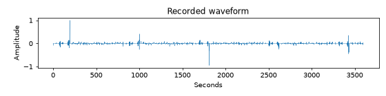

# Device stress harness report

Mode: **owner device run**

Commit: ab7ce364e704d2a189717699b903a54daae3d579 · Rate: 48000 Hz · Block: 128 frames
Platform: Linux · CPU: aarch64 · Device: ALSA|pulse

## Protocol and device metrics

| Metric | Value |
|---|---:|
| Acknowledged commands | 114332 |
| Ack p50/p95/p99 (ms) | 0.176 / 0.250 / 0.751 |
| CPU max (%) | 26.97661781311035 |
| Dropouts (latest counter) | 0 |
| Refused replies | 0 |
| Status/telemetry pushes | 35977 / 102933 |

## Recorded signal

| RMS | Peak | DC | Clicks | Dropouts |
|---:|---:|---:|---:|---:|
| 0.033608262 | 1.0 | 1.8379e-05 | 270 | 10 |

## Per-step audio metrics

| Time (s) | Action | RMS | Peak | DC | Clicks | Dropouts |
|---:|---|---:|---:|---:|---:|---:|
| ... | Remaining per-step metrics in analysis.json | ... | ... | ... | ... | ... |
| 0.0 | load_patch | 0.00029 | 0.01013 | 0.00001 | 0 | 0 |
| 2.0001 | noteOn | 0.01207 | 0.01987 | -0.00694 | 0 | 0 |
| 2.0061 | noteOn | 0.03130 | 0.04895 | -0.00284 | 0 | 0 |
| 2.0121 | noteOn | 0.04234 | 0.06729 | 0.01360 | 0 | 0 |
| 2.0181 | noteOn | 0.05648 | 0.08157 | 0.00555 | 0 | 0 |
| 2.0241 | noteOn | 0.06056 | 0.09079 | 0.00402 | 0 | 0 |
| 2.0301 | noteOn | 0.08179 | 0.11615 | -0.00133 | 0 | 0 |
| 2.0361 | noteOn | 0.07191 | 0.10626 | -0.00073 | 0 | 0 |
| 2.0421 | noteOn | 0.07303 | 0.10632 | -0.01234 | 0 | 0 |
| 2.0481 | noteOn | 0.08449 | 0.12946 | -0.01734 | 0 | 0 |
| 2.0541 | noteOn | 0.09698 | 0.14679 | 0.00734 | 0 | 0 |
| 2.0601 | noteOn | 0.09341 | 0.13992 | 0.02320 | 0 | 0 |
| 2.0661 | noteOn | 0.09787 | 0.13742 | -0.02620 | 0 | 0 |
| 2.0721 | noteOn | 0.09561 | 0.14301 | 0.02195 | 0 | 0 |
| 2.0781 | noteOn | 0.09671 | 0.14697 | -0.02296 | 0 | 0 |
| 2.0841 | noteOn | 0.08345 | 0.12997 | 0.01815 | 0 | 0 |
| 2.0901 | noteOn | 0.05248 | 0.13428 | -0.00008 | 0 | 0 |
| 2.3501 | noteOff | 0.04524 | 0.07242 | -0.00493 | 0 | 0 |
| 2.3561 | noteOff | 0.04847 | 0.07309 | -0.00360 | 0 | 0 |
| 2.3621 | noteOff | 0.02793 | 0.04819 | 0.00758 | 0 | 0 |
| 2.3681 | noteOff | 0.02417 | 0.03864 | -0.00630 | 0 | 0 |
| 2.3741 | noteOff | 0.02996 | 0.04126 | 0.00059 | 0 | 0 |
| 2.3801 | noteOff | 0.03231 | 0.05762 | 0.00276 | 0 | 0 |
| 2.3861 | noteOff | 0.05114 | 0.08032 | 0.00728 | 0 | 0 |
| 2.3921 | noteOff | 0.05646 | 0.08319 | -0.00856 | 0 | 0 |
| 2.3981 | noteOff | 0.03636 | 0.07028 | -0.00054 | 0 | 0 |
| 2.404 | noteOff | 0.01367 | 0.03574 | 0.00131 | 0 | 0 |
| 2.4101 | noteOff | 0.03917 | 0.06216 | -0.00471 | 0 | 0 |
| 2.4161 | noteOff | 0.03996 | 0.06281 | 0.00945 | 0 | 0 |
| 2.4221 | noteOff | 0.02860 | 0.04660 | -0.00717 | 0 | 0 |
| 2.4281 | noteOff | 0.03288 | 0.05319 | 0.00250 | 0 | 0 |
| 2.4341 | noteOff | 0.03821 | 0.05505 | 0.00473 | 0 | 0 |
| 2.44 | noteOff | 0.02922 | 0.07059 | -0.00012 | 0 | 0 |
| 2.6501 | noteOn | 0.02753 | 0.04407 | -0.00365 | 0 | 0 |
| 2.6561 | noteOn | 0.03686 | 0.06320 | 0.00005 | 0 | 0 |
| 2.6621 | noteOn | 0.02954 | 0.04861 | 0.00401 | 0 | 0 |
| 2.6681 | noteOn | 0.03239 | 0.04443 | 0.00889 | 0 | 0 |
| 2.6741 | noteOn | 0.04312 | 0.07385 | 0.00049 | 0 | 0 |
| 2.6801 | noteOn | 0.07520 | 0.10840 | -0.01849 | 0 | 0 |
| 2.6861 | noteOn | 0.05673 | 0.09012 | 0.01801 | 0 | 0 |
| 2.6921 | noteOn | 0.04572 | 0.06537 | -0.01170 | 0 | 0 |
| 2.6981 | noteOn | 0.06809 | 0.11588 | 0.01666 | 0 | 0 |
| 2.7041 | noteOn | 0.07169 | 0.11752 | -0.01378 | 0 | 0 |
| 2.7101 | noteOn | 0.02995 | 0.07086 | 0.00314 | 0 | 0 |
| 2.7161 | noteOn | 0.01360 | 0.02704 | -0.00063 | 0 | 0 |
| 2.7221 | noteOn | 0.03142 | 0.07062 | 0.00069 | 0 | 0 |
| 2.7281 | noteOn | 0.05263 | 0.08905 | -0.00088 | 0 | 0 |
| 2.7341 | noteOn | 0.01014 | 0.02850 | 0.00267 | 0 | 0 |
| 2.7401 | noteOn | 0.05224 | 0.16324 | 0.00006 | 0 | 0 |
| 3.0001 | noteOff | 0.05760 | 0.09302 | 0.00140 | 0 | 0 |
| 3.0061 | noteOff | 0.05665 | 0.09265 | -0.00780 | 0 | 0 |
| 3.0121 | noteOff | 0.01975 | 0.03925 | 0.00475 | 0 | 0 |
| 3.0181 | noteOff | 0.03873 | 0.05902 | -0.00561 | 0 | 0 |
| 3.0241 | noteOff | 0.02997 | 0.05420 | 0.00486 | 0 | 0 |
| 3.0301 | noteOff | 0.02332 | 0.03867 | -0.00276 | 0 | 0 |
| 3.0361 | noteOff | 0.02576 | 0.03870 | -0.00143 | 0 | 0 |
| 3.0421 | noteOff | 0.04215 | 0.07599 | -0.00054 | 0 | 0 |
| 3.048 | noteOff | 0.06500 | 0.09302 | 0.00855 | 0 | 0 |
| 3.0541 | noteOff | 0.03792 | 0.07578 | -0.00518 | 0 | 0 |
| 3.0601 | noteOff | 0.02261 | 0.04816 | 0.00357 | 0 | 0 |
| 3.0661 | noteOff | 0.03804 | 0.05695 | -0.00429 | 0 | 0 |
| 3.0721 | noteOff | 0.01960 | 0.04175 | 0.00124 | 0 | 0 |
| 3.0781 | noteOff | 0.01345 | 0.02087 | 0.00060 | 0 | 0 |
| 3.0841 | noteOff | 0.02295 | 0.05154 | 0.00003 | 0 | 0 |
| 3.0901 | noteOff | 0.02992 | 0.09302 | -0.00001 | 0 | 0 |
| 3.3001 | noteOn | 0.02788 | 0.05865 | -0.00408 | 0 | 0 |
| 3.3061 | noteOn | 0.03325 | 0.05682 | 0.00970 | 0 | 0 |
| 3.3121 | noteOn | 0.04314 | 0.06085 | -0.01235 | 0 | 0 |
| 3.3181 | noteOn | 0.03950 | 0.05945 | 0.00860 | 0 | 0 |
| 3.3241 | noteOn | 0.03389 | 0.05719 | -0.00395 | 0 | 0 |
| 3.3301 | noteOn | 0.02196 | 0.04111 | -0.00173 | 0 | 0 |
| 3.3361 | noteOn | 0.03482 | 0.05914 | 0.00392 | 0 | 0 |
| 3.3421 | noteOn | 0.03898 | 0.06036 | 0.00342 | 0 | 0 |
| 3.3481 | noteOn | 0.02673 | 0.05664 | -0.00563 | 0 | 0 |
| 3.3541 | noteOn | 0.04002 | 0.06924 | 0.00256 | 0 | 0 |
| 3.3601 | noteOn | 0.03905 | 0.06689 | 0.00368 | 0 | 0 |
| 3.3661 | noteOn | 0.08026 | 0.14273 | -0.00994 | 0 | 0 |
| 3.3721 | noteOn | 0.11001 | 0.16397 | 0.01341 | 0 | 0 |
| 3.3781 | noteOn | 0.06014 | 0.12448 | -0.00742 | 0 | 0 |
| 3.3841 | noteOn | 0.04802 | 0.09995 | -0.00077 | 0 | 0 |
| 3.3901 | noteOn | 0.05285 | 0.13962 | 0.00001 | 0 | 0 |
| 3.6501 | noteOff | 0.03700 | 0.05917 | 0.00126 | 0 | 0 |
| 3.6561 | noteOff | 0.03432 | 0.07538 | -0.00292 | 0 | 0 |
| 3.6621 | noteOff | 0.05610 | 0.08530 | 0.00040 | 0 | 0 |
| 3.6681 | noteOff | 0.04036 | 0.06332 | 0.00302 | 0 | 0 |
| 3.6741 | noteOff | 0.04086 | 0.06677 | -0.00214 | 0 | 0 |
| 3.6801 | noteOff | 0.02784 | 0.05243 | -0.00134 | 0 | 0 |
| 3.6861 | noteOff | 0.03109 | 0.05453 | 0.00280 | 0 | 0 |
| 3.6921 | noteOff | 0.03613 | 0.06653 | 0.00086 | 0 | 0 |
| 3.6981 | noteOff | 0.04244 | 0.06790 | 0.00095 | 0 | 0 |
| 3.7041 | noteOff | 0.04928 | 0.07639 | 0.00092 | 0 | 0 |
| 3.7101 | noteOff | 0.03526 | 0.07108 | -0.00415 | 0 | 0 |
| 3.7161 | noteOff | 0.03087 | 0.05252 | -0.00219 | 0 | 0 |
| 3.7221 | noteOff | 0.02603 | 0.04901 | 0.00384 | 0 | 0 |
| 3.7281 | noteOff | 0.03384 | 0.05228 | 0.00125 | 0 | 0 |
| 3.7341 | noteOff | 0.03794 | 0.07080 | -0.00112 | 0 | 0 |
| 3.7401 | noteOff | 0.02176 | 0.08429 | -0.00002 | 0 | 0 |
| 4.2001 | unheld-note-off | 0.00017 | 0.00342 | 0.00000 | 0 | 0 |
| 6.0001 | setParam | 0.00000 | 0.00000 | 0.00000 | 0 | 0 |
| 6.0501 | setParam | 0.00000 | 0.00000 | 0.00000 | 0 | 0 |
| 8.0001 | setParam | 0.00000 | 0.00000 | 0.00000 | 0 | 0 |
| 8.0051 | setParam | 0.00000 | 0.00000 | 0.00000 | 0 | 0 |
| 8.0101 | setParam | 0.00000 | 0.00000 | 0.00000 | 0 | 0 |
| 8.0151 | setParam | 0.00000 | 0.00000 | 0.00000 | 0 | 0 |
| 8.0201 | setParam | 0.00000 | 0.00000 | 0.00000 | 0 | 0 |
| 8.0251 | setParam | 0.00000 | 0.00000 | 0.00000 | 0 | 0 |
| 8.0301 | setParam | 0.00000 | 0.00000 | 0.00000 | 0 | 0 |
| 8.0351 | setParam | 0.00000 | 0.00000 | 0.00000 | 0 | 0 |
| 8.0401 | setParam | 0.00000 | 0.00000 | 0.00000 | 0 | 0 |
| 8.0451 | setParam | 0.00000 | 0.00000 | 0.00000 | 0 | 0 |
| 8.0501 | setParam | 0.00000 | 0.00000 | 0.00000 | 0 | 0 |
| 12.0001 | setParam | 0.00000 | 0.00000 | 0.00000 | 0 | 0 |
| 12.0005 | setParam | 0.00000 | 0.00000 | 0.00000 | 0 | 0 |
| 12.0008 | setParam | 0.00000 | 0.00000 | 0.00000 | 0 | 0 |
| 12.001 | setParam | 0.00000 | 0.00000 | 0.00000 | 0 | 0 |
| 12.0251 | setParam | 0.00000 | 0.00000 | 0.00000 | 0 | 0 |
| 12.0254 | setParam | 0.00000 | 0.00000 | 0.00000 | 0 | 0 |
| 12.0257 | setParam | 0.00000 | 0.00000 | 0.00000 | 0 | 0 |
| 12.026 | setParam | 0.00000 | 0.00000 | 0.00000 | 0 | 0 |
| 12.0501 | setParam | 0.00000 | 0.00000 | 0.00000 | 0 | 0 |
| 12.0504 | setParam | 0.00000 | 0.00000 | 0.00000 | 0 | 0 |
| 12.0507 | setParam | 0.00000 | 0.00000 | 0.00000 | 0 | 0 |
| 12.051 | setParam | 0.00000 | 0.00000 | 0.00000 | 0 | 0 |
| 12.0751 | setParam | 0.00000 | 0.00000 | 0.00000 | 0 | 0 |
| 12.0754 | setParam | 0.00000 | 0.00000 | 0.00000 | 0 | 0 |
| 12.0757 | setParam | 0.00000 | 0.00000 | 0.00000 | 0 | 0 |
| 12.0763 | setParam | 0.00000 | 0.00000 | 0.00000 | 0 | 0 |
| 12.1001 | setParam | 0.00000 | 0.00000 | 0.00000 | 0 | 0 |
| 12.1004 | setParam | 0.00000 | 0.00000 | 0.00000 | 0 | 0 |
| 12.1006 | setParam | 0.00000 | 0.00000 | 0.00000 | 0 | 0 |
| 12.1009 | setParam | 0.00000 | 0.00000 | 0.00000 | 0 | 0 |
| 12.125 | setParam | 0.00000 | 0.00000 | 0.00000 | 0 | 0 |
| 12.1254 | setParam | 0.00000 | 0.00000 | 0.00000 | 0 | 0 |
| 12.1256 | setParam | 0.00000 | 0.00000 | 0.00000 | 0 | 0 |
| 12.1259 | setParam | 0.00000 | 0.00000 | 0.00000 | 0 | 0 |
| 12.1501 | setParam | 0.00000 | 0.00000 | 0.00000 | 0 | 0 |
| 12.1504 | setParam | 0.00000 | 0.00000 | 0.00000 | 0 | 0 |
| 12.1507 | setParam | 0.00000 | 0.00000 | 0.00000 | 0 | 0 |
| 12.151 | setParam | 0.00000 | 0.00000 | 0.00000 | 0 | 0 |
| 12.1751 | setParam | 0.00000 | 0.00000 | 0.00000 | 0 | 0 |
| 12.1754 | setParam | 0.00000 | 0.00000 | 0.00000 | 0 | 0 |
| 12.1756 | setParam | 0.00000 | 0.00000 | 0.00000 | 0 | 0 |
| 12.1759 | setParam | 0.00000 | 0.00000 | 0.00000 | 0 | 0 |
| 12.2001 | setParam | 0.00000 | 0.00000 | 0.00000 | 0 | 0 |
| 12.2004 | setParam | 0.00000 | 0.00000 | 0.00000 | 0 | 0 |
| 12.2007 | setParam | 0.00000 | 0.00000 | 0.00000 | 0 | 0 |
| 12.2009 | setParam | 0.00000 | 0.00000 | 0.00000 | 0 | 0 |
| 12.2251 | setParam | 0.00000 | 0.00000 | 0.00000 | 0 | 0 |
| 12.2254 | setParam | 0.00000 | 0.00000 | 0.00000 | 0 | 0 |
| 12.2257 | setParam | 0.00000 | 0.00000 | 0.00000 | 0 | 0 |
| 12.226 | setParam | 0.00000 | 0.00000 | 0.00000 | 0 | 0 |
| 12.2501 | setParam | 0.00000 | 0.00000 | 0.00000 | 0 | 0 |
| 12.2505 | setParam | 0.00000 | 0.00000 | 0.00000 | 0 | 0 |
| 12.2511 | setParam | 0.00000 | 0.00000 | 0.00000 | 0 | 0 |
| 12.2513 | setParam | 0.00000 | 0.00000 | 0.00000 | 0 | 0 |
| 12.2751 | setParam | 0.00000 | 0.00000 | 0.00000 | 0 | 0 |
| 12.2754 | setParam | 0.00000 | 0.00000 | 0.00000 | 0 | 0 |
| 12.2757 | setParam | 0.00000 | 0.00000 | 0.00000 | 0 | 0 |
| 12.276 | setParam | 0.00000 | 0.00000 | 0.00000 | 0 | 0 |
| 12.3001 | setParam | 0.00000 | 0.00000 | 0.00000 | 0 | 0 |
| 12.3004 | setParam | 0.00000 | 0.00000 | 0.00000 | 0 | 0 |
| 12.3007 | setParam | 0.00000 | 0.00000 | 0.00000 | 0 | 0 |
| 12.301 | setParam | 0.00000 | 0.00000 | 0.00000 | 0 | 0 |
| 12.3251 | setParam | 0.00000 | 0.00000 | 0.00000 | 0 | 0 |
| 12.3254 | setParam | 0.00000 | 0.00000 | 0.00000 | 0 | 0 |
| 12.3256 | setParam | 0.00000 | 0.00000 | 0.00000 | 0 | 0 |
| 12.3259 | setParam | 0.00000 | 0.00000 | 0.00000 | 0 | 0 |
| 12.3501 | setParam | 0.00000 | 0.00000 | 0.00000 | 0 | 0 |
| 12.3504 | setParam | 0.00000 | 0.00000 | 0.00000 | 0 | 0 |
| 12.3507 | setParam | 0.00000 | 0.00000 | 0.00000 | 0 | 0 |
| 12.351 | setParam | 0.00000 | 0.00000 | 0.00000 | 0 | 0 |
| 12.3751 | setParam | 0.00000 | 0.00000 | 0.00000 | 0 | 0 |
| 12.3755 | setParam | 0.00000 | 0.00000 | 0.00000 | 0 | 0 |
| 12.3757 | setParam | 0.00000 | 0.00000 | 0.00000 | 0 | 0 |
| 12.376 | setParam | 0.00000 | 0.00000 | 0.00000 | 0 | 0 |
| 12.4001 | setParam | 0.00000 | 0.00000 | 0.00000 | 0 | 0 |
| 12.4004 | setParam | 0.00000 | 0.00000 | 0.00000 | 0 | 0 |
| 12.4007 | setParam | 0.00000 | 0.00000 | 0.00000 | 0 | 0 |
| 12.401 | setParam | 0.00000 | 0.00000 | 0.00000 | 0 | 0 |
| 12.4251 | setParam | 0.00000 | 0.00000 | 0.00000 | 0 | 0 |
| 12.4254 | setParam | 0.00000 | 0.00000 | 0.00000 | 0 | 0 |
| 12.4257 | setParam | 0.00000 | 0.00000 | 0.00000 | 0 | 0 |
| 12.4263 | setParam | 0.00000 | 0.00000 | 0.00000 | 0 | 0 |
| 12.4501 | setParam | 0.00000 | 0.00000 | 0.00000 | 0 | 0 |
| 12.4504 | setParam | 0.00000 | 0.00000 | 0.00000 | 0 | 0 |
| 12.4507 | setParam | 0.00000 | 0.00000 | 0.00000 | 0 | 0 |
| 12.451 | setParam | 0.00000 | 0.00000 | 0.00000 | 0 | 0 |
| 12.4751 | setParam | 0.00000 | 0.00000 | 0.00000 | 0 | 0 |
| 12.4754 | setParam | 0.00000 | 0.00000 | 0.00000 | 0 | 0 |
| 12.4757 | setParam | 0.00000 | 0.00000 | 0.00000 | 0 | 0 |
| 12.476 | setParam | 0.00000 | 0.00000 | 0.00000 | 0 | 0 |
| 12.5001 | setParam | 0.00000 | 0.00000 | 0.00000 | 0 | 0 |
| 12.5004 | setParam | 0.00000 | 0.00000 | 0.00000 | 0 | 0 |
| 12.5007 | setParam | 0.00000 | 0.00000 | 0.00000 | 0 | 0 |
| 12.5009 | setParam | 0.00000 | 0.00000 | 0.00000 | 0 | 0 |
| 12.5251 | setParam | 0.00000 | 0.00000 | 0.00000 | 0 | 0 |
| 12.5254 | setParam | 0.00000 | 0.00000 | 0.00000 | 0 | 0 |
| 12.5257 | setParam | 0.00000 | 0.00000 | 0.00000 | 0 | 0 |
| 12.526 | setParam | 0.00000 | 0.00000 | 0.00000 | 0 | 0 |
| 12.5501 | setParam | 0.00000 | 0.00000 | 0.00000 | 0 | 0 |
| 12.5504 | setParam | 0.00000 | 0.00000 | 0.00000 | 0 | 0 |
| 12.5507 | setParam | 0.00000 | 0.00000 | 0.00000 | 0 | 0 |
| 12.551 | setParam | 0.00000 | 0.00000 | 0.00000 | 0 | 0 |
| 12.5751 | setParam | 0.00000 | 0.00000 | 0.00000 | 0 | 0 |
| 12.5754 | setParam | 0.00000 | 0.00000 | 0.00000 | 0 | 0 |
| 12.5757 | setParam | 0.00000 | 0.00000 | 0.00000 | 0 | 0 |
| 12.576 | setParam | 0.00000 | 0.00000 | 0.00000 | 0 | 0 |
| 12.6001 | setParam | 0.00000 | 0.00000 | 0.00000 | 0 | 0 |
| 12.6004 | setParam | 0.00000 | 0.00000 | 0.00000 | 0 | 0 |
| 12.6007 | setParam | 0.00000 | 0.00000 | 0.00000 | 0 | 0 |
| 12.6013 | setParam | 0.00000 | 0.00000 | 0.00000 | 0 | 0 |
| 12.6251 | setParam | 0.00000 | 0.00000 | 0.00000 | 0 | 0 |
| 12.6254 | setParam | 0.00000 | 0.00000 | 0.00000 | 0 | 0 |
| 12.6257 | setParam | 0.00000 | 0.00000 | 0.00000 | 0 | 0 |
| 12.626 | setParam | 0.00000 | 0.00000 | 0.00000 | 0 | 0 |
| 12.6501 | setParam | 0.00000 | 0.00000 | 0.00000 | 0 | 0 |
| 12.6504 | setParam | 0.00000 | 0.00000 | 0.00000 | 0 | 0 |
| 12.6507 | setParam | 0.00000 | 0.00000 | 0.00000 | 0 | 0 |
| 12.6509 | setParam | 0.00000 | 0.00000 | 0.00000 | 0 | 0 |
| 12.6751 | setParam | 0.00000 | 0.00000 | 0.00000 | 0 | 0 |
| 12.6754 | setParam | 0.00000 | 0.00000 | 0.00000 | 0 | 0 |
| 12.6757 | setParam | 0.00000 | 0.00000 | 0.00000 | 0 | 0 |
| 12.676 | setParam | 0.00000 | 0.00000 | 0.00000 | 0 | 0 |
| 12.7001 | setParam | 0.00000 | 0.00000 | 0.00000 | 0 | 0 |
| 12.7004 | setParam | 0.00000 | 0.00000 | 0.00000 | 0 | 0 |
| 12.7007 | setParam | 0.00000 | 0.00000 | 0.00000 | 0 | 0 |
| 12.7009 | setParam | 0.00000 | 0.00000 | 0.00000 | 0 | 0 |
| 12.7251 | setParam | 0.00000 | 0.00000 | 0.00000 | 0 | 0 |
| 12.7254 | setParam | 0.00000 | 0.00000 | 0.00000 | 0 | 0 |
| 12.7263 | setParam | 0.00000 | 0.00000 | 0.00000 | 0 | 0 |
| 12.7266 | setParam | 0.00000 | 0.00000 | 0.00000 | 0 | 0 |
| 12.7501 | setParam | 0.00000 | 0.00000 | 0.00000 | 0 | 0 |
| 12.7504 | setParam | 0.00000 | 0.00000 | 0.00000 | 0 | 0 |
| 12.7507 | setParam | 0.00000 | 0.00000 | 0.00000 | 0 | 0 |
| 12.7509 | setParam | 0.00000 | 0.00000 | 0.00000 | 0 | 0 |
| 12.7751 | setParam | 0.00000 | 0.00000 | 0.00000 | 0 | 0 |
| 12.7754 | setParam | 0.00000 | 0.00000 | 0.00000 | 0 | 0 |
| 12.7757 | setParam | 0.00000 | 0.00000 | 0.00000 | 0 | 0 |
| 12.776 | setParam | 0.00000 | 0.00000 | 0.00000 | 0 | 0 |
| 12.8001 | setParam | 0.00000 | 0.00000 | 0.00000 | 0 | 0 |
| 12.8004 | setParam | 0.00000 | 0.00000 | 0.00000 | 0 | 0 |
| 12.8008 | setParam | 0.00000 | 0.00000 | 0.00000 | 0 | 0 |
| 12.8011 | setParam | 0.00000 | 0.00000 | 0.00000 | 0 | 0 |
| 12.8251 | setParam | 0.00000 | 0.00000 | 0.00000 | 0 | 0 |
| 12.8255 | setParam | 0.00000 | 0.00000 | 0.00000 | 0 | 0 |
| 12.8265 | setParam | 0.00000 | 0.00000 | 0.00000 | 0 | 0 |
| 12.8267 | setParam | 0.00000 | 0.00000 | 0.00000 | 0 | 0 |
| 12.8501 | setParam | 0.00000 | 0.00000 | 0.00000 | 0 | 0 |
| 12.8504 | setParam | 0.00000 | 0.00000 | 0.00000 | 0 | 0 |
| 12.8507 | setParam | 0.00000 | 0.00000 | 0.00000 | 0 | 0 |
| 12.851 | setParam | 0.00000 | 0.00000 | 0.00000 | 0 | 0 |
| 12.8751 | setParam | 0.00000 | 0.00000 | 0.00000 | 0 | 0 |
| 12.8754 | setParam | 0.00000 | 0.00000 | 0.00000 | 0 | 0 |
| 12.8757 | setParam | 0.00000 | 0.00000 | 0.00000 | 0 | 0 |
| 12.876 | setParam | 0.00000 | 0.00000 | 0.00000 | 0 | 0 |
| 12.9001 | setParam | 0.00000 | 0.00000 | 0.00000 | 0 | 0 |
| 12.9004 | setParam | 0.00000 | 0.00000 | 0.00000 | 0 | 0 |
| 12.9007 | setParam | 0.00000 | 0.00000 | 0.00000 | 0 | 0 |
| 12.901 | setParam | 0.00000 | 0.00000 | 0.00000 | 0 | 0 |
| 12.9251 | setParam | 0.00000 | 0.00000 | 0.00000 | 0 | 0 |
| 12.9254 | setParam | 0.00000 | 0.00000 | 0.00000 | 0 | 0 |
| 12.9257 | setParam | 0.00000 | 0.00000 | 0.00000 | 0 | 0 |
| 12.9266 | setParam | 0.00000 | 0.00000 | 0.00000 | 0 | 0 |
| 12.9501 | setParam | 0.00000 | 0.00000 | 0.00000 | 0 | 0 |
| 12.9504 | setParam | 0.00000 | 0.00000 | 0.00000 | 0 | 0 |
| 12.9507 | setParam | 0.00000 | 0.00000 | 0.00000 | 0 | 0 |
| 12.9513 | setParam | 0.00000 | 0.00000 | 0.00000 | 0 | 0 |
| 12.9751 | setParam | 0.00000 | 0.00000 | 0.00000 | 0 | 0 |
| 12.9754 | setParam | 0.00000 | 0.00000 | 0.00000 | 0 | 0 |
| 12.9757 | setParam | 0.00000 | 0.00000 | 0.00000 | 0 | 0 |
| 12.9759 | setParam | 0.00000 | 0.00000 | 0.00000 | 0 | 0 |
| 13.0001 | setParam | 0.00000 | 0.00000 | 0.00000 | 0 | 0 |
| 13.0004 | setParam | 0.00000 | 0.00000 | 0.00000 | 0 | 0 |
| 13.0007 | setParam | 0.00000 | 0.00000 | 0.00000 | 0 | 0 |
| 13.001 | setParam | 0.00000 | 0.00000 | 0.00000 | 0 | 0 |
| 13.0251 | setParam | 0.00000 | 0.00000 | 0.00000 | 0 | 0 |
| 13.0254 | setParam | 0.00000 | 0.00000 | 0.00000 | 0 | 0 |
| 13.0264 | setParam | 0.00000 | 0.00000 | 0.00000 | 0 | 0 |
| 13.0268 | setParam | 0.00000 | 0.00000 | 0.00000 | 0 | 0 |
| 13.0501 | setParam | 0.00000 | 0.00000 | 0.00000 | 0 | 0 |
| 13.0504 | setParam | 0.00000 | 0.00000 | 0.00000 | 0 | 0 |
| 13.0507 | setParam | 0.00000 | 0.00000 | 0.00000 | 0 | 0 |
| 13.051 | setParam | 0.00000 | 0.00000 | 0.00000 | 0 | 0 |
| 13.0751 | setParam | 0.00000 | 0.00000 | 0.00000 | 0 | 0 |
| 13.0754 | setParam | 0.00000 | 0.00000 | 0.00000 | 0 | 0 |
| 13.0757 | setParam | 0.00000 | 0.00000 | 0.00000 | 0 | 0 |
| 13.076 | setParam | 0.00000 | 0.00000 | 0.00000 | 0 | 0 |
| 13.1001 | setParam | 0.00000 | 0.00000 | 0.00000 | 0 | 0 |
| 13.1004 | setParam | 0.00000 | 0.00000 | 0.00000 | 0 | 0 |
| 13.1007 | setParam | 0.00000 | 0.00000 | 0.00000 | 0 | 0 |
| 13.101 | setParam | 0.00000 | 0.00000 | 0.00000 | 0 | 0 |
| 13.1251 | setParam | 0.00000 | 0.00000 | 0.00000 | 0 | 0 |
| 13.1254 | setParam | 0.00000 | 0.00000 | 0.00000 | 0 | 0 |
| 13.1257 | setParam | 0.00000 | 0.00000 | 0.00000 | 0 | 0 |
| 13.1263 | setParam | 0.00000 | 0.00000 | 0.00000 | 0 | 0 |
| 13.1501 | setParam | 0.00000 | 0.00000 | 0.00000 | 0 | 0 |
| 13.1504 | setParam | 0.00000 | 0.00000 | 0.00000 | 0 | 0 |
| 13.1507 | setParam | 0.00000 | 0.00000 | 0.00000 | 0 | 0 |
| 13.1509 | setParam | 0.00000 | 0.00000 | 0.00000 | 0 | 0 |
| 13.1751 | setParam | 0.00000 | 0.00000 | 0.00000 | 0 | 0 |
| 13.1754 | setParam | 0.00000 | 0.00000 | 0.00000 | 0 | 0 |
| 13.1757 | setParam | 0.00000 | 0.00000 | 0.00000 | 0 | 0 |
| 13.1759 | setParam | 0.00000 | 0.00000 | 0.00000 | 0 | 0 |
| 13.2001 | setParam | 0.00000 | 0.00000 | 0.00000 | 0 | 0 |
| 13.2004 | setParam | 0.00000 | 0.00000 | 0.00000 | 0 | 0 |
| 13.2007 | setParam | 0.00000 | 0.00000 | 0.00000 | 0 | 0 |
| 13.2009 | setParam | 0.00000 | 0.00000 | 0.00000 | 0 | 0 |
| 13.2251 | setParam | 0.00000 | 0.00000 | 0.00000 | 0 | 0 |
| 13.2254 | setParam | 0.00000 | 0.00000 | 0.00000 | 0 | 0 |
| 13.2257 | setParam | 0.00000 | 0.00000 | 0.00000 | 0 | 0 |
| 13.226 | setParam | 0.00000 | 0.00000 | 0.00000 | 0 | 0 |
| 13.2501 | setParam | 0.00000 | 0.00000 | 0.00000 | 0 | 0 |
| 13.2505 | setParam | 0.00000 | 0.00000 | 0.00000 | 0 | 0 |
| 13.2508 | setParam | 0.00000 | 0.00000 | 0.00000 | 0 | 0 |
| 13.251 | setParam | 0.00000 | 0.00000 | 0.00000 | 0 | 0 |
| 13.2751 | setParam | 0.00000 | 0.00000 | 0.00000 | 0 | 0 |
| 13.2754 | setParam | 0.00000 | 0.00000 | 0.00000 | 0 | 0 |
| 13.2757 | setParam | 0.00000 | 0.00000 | 0.00000 | 0 | 0 |
| 13.276 | setParam | 0.00000 | 0.00000 | 0.00000 | 0 | 0 |
| 13.3001 | setParam | 0.00000 | 0.00000 | 0.00000 | 0 | 0 |
| 13.3004 | setParam | 0.00000 | 0.00000 | 0.00000 | 0 | 0 |
| 13.3007 | setParam | 0.00000 | 0.00000 | 0.00000 | 0 | 0 |
| 13.3013 | setParam | 0.00000 | 0.00000 | 0.00000 | 0 | 0 |
| 13.3251 | setParam | 0.00000 | 0.00000 | 0.00000 | 0 | 0 |
| 13.3254 | setParam | 0.00000 | 0.00000 | 0.00000 | 0 | 0 |
| 13.3257 | setParam | 0.00000 | 0.00000 | 0.00000 | 0 | 0 |
| 13.326 | setParam | 0.00000 | 0.00000 | 0.00000 | 0 | 0 |
| 13.3501 | setParam | 0.00000 | 0.00000 | 0.00000 | 0 | 0 |
| 13.3504 | setParam | 0.00000 | 0.00000 | 0.00000 | 0 | 0 |
| 13.3507 | setParam | 0.00000 | 0.00000 | 0.00000 | 0 | 0 |
| 13.3509 | setParam | 0.00000 | 0.00000 | 0.00000 | 0 | 0 |
| 13.3751 | setParam | 0.00000 | 0.00000 | 0.00000 | 0 | 0 |
| 13.3754 | setParam | 0.00000 | 0.00000 | 0.00000 | 0 | 0 |
| 13.3757 | setParam | 0.00000 | 0.00000 | 0.00000 | 0 | 0 |
| 13.376 | setParam | 0.00000 | 0.00000 | 0.00000 | 0 | 0 |
| 13.4001 | setParam | 0.00000 | 0.00000 | 0.00000 | 0 | 0 |
| 13.4004 | setParam | 0.00000 | 0.00000 | 0.00000 | 0 | 0 |
| 13.4006 | setParam | 0.00000 | 0.00000 | 0.00000 | 0 | 0 |
| 13.4009 | setParam | 0.00000 | 0.00000 | 0.00000 | 0 | 0 |
| 13.4251 | setParam | 0.00000 | 0.00000 | 0.00000 | 0 | 0 |
| 13.4254 | setParam | 0.00000 | 0.00000 | 0.00000 | 0 | 0 |
| 13.4257 | setParam | 0.00000 | 0.00000 | 0.00000 | 0 | 0 |
| 13.426 | setParam | 0.00000 | 0.00000 | 0.00000 | 0 | 0 |
| 13.4501 | setParam | 0.00000 | 0.00000 | 0.00000 | 0 | 0 |
| 13.4504 | setParam | 0.00000 | 0.00000 | 0.00000 | 0 | 0 |
| 13.4507 | setParam | 0.00000 | 0.00000 | 0.00000 | 0 | 0 |
| 13.451 | setParam | 0.00000 | 0.00000 | 0.00000 | 0 | 0 |
| 13.4751 | setParam | 0.00000 | 0.00000 | 0.00000 | 0 | 0 |
| 13.4754 | setParam | 0.00000 | 0.00000 | 0.00000 | 0 | 0 |
| 13.4757 | setParam | 0.00000 | 0.00000 | 0.00000 | 0 | 0 |
| 13.4763 | setParam | 0.00000 | 0.00000 | 0.00000 | 0 | 0 |
| 13.5001 | setParam | 0.00000 | 0.00000 | 0.00000 | 0 | 0 |
| 13.5004 | setParam | 0.00000 | 0.00000 | 0.00000 | 0 | 0 |
| 13.5007 | setParam | 0.00000 | 0.00000 | 0.00000 | 0 | 0 |
| 13.501 | setParam | 0.00000 | 0.00000 | 0.00000 | 0 | 0 |
| 13.5251 | setParam | 0.00000 | 0.00000 | 0.00000 | 0 | 0 |
| 13.5254 | setParam | 0.00000 | 0.00000 | 0.00000 | 0 | 0 |
| 13.5257 | setParam | 0.00000 | 0.00000 | 0.00000 | 0 | 0 |
| 13.526 | setParam | 0.00000 | 0.00000 | 0.00000 | 0 | 0 |
| 13.5501 | setParam | 0.00000 | 0.00000 | 0.00000 | 0 | 0 |
| 13.5504 | setParam | 0.00000 | 0.00000 | 0.00000 | 0 | 0 |
| 13.5507 | setParam | 0.00000 | 0.00000 | 0.00000 | 0 | 0 |
| 13.551 | setParam | 0.00000 | 0.00000 | 0.00000 | 0 | 0 |
| 13.5751 | setParam | 0.00000 | 0.00000 | 0.00000 | 0 | 0 |
| 13.5754 | setParam | 0.00000 | 0.00000 | 0.00000 | 0 | 0 |
| 13.5757 | setParam | 0.00000 | 0.00000 | 0.00000 | 0 | 0 |
| 13.576 | setParam | 0.00000 | 0.00000 | 0.00000 | 0 | 0 |
| 13.6001 | setParam | 0.00000 | 0.00000 | 0.00000 | 0 | 0 |
| 13.6004 | setParam | 0.00000 | 0.00000 | 0.00000 | 0 | 0 |
| 13.6007 | setParam | 0.00000 | 0.00000 | 0.00000 | 0 | 0 |
| 13.601 | setParam | 0.00000 | 0.00000 | 0.00000 | 0 | 0 |
| 13.6251 | setParam | 0.00000 | 0.00000 | 0.00000 | 0 | 0 |
| 13.6254 | setParam | 0.00000 | 0.00000 | 0.00000 | 0 | 0 |
| 13.6257 | setParam | 0.00000 | 0.00000 | 0.00000 | 0 | 0 |
| 13.626 | setParam | 0.00000 | 0.00000 | 0.00000 | 0 | 0 |
| 13.6501 | setParam | 0.00000 | 0.00000 | 0.00000 | 0 | 0 |
| 13.6504 | setParam | 0.00000 | 0.00000 | 0.00000 | 0 | 0 |
| 13.6507 | setParam | 0.00000 | 0.00000 | 0.00000 | 0 | 0 |
| 13.6512 | setParam | 0.00000 | 0.00000 | 0.00000 | 0 | 0 |
| 13.6751 | setParam | 0.00000 | 0.00000 | 0.00000 | 0 | 0 |
| 13.6754 | setParam | 0.00000 | 0.00000 | 0.00000 | 0 | 0 |
| 13.6757 | setParam | 0.00000 | 0.00000 | 0.00000 | 0 | 0 |
| 13.6759 | setParam | 0.00000 | 0.00000 | 0.00000 | 0 | 0 |
| 13.7001 | setParam | 0.00000 | 0.00000 | 0.00000 | 0 | 0 |
| 13.7004 | setParam | 0.00000 | 0.00000 | 0.00000 | 0 | 0 |
| 13.7007 | setParam | 0.00000 | 0.00000 | 0.00000 | 0 | 0 |
| 13.701 | setParam | 0.00000 | 0.00000 | 0.00000 | 0 | 0 |
| 13.7251 | setParam | 0.00000 | 0.00000 | 0.00000 | 0 | 0 |
| 13.7254 | setParam | 0.00000 | 0.00000 | 0.00000 | 0 | 0 |
| 13.7257 | setParam | 0.00000 | 0.00000 | 0.00000 | 0 | 0 |
| 13.726 | setParam | 0.00000 | 0.00000 | 0.00000 | 0 | 0 |
| 13.7501 | setParam | 0.00000 | 0.00000 | 0.00000 | 0 | 0 |
| 13.7504 | setParam | 0.00000 | 0.00000 | 0.00000 | 0 | 0 |
| 13.7507 | setParam | 0.00000 | 0.00000 | 0.00000 | 0 | 0 |
| 13.751 | setParam | 0.00000 | 0.00000 | 0.00000 | 0 | 0 |
| 13.7751 | setParam | 0.00000 | 0.00000 | 0.00000 | 0 | 0 |
| 13.7754 | setParam | 0.00000 | 0.00000 | 0.00000 | 0 | 0 |
| 13.7757 | setParam | 0.00000 | 0.00000 | 0.00000 | 0 | 0 |
| 13.776 | setParam | 0.00000 | 0.00000 | 0.00000 | 0 | 0 |
| 13.8001 | setParam | 0.00000 | 0.00000 | 0.00000 | 0 | 0 |
| 13.8004 | setParam | 0.00000 | 0.00000 | 0.00000 | 0 | 0 |
| 13.8007 | setParam | 0.00000 | 0.00000 | 0.00000 | 0 | 0 |
| 13.801 | setParam | 0.00000 | 0.00000 | 0.00000 | 0 | 0 |
| 13.8251 | setParam | 0.00000 | 0.00000 | 0.00000 | 0 | 0 |
| 13.8255 | setParam | 0.00000 | 0.00000 | 0.00000 | 0 | 0 |
| 13.8258 | setParam | 0.00000 | 0.00000 | 0.00000 | 0 | 0 |
| 13.8264 | setParam | 0.00000 | 0.00000 | 0.00000 | 0 | 0 |
| 13.8501 | setParam | 0.00000 | 0.00000 | 0.00000 | 0 | 0 |
| 13.8505 | setParam | 0.00000 | 0.00000 | 0.00000 | 0 | 0 |
| 13.851 | setParam | 0.00000 | 0.00000 | 0.00000 | 0 | 0 |
| 13.8513 | setParam | 0.00000 | 0.00000 | 0.00000 | 0 | 0 |
| 13.8751 | setParam | 0.00000 | 0.00000 | 0.00000 | 0 | 0 |
| 13.8754 | setParam | 0.00000 | 0.00000 | 0.00000 | 0 | 0 |
| 13.8757 | setParam | 0.00000 | 0.00000 | 0.00000 | 0 | 0 |
| 13.876 | setParam | 0.00000 | 0.00000 | 0.00000 | 0 | 0 |
| 13.9001 | setParam | 0.00000 | 0.00000 | 0.00000 | 0 | 0 |
| 13.9004 | setParam | 0.00000 | 0.00000 | 0.00000 | 0 | 0 |
| 13.9008 | setParam | 0.00000 | 0.00000 | 0.00000 | 0 | 0 |
| 13.901 | setParam | 0.00000 | 0.00000 | 0.00000 | 0 | 0 |
| 13.9251 | setParam | 0.00000 | 0.00000 | 0.00000 | 0 | 0 |
| 13.9254 | setParam | 0.00000 | 0.00000 | 0.00000 | 0 | 0 |
| 13.9257 | setParam | 0.00000 | 0.00000 | 0.00000 | 0 | 0 |
| 13.926 | setParam | 0.00000 | 0.00000 | 0.00000 | 0 | 0 |
| 13.9501 | setParam | 0.00000 | 0.00000 | 0.00000 | 0 | 0 |
| 13.9504 | setParam | 0.00000 | 0.00000 | 0.00000 | 0 | 0 |
| 13.9507 | setParam | 0.00000 | 0.00000 | 0.00000 | 0 | 0 |
| 13.9509 | setParam | 0.00000 | 0.00000 | 0.00000 | 0 | 0 |
| 13.9751 | setParam | 0.00000 | 0.00000 | 0.00000 | 0 | 0 |
| 13.9754 | setParam | 0.00000 | 0.00000 | 0.00000 | 0 | 0 |
| 13.9757 | setParam | 0.00000 | 0.00000 | 0.00000 | 0 | 0 |
| 13.9759 | setParam | 0.00000 | 0.00000 | 0.00000 | 0 | 0 |
| 16.0001 | disconnect | 0.00000 | 0.00000 | 0.00000 | 0 | 0 |
| 16.1601 | connect | 0.00000 | 0.00000 | 0.00000 | 0 | 0 |
| 20.0001 | addModule | 0.00000 | 0.00000 | 0.00000 | 0 | 0 |
| 20.2501 | removeModule | 0.00000 | 0.00000 | 0.00000 | 0 | 0 |
| 24.0001 | setBufferFrames | 0.00000 | 0.00000 | 0.00000 | 0 | 0 |
| 27.0001 | panic | 0.00000 | 0.00006 | -0.00000 | 0 | 0 |
| 29.0001 | noteOn | 0.00010 | 0.00018 | 0.00000 | 0 | 0 |
| 29.0061 | noteOn | 0.00022 | 0.00052 | -0.00000 | 0 | 0 |
| 29.0121 | noteOn | 0.00037 | 0.00095 | 0.00000 | 0 | 0 |
| 29.0181 | noteOn | 0.00058 | 0.00143 | -0.00000 | 0 | 0 |
| 29.0241 | noteOn | 0.00075 | 0.00174 | 0.00000 | 0 | 0 |
| 29.0301 | noteOn | 0.00096 | 0.00241 | 0.00000 | 0 | 0 |
| 29.0361 | noteOn | 0.00109 | 0.00302 | -0.00000 | 0 | 0 |
| 29.0421 | noteOn | 0.00134 | 0.00293 | 0.00000 | 0 | 0 |
| 29.0481 | noteOn | 0.00152 | 0.00406 | -0.00000 | 0 | 0 |
| 29.0541 | noteOn | 0.00169 | 0.00403 | -0.00000 | 0 | 0 |
| 29.0601 | noteOn | 0.00189 | 0.00522 | 0.00000 | 0 | 0 |
| 29.0661 | noteOn | 0.00214 | 0.00540 | 0.00000 | 0 | 0 |
| 29.0721 | noteOn | 0.00242 | 0.00558 | -0.00000 | 0 | 0 |
| 29.0781 | noteOn | 0.00174 | 0.00330 | -0.00000 | 0 | 0 |
| 29.0841 | noteOn | 0.00214 | 0.00308 | -0.00000 | 0 | 0 |
| 29.0901 | noteOn | 0.00760 | 0.01688 | 0.00000 | 0 | 0 |
| 29.4801 | noteOff | 0.01224 | 0.01709 | -0.00002 | 0 | 0 |
| 29.4861 | noteOff | 0.01223 | 0.01730 | -0.00002 | 0 | 0 |
| 29.4921 | noteOff | 0.01210 | 0.01749 | -0.00000 | 0 | 0 |
| 29.4981 | noteOff | 0.01239 | 0.01773 | 0.00001 | 0 | 0 |
| 29.5041 | noteOff | 0.01284 | 0.01794 | 0.00002 | 0 | 0 |
| 29.5101 | noteOff | 0.01288 | 0.01816 | 0.00002 | 0 | 0 |
| 29.5161 | noteOff | 0.01271 | 0.01834 | 0.00001 | 0 | 0 |
| 29.5221 | noteOff | 0.01293 | 0.01855 | -0.00001 | 0 | 0 |
| 29.5281 | noteOff | 0.01342 | 0.01880 | -0.00002 | 0 | 0 |
| 29.5341 | noteOff | 0.01354 | 0.01901 | -0.00002 | 0 | 0 |
| 29.5401 | noteOff | 0.01334 | 0.01923 | -0.00001 | 0 | 0 |
| 29.5461 | noteOff | 0.01344 | 0.01932 | 0.00001 | 0 | 0 |
| 29.5521 | noteOff | 0.01383 | 0.01935 | 0.00002 | 0 | 0 |
| 29.5581 | noteOff | 0.01393 | 0.01944 | 0.00002 | 0 | 0 |
| 29.5641 | noteOff | 0.01361 | 0.01944 | 0.00001 | 0 | 0 |
| 29.5701 | noteOff | 0.01366 | 0.01944 | -0.00000 | 0 | 0 |
| 29.8001 | unheld-note-off | 0.01193 | 0.01923 | 0.00000 | 0 | 0 |
| 35.0001 | load_patch | 0.00026 | 0.01025 | 0.00000 | 0 | 0 |
| 37.0001 | noteOn | 0.00022 | 0.00031 | -0.00020 | 0 | 0 |
| 37.0061 | noteOn | 0.00024 | 0.00043 | 0.00011 | 0 | 0 |
| 37.0121 | noteOn | 0.00032 | 0.00064 | 0.00006 | 0 | 0 |
| 37.0181 | noteOn | 0.00057 | 0.00104 | -0.00021 | 0 | 0 |
| 37.0241 | noteOn | 0.00053 | 0.00104 | 0.00024 | 0 | 0 |
| 37.0301 | noteOn | 0.00081 | 0.00156 | -0.00032 | 0 | 0 |
| 37.0361 | noteOn | 0.00098 | 0.00162 | 0.00042 | 0 | 0 |
| 37.0421 | noteOn | 0.00111 | 0.00168 | -0.00011 | 0 | 0 |
| 37.0481 | noteOn | 0.00115 | 0.00201 | -0.00059 | 0 | 0 |
| 37.0541 | noteOn | 0.00107 | 0.00211 | 0.00081 | 0 | 0 |
| 37.0601 | noteOn | 0.00158 | 0.00287 | -0.00066 | 0 | 0 |
| 37.0661 | noteOn | 0.00164 | 0.00275 | -0.00018 | 0 | 0 |
| 37.0721 | noteOn | 0.00157 | 0.00290 | 0.00066 | 0 | 0 |
| 37.0781 | noteOn | 0.00197 | 0.00360 | 0.00057 | 0 | 0 |
| 37.0841 | noteOn | 0.00204 | 0.00381 | -0.00057 | 0 | 0 |
| 37.0901 | noteOn | 0.01681 | 0.06610 | 0.00006 | 0 | 0 |
| 37.4801 | noteOff | 0.01722 | 0.03085 | -0.00195 | 0 | 0 |
| 37.4861 | noteOff | 0.01583 | 0.02841 | 0.00032 | 0 | 0 |
| 37.4921 | noteOff | 0.02921 | 0.06302 | 0.00480 | 0 | 0 |
| 37.4981 | noteOff | 0.03110 | 0.05960 | 0.01790 | 0 | 0 |
| 37.5001 | noteOn | 0.05665 | 0.08246 | -0.04842 | 0 | 0 |
| 37.5041 | noteOff | 0.06181 | 0.07867 | 0.05964 | 0 | 0 |
| 37.5061 | noteOn | 0.02641 | 0.06784 | 0.00297 | 0 | 0 |
| 37.5101 | noteOff | 0.01893 | 0.02582 | -0.01849 | 0 | 0 |
| 37.5121 | noteOn | 0.01675 | 0.02951 | -0.00968 | 0 | 0 |
| 37.5161 | noteOff | 0.03312 | 0.04419 | 0.03240 | 0 | 0 |
| 37.5181 | noteOn | 0.02697 | 0.04269 | 0.01031 | 0 | 0 |
| 37.5221 | noteOff | 0.03972 | 0.04391 | -0.03962 | 0 | 0 |
| 37.5241 | noteOn | 0.03318 | 0.04968 | 0.01135 | 0 | 0 |

