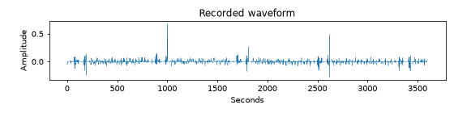

# Device stress harness report

Mode: **owner device run**

Commit: ab7ce364e704d2a189717699b903a54daae3d579 · Rate: 48000 Hz · Block: 256 frames
Platform: Linux · CPU: aarch64 · Device: ALSA|pulse

## Protocol and device metrics

| Metric | Value |
|---|---:|
| Acknowledged commands | 114332 |
| Ack p50/p95/p99 (ms) | 0.176 / 0.254 / 0.743 |
| CPU max (%) | 26.188405990600586 |
| Dropouts (latest counter) | 0 |
| Refused replies | 0 |
| Status/telemetry pushes | 35972 / 102912 |

## Recorded signal

| RMS | Peak | DC | Clicks | Dropouts |
|---:|---:|---:|---:|---:|
| 0.033406247 | 1.0 | 1.7879e-05 | 276 | 10 |

## Per-step audio metrics

| Time (s) | Action | RMS | Peak | DC | Clicks | Dropouts |
|---:|---|---:|---:|---:|---:|---:|
| ... | Remaining per-step metrics in analysis.json | ... | ... | ... | ... | ... |
| 0.0 | load_patch | 0.00029 | 0.01013 | 0.00001 | 0 | 0 |
| 2.0001 | noteOn | 0.01205 | 0.01987 | -0.00696 | 0 | 0 |
| 2.0061 | noteOn | 0.02503 | 0.03790 | -0.00024 | 0 | 0 |
| 2.0121 | noteOn | 0.03363 | 0.05368 | 0.01622 | 0 | 0 |
| 2.0181 | noteOn | 0.06413 | 0.08902 | 0.00110 | 0 | 0 |
| 2.0241 | noteOn | 0.05360 | 0.07782 | -0.00547 | 0 | 0 |
| 2.0301 | noteOn | 0.05791 | 0.09320 | 0.00553 | 0 | 0 |
| 2.0361 | noteOn | 0.08041 | 0.12357 | 0.00723 | 0 | 0 |
| 2.0421 | noteOn | 0.07626 | 0.12350 | -0.00576 | 0 | 0 |
| 2.0481 | noteOn | 0.06004 | 0.08734 | -0.01569 | 0 | 0 |
| 2.0541 | noteOn | 0.06304 | 0.10300 | -0.00590 | 0 | 0 |
| 2.0601 | noteOn | 0.09121 | 0.13486 | 0.02490 | 0 | 0 |
| 2.0661 | noteOn | 0.10832 | 0.16135 | -0.01746 | 0 | 0 |
| 2.0721 | noteOn | 0.09247 | 0.14594 | 0.00621 | 0 | 0 |
| 2.0781 | noteOn | 0.07528 | 0.11160 | -0.00823 | 0 | 0 |
| 2.0841 | noteOn | 0.09265 | 0.15591 | 0.02038 | 0 | 0 |
| 2.0901 | noteOn | 0.05351 | 0.17130 | -0.00024 | 0 | 0 |
| 2.3501 | noteOff | 0.05654 | 0.07874 | 0.00029 | 0 | 0 |
| 2.3561 | noteOff | 0.04098 | 0.06976 | -0.00693 | 0 | 0 |
| 2.3621 | noteOff | 0.01726 | 0.03433 | 0.00199 | 0 | 0 |
| 2.3681 | noteOff | 0.03386 | 0.05716 | -0.00389 | 0 | 0 |
| 2.3741 | noteOff | 0.04058 | 0.06064 | 0.00640 | 0 | 0 |
| 2.3801 | noteOff | 0.03061 | 0.05237 | 0.00127 | 0 | 0 |
| 2.3861 | noteOff | 0.03237 | 0.05087 | 0.00139 | 0 | 0 |
| 2.3921 | noteOff | 0.03709 | 0.05582 | -0.00798 | 0 | 0 |
| 2.3981 | noteOff | 0.03489 | 0.05200 | 0.00521 | 0 | 0 |
| 2.4041 | noteOff | 0.04397 | 0.07162 | 0.00176 | 0 | 0 |
| 2.4101 | noteOff | 0.05502 | 0.08115 | -0.01049 | 0 | 0 |
| 2.4161 | noteOff | 0.04660 | 0.07681 | 0.00823 | 0 | 0 |
| 2.4221 | noteOff | 0.01839 | 0.04474 | -0.00159 | 0 | 0 |
| 2.4281 | noteOff | 0.02720 | 0.05032 | 0.00458 | 0 | 0 |
| 2.4341 | noteOff | 0.04358 | 0.06058 | -0.00058 | 0 | 0 |
| 2.4401 | noteOff | 0.02842 | 0.07974 | -0.00013 | 0 | 0 |
| 2.6501 | noteOn | 0.02659 | 0.05368 | -0.00040 | 0 | 0 |
| 2.6561 | noteOn | 0.04283 | 0.06854 | -0.00403 | 0 | 0 |
| 2.6621 | noteOn | 0.03645 | 0.05438 | -0.00125 | 0 | 0 |
| 2.6681 | noteOn | 0.04256 | 0.06473 | 0.00278 | 0 | 0 |
| 2.6741 | noteOn | 0.08059 | 0.11633 | 0.01429 | 0 | 0 |
| 2.6801 | noteOn | 0.05975 | 0.09760 | -0.00758 | 0 | 0 |
| 2.6861 | noteOn | 0.03849 | 0.06366 | -0.00834 | 0 | 0 |
| 2.6921 | noteOn | 0.06103 | 0.10617 | 0.01366 | 0 | 0 |
| 2.6981 | noteOn | 0.08274 | 0.12677 | -0.01181 | 0 | 0 |
| 2.7041 | noteOn | 0.04711 | 0.09036 | -0.00113 | 0 | 0 |
| 2.7101 | noteOn | 0.03568 | 0.05487 | 0.00339 | 0 | 0 |
| 2.7161 | noteOn | 0.04140 | 0.07339 | 0.00444 | 0 | 0 |
| 2.7221 | noteOn | 0.08604 | 0.13751 | 0.00505 | 0 | 0 |
| 2.7281 | noteOn | 0.08400 | 0.13510 | -0.00515 | 0 | 0 |
| 2.7341 | noteOn | 0.03571 | 0.07654 | -0.00532 | 0 | 0 |
| 2.7401 | noteOn | 0.05271 | 0.14807 | 0.00008 | 0 | 0 |
| 3.0001 | noteOff | 0.04244 | 0.08539 | 0.00551 | 0 | 0 |
| 3.0061 | noteOff | 0.07378 | 0.10834 | -0.00730 | 0 | 0 |
| 3.0121 | noteOff | 0.05328 | 0.09973 | -0.00132 | 0 | 0 |
| 3.0181 | noteOff | 0.01830 | 0.03870 | 0.00266 | 0 | 0 |
| 3.0241 | noteOff | 0.01223 | 0.02142 | -0.00071 | 0 | 0 |
| 3.0301 | noteOff | 0.02100 | 0.04254 | -0.00242 | 0 | 0 |
| 3.0361 | noteOff | 0.02983 | 0.04752 | 0.00166 | 0 | 0 |
| 3.0421 | noteOff | 0.01673 | 0.03821 | -0.00218 | 0 | 0 |
| 3.0481 | noteOff | 0.05869 | 0.10080 | 0.00548 | 0 | 0 |
| 3.0541 | noteOff | 0.06585 | 0.10257 | 0.00236 | 0 | 0 |
| 3.0601 | noteOff | 0.03428 | 0.07144 | -0.00492 | 0 | 0 |
| 3.0661 | noteOff | 0.00667 | 0.01337 | 0.00074 | 0 | 0 |
| 3.0721 | noteOff | 0.00832 | 0.01981 | 0.00122 | 0 | 0 |
| 3.0781 | noteOff | 0.02800 | 0.04575 | -0.00178 | 0 | 0 |
| 3.0841 | noteOff | 0.02205 | 0.04520 | 0.00023 | 0 | 0 |
| 3.0901 | noteOff | 0.02974 | 0.09625 | 0.00006 | 0 | 0 |
| 3.3001 | noteOn | 0.02871 | 0.04727 | -0.00755 | 0 | 0 |
| 3.3061 | noteOn | 0.05225 | 0.07788 | 0.01486 | 0 | 0 |
| 3.3121 | noteOn | 0.07277 | 0.10675 | -0.01970 | 0 | 0 |
| 3.3181 | noteOn | 0.08160 | 0.11783 | 0.01297 | 0 | 0 |
| 3.3241 | noteOn | 0.07210 | 0.10864 | 0.00533 | 0 | 0 |
| 3.3301 | noteOn | 0.08120 | 0.12933 | -0.01649 | 0 | 0 |
| 3.3361 | noteOn | 0.09548 | 0.13647 | -0.00247 | 0 | 0 |
| 3.3421 | noteOn | 0.08477 | 0.13467 | 0.00499 | 0 | 0 |
| 3.3481 | noteOn | 0.06928 | 0.10876 | 0.00038 | 0 | 0 |
| 3.3541 | noteOn | 0.09192 | 0.13138 | 0.01271 | 0 | 0 |
| 3.3601 | noteOn | 0.09297 | 0.13727 | -0.01042 | 0 | 0 |
| 3.3661 | noteOn | 0.06750 | 0.11380 | 0.00844 | 0 | 0 |
| 3.3721 | noteOn | 0.06241 | 0.09818 | -0.00289 | 0 | 0 |
| 3.3781 | noteOn | 0.02092 | 0.04272 | 0.00021 | 0 | 0 |
| 3.3841 | noteOn | 0.03939 | 0.07468 | -0.00426 | 0 | 0 |
| 3.3901 | noteOn | 0.05220 | 0.13898 | -0.00002 | 0 | 0 |
| 3.6501 | noteOff | 0.06009 | 0.09219 | 0.00112 | 0 | 0 |
| 3.6561 | noteOff | 0.02814 | 0.05789 | 0.00270 | 0 | 0 |
| 3.6621 | noteOff | 0.03501 | 0.05542 | 0.00107 | 0 | 0 |
| 3.6681 | noteOff | 0.02807 | 0.05722 | 0.00255 | 0 | 0 |
| 3.6741 | noteOff | 0.04418 | 0.06693 | -0.00133 | 0 | 0 |
| 3.6801 | noteOff | 0.04686 | 0.07452 | -0.00424 | 0 | 0 |
| 3.6861 | noteOff | 0.04133 | 0.07391 | 0.00177 | 0 | 0 |
| 3.6921 | noteOff | 0.02806 | 0.05261 | 0.00291 | 0 | 0 |
| 3.6981 | noteOff | 0.02837 | 0.05319 | -0.00110 | 0 | 0 |
| 3.7041 | noteOff | 0.04216 | 0.07605 | 0.00057 | 0 | 0 |
| 3.7101 | noteOff | 0.04508 | 0.07523 | 0.00070 | 0 | 0 |
| 3.716 | noteOff | 0.03918 | 0.05896 | -0.00157 | 0 | 0 |
| 3.7221 | noteOff | 0.02736 | 0.05389 | 0.00121 | 0 | 0 |
| 3.7281 | noteOff | 0.03457 | 0.05365 | 0.00008 | 0 | 0 |
| 3.7341 | noteOff | 0.02125 | 0.04321 | -0.00414 | 0 | 0 |
| 3.7401 | noteOff | 0.02182 | 0.08273 | 0.00003 | 0 | 0 |
| 4.2001 | unheld-note-off | 0.00010 | 0.00345 | -0.00000 | 0 | 0 |
| 6.0001 | setParam | 0.00000 | 0.00000 | 0.00000 | 0 | 0 |
| 6.0501 | setParam | 0.00000 | 0.00000 | 0.00000 | 0 | 0 |
| 8.0001 | setParam | 0.00000 | 0.00000 | 0.00000 | 0 | 0 |
| 8.0051 | setParam | 0.00000 | 0.00000 | 0.00000 | 0 | 0 |
| 8.0101 | setParam | 0.00000 | 0.00000 | 0.00000 | 0 | 0 |
| 8.0151 | setParam | 0.00000 | 0.00000 | 0.00000 | 0 | 0 |
| 8.0201 | setParam | 0.00000 | 0.00000 | 0.00000 | 0 | 0 |
| 8.0251 | setParam | 0.00000 | 0.00000 | 0.00000 | 0 | 0 |
| 8.0301 | setParam | 0.00000 | 0.00000 | 0.00000 | 0 | 0 |
| 8.0351 | setParam | 0.00000 | 0.00000 | 0.00000 | 0 | 0 |
| 8.0401 | setParam | 0.00000 | 0.00000 | 0.00000 | 0 | 0 |
| 8.0451 | setParam | 0.00000 | 0.00000 | 0.00000 | 0 | 0 |
| 8.0501 | setParam | 0.00000 | 0.00000 | 0.00000 | 0 | 0 |
| 12.0001 | setParam | 0.00000 | 0.00000 | 0.00000 | 0 | 0 |
| 12.0005 | setParam | 0.00000 | 0.00000 | 0.00000 | 0 | 0 |
| 12.0008 | setParam | 0.00000 | 0.00000 | 0.00000 | 0 | 0 |
| 12.0011 | setParam | 0.00000 | 0.00000 | 0.00000 | 0 | 0 |
| 12.0251 | setParam | 0.00000 | 0.00000 | 0.00000 | 0 | 0 |
| 12.0255 | setParam | 0.00000 | 0.00000 | 0.00000 | 0 | 0 |
| 12.0257 | setParam | 0.00000 | 0.00000 | 0.00000 | 0 | 0 |
| 12.026 | setParam | 0.00000 | 0.00000 | 0.00000 | 0 | 0 |
| 12.0501 | setParam | 0.00000 | 0.00000 | 0.00000 | 0 | 0 |
| 12.0504 | setParam | 0.00000 | 0.00000 | 0.00000 | 0 | 0 |
| 12.0508 | setParam | 0.00000 | 0.00000 | 0.00000 | 0 | 0 |
| 12.0511 | setParam | 0.00000 | 0.00000 | 0.00000 | 0 | 0 |
| 12.075 | setParam | 0.00000 | 0.00000 | 0.00000 | 0 | 0 |
| 12.0754 | setParam | 0.00000 | 0.00000 | 0.00000 | 0 | 0 |
| 12.0757 | setParam | 0.00000 | 0.00000 | 0.00000 | 0 | 0 |
| 12.0759 | setParam | 0.00000 | 0.00000 | 0.00000 | 0 | 0 |
| 12.1001 | setParam | 0.00000 | 0.00000 | 0.00000 | 0 | 0 |
| 12.1004 | setParam | 0.00000 | 0.00000 | 0.00000 | 0 | 0 |
| 12.1007 | setParam | 0.00000 | 0.00000 | 0.00000 | 0 | 0 |
| 12.101 | setParam | 0.00000 | 0.00000 | 0.00000 | 0 | 0 |
| 12.1251 | setParam | 0.00000 | 0.00000 | 0.00000 | 0 | 0 |
| 12.1254 | setParam | 0.00000 | 0.00000 | 0.00000 | 0 | 0 |
| 12.1257 | setParam | 0.00000 | 0.00000 | 0.00000 | 0 | 0 |
| 12.126 | setParam | 0.00000 | 0.00000 | 0.00000 | 0 | 0 |
| 12.1501 | setParam | 0.00000 | 0.00000 | 0.00000 | 0 | 0 |
| 12.1504 | setParam | 0.00000 | 0.00000 | 0.00000 | 0 | 0 |
| 12.1507 | setParam | 0.00000 | 0.00000 | 0.00000 | 0 | 0 |
| 12.1512 | setParam | 0.00000 | 0.00000 | 0.00000 | 0 | 0 |
| 12.1751 | setParam | 0.00000 | 0.00000 | 0.00000 | 0 | 0 |
| 12.1754 | setParam | 0.00000 | 0.00000 | 0.00000 | 0 | 0 |
| 12.1757 | setParam | 0.00000 | 0.00000 | 0.00000 | 0 | 0 |
| 12.1759 | setParam | 0.00000 | 0.00000 | 0.00000 | 0 | 0 |
| 12.2001 | setParam | 0.00000 | 0.00000 | 0.00000 | 0 | 0 |
| 12.2004 | setParam | 0.00000 | 0.00000 | 0.00000 | 0 | 0 |
| 12.2007 | setParam | 0.00000 | 0.00000 | 0.00000 | 0 | 0 |
| 12.2009 | setParam | 0.00000 | 0.00000 | 0.00000 | 0 | 0 |
| 12.2251 | setParam | 0.00000 | 0.00000 | 0.00000 | 0 | 0 |
| 12.2254 | setParam | 0.00000 | 0.00000 | 0.00000 | 0 | 0 |
| 12.2257 | setParam | 0.00000 | 0.00000 | 0.00000 | 0 | 0 |
| 12.2259 | setParam | 0.00000 | 0.00000 | 0.00000 | 0 | 0 |
| 12.2501 | setParam | 0.00000 | 0.00000 | 0.00000 | 0 | 0 |
| 12.2504 | setParam | 0.00000 | 0.00000 | 0.00000 | 0 | 0 |
| 12.2506 | setParam | 0.00000 | 0.00000 | 0.00000 | 0 | 0 |
| 12.2509 | setParam | 0.00000 | 0.00000 | 0.00000 | 0 | 0 |
| 12.2751 | setParam | 0.00000 | 0.00000 | 0.00000 | 0 | 0 |
| 12.2754 | setParam | 0.00000 | 0.00000 | 0.00000 | 0 | 0 |
| 12.2757 | setParam | 0.00000 | 0.00000 | 0.00000 | 0 | 0 |
| 12.2759 | setParam | 0.00000 | 0.00000 | 0.00000 | 0 | 0 |
| 12.3001 | setParam | 0.00000 | 0.00000 | 0.00000 | 0 | 0 |
| 12.3004 | setParam | 0.00000 | 0.00000 | 0.00000 | 0 | 0 |
| 12.3007 | setParam | 0.00000 | 0.00000 | 0.00000 | 0 | 0 |
| 12.3009 | setParam | 0.00000 | 0.00000 | 0.00000 | 0 | 0 |
| 12.3251 | setParam | 0.00000 | 0.00000 | 0.00000 | 0 | 0 |
| 12.3255 | setParam | 0.00000 | 0.00000 | 0.00000 | 0 | 0 |
| 12.326 | setParam | 0.00000 | 0.00000 | 0.00000 | 0 | 0 |
| 12.3263 | setParam | 0.00000 | 0.00000 | 0.00000 | 0 | 0 |
| 12.3501 | setParam | 0.00000 | 0.00000 | 0.00000 | 0 | 0 |
| 12.3504 | setParam | 0.00000 | 0.00000 | 0.00000 | 0 | 0 |
| 12.3507 | setParam | 0.00000 | 0.00000 | 0.00000 | 0 | 0 |
| 12.3509 | setParam | 0.00000 | 0.00000 | 0.00000 | 0 | 0 |
| 12.3751 | setParam | 0.00000 | 0.00000 | 0.00000 | 0 | 0 |
| 12.3754 | setParam | 0.00000 | 0.00000 | 0.00000 | 0 | 0 |
| 12.3757 | setParam | 0.00000 | 0.00000 | 0.00000 | 0 | 0 |
| 12.3761 | setParam | 0.00000 | 0.00000 | 0.00000 | 0 | 0 |
| 12.4001 | setParam | 0.00000 | 0.00000 | 0.00000 | 0 | 0 |
| 12.4004 | setParam | 0.00000 | 0.00000 | 0.00000 | 0 | 0 |
| 12.4007 | setParam | 0.00000 | 0.00000 | 0.00000 | 0 | 0 |
| 12.401 | setParam | 0.00000 | 0.00000 | 0.00000 | 0 | 0 |
| 12.4251 | setParam | 0.00000 | 0.00000 | 0.00000 | 0 | 0 |
| 12.4254 | setParam | 0.00000 | 0.00000 | 0.00000 | 0 | 0 |
| 12.4257 | setParam | 0.00000 | 0.00000 | 0.00000 | 0 | 0 |
| 12.4259 | setParam | 0.00000 | 0.00000 | 0.00000 | 0 | 0 |
| 12.4501 | setParam | 0.00000 | 0.00000 | 0.00000 | 0 | 0 |
| 12.4504 | setParam | 0.00000 | 0.00000 | 0.00000 | 0 | 0 |
| 12.4507 | setParam | 0.00000 | 0.00000 | 0.00000 | 0 | 0 |
| 12.451 | setParam | 0.00000 | 0.00000 | 0.00000 | 0 | 0 |
| 12.4751 | setParam | 0.00000 | 0.00000 | 0.00000 | 0 | 0 |
| 12.4754 | setParam | 0.00000 | 0.00000 | 0.00000 | 0 | 0 |
| 12.4756 | setParam | 0.00000 | 0.00000 | 0.00000 | 0 | 0 |
| 12.4759 | setParam | 0.00000 | 0.00000 | 0.00000 | 0 | 0 |
| 12.5 | setParam | 0.00000 | 0.00000 | 0.00000 | 0 | 0 |
| 12.5004 | setParam | 0.00000 | 0.00000 | 0.00000 | 0 | 0 |
| 12.5013 | setParam | 0.00000 | 0.00000 | 0.00000 | 0 | 0 |
| 12.5019 | setParam | 0.00000 | 0.00000 | 0.00000 | 0 | 0 |
| 12.5251 | setParam | 0.00000 | 0.00000 | 0.00000 | 0 | 0 |
| 12.5254 | setParam | 0.00000 | 0.00000 | 0.00000 | 0 | 0 |
| 12.5258 | setParam | 0.00000 | 0.00000 | 0.00000 | 0 | 0 |
| 12.5261 | setParam | 0.00000 | 0.00000 | 0.00000 | 0 | 0 |
| 12.5501 | setParam | 0.00000 | 0.00000 | 0.00000 | 0 | 0 |
| 12.5504 | setParam | 0.00000 | 0.00000 | 0.00000 | 0 | 0 |
| 12.5507 | setParam | 0.00000 | 0.00000 | 0.00000 | 0 | 0 |
| 12.551 | setParam | 0.00000 | 0.00000 | 0.00000 | 0 | 0 |
| 12.5751 | setParam | 0.00000 | 0.00000 | 0.00000 | 0 | 0 |
| 12.5754 | setParam | 0.00000 | 0.00000 | 0.00000 | 0 | 0 |
| 12.5757 | setParam | 0.00000 | 0.00000 | 0.00000 | 0 | 0 |
| 12.576 | setParam | 0.00000 | 0.00000 | 0.00000 | 0 | 0 |
| 12.6001 | setParam | 0.00000 | 0.00000 | 0.00000 | 0 | 0 |
| 12.6006 | setParam | 0.00000 | 0.00000 | 0.00000 | 0 | 0 |
| 12.6016 | setParam | 0.00000 | 0.00000 | 0.00000 | 0 | 0 |
| 12.6019 | setParam | 0.00000 | 0.00000 | 0.00000 | 0 | 0 |
| 12.6251 | setParam | 0.00000 | 0.00000 | 0.00000 | 0 | 0 |
| 12.6254 | setParam | 0.00000 | 0.00000 | 0.00000 | 0 | 0 |
| 12.6257 | setParam | 0.00000 | 0.00000 | 0.00000 | 0 | 0 |
| 12.626 | setParam | 0.00000 | 0.00000 | 0.00000 | 0 | 0 |
| 12.6501 | setParam | 0.00000 | 0.00000 | 0.00000 | 0 | 0 |
| 12.6504 | setParam | 0.00000 | 0.00000 | 0.00000 | 0 | 0 |
| 12.6507 | setParam | 0.00000 | 0.00000 | 0.00000 | 0 | 0 |
| 12.6509 | setParam | 0.00000 | 0.00000 | 0.00000 | 0 | 0 |
| 12.6751 | setParam | 0.00000 | 0.00000 | 0.00000 | 0 | 0 |
| 12.6755 | setParam | 0.00000 | 0.00000 | 0.00000 | 0 | 0 |
| 12.676 | setParam | 0.00000 | 0.00000 | 0.00000 | 0 | 0 |
| 12.6763 | setParam | 0.00000 | 0.00000 | 0.00000 | 0 | 0 |
| 12.7001 | setParam | 0.00000 | 0.00000 | 0.00000 | 0 | 0 |
| 12.7005 | setParam | 0.00000 | 0.00000 | 0.00000 | 0 | 0 |
| 12.7015 | setParam | 0.00000 | 0.00000 | 0.00000 | 0 | 0 |
| 12.7018 | setParam | 0.00000 | 0.00000 | 0.00000 | 0 | 0 |
| 12.7251 | setParam | 0.00000 | 0.00000 | 0.00000 | 0 | 0 |
| 12.7254 | setParam | 0.00000 | 0.00000 | 0.00000 | 0 | 0 |
| 12.7257 | setParam | 0.00000 | 0.00000 | 0.00000 | 0 | 0 |
| 12.7259 | setParam | 0.00000 | 0.00000 | 0.00000 | 0 | 0 |
| 12.7501 | setParam | 0.00000 | 0.00000 | 0.00000 | 0 | 0 |
| 12.7504 | setParam | 0.00000 | 0.00000 | 0.00000 | 0 | 0 |
| 12.7507 | setParam | 0.00000 | 0.00000 | 0.00000 | 0 | 0 |
| 12.7509 | setParam | 0.00000 | 0.00000 | 0.00000 | 0 | 0 |
| 12.7751 | setParam | 0.00000 | 0.00000 | 0.00000 | 0 | 0 |
| 12.7754 | setParam | 0.00000 | 0.00000 | 0.00000 | 0 | 0 |
| 12.7757 | setParam | 0.00000 | 0.00000 | 0.00000 | 0 | 0 |
| 12.776 | setParam | 0.00000 | 0.00000 | 0.00000 | 0 | 0 |
| 12.8001 | setParam | 0.00000 | 0.00000 | 0.00000 | 0 | 0 |
| 12.8005 | setParam | 0.00000 | 0.00000 | 0.00000 | 0 | 0 |
| 12.8014 | setParam | 0.00000 | 0.00000 | 0.00000 | 0 | 0 |
| 12.8017 | setParam | 0.00000 | 0.00000 | 0.00000 | 0 | 0 |
| 12.8251 | setParam | 0.00000 | 0.00000 | 0.00000 | 0 | 0 |
| 12.8254 | setParam | 0.00000 | 0.00000 | 0.00000 | 0 | 0 |
| 12.8257 | setParam | 0.00000 | 0.00000 | 0.00000 | 0 | 0 |
| 12.8259 | setParam | 0.00000 | 0.00000 | 0.00000 | 0 | 0 |
| 12.8501 | setParam | 0.00000 | 0.00000 | 0.00000 | 0 | 0 |
| 12.8504 | setParam | 0.00000 | 0.00000 | 0.00000 | 0 | 0 |
| 12.8507 | setParam | 0.00000 | 0.00000 | 0.00000 | 0 | 0 |
| 12.851 | setParam | 0.00000 | 0.00000 | 0.00000 | 0 | 0 |
| 12.8751 | setParam | 0.00000 | 0.00000 | 0.00000 | 0 | 0 |
| 12.8754 | setParam | 0.00000 | 0.00000 | 0.00000 | 0 | 0 |
| 12.8757 | setParam | 0.00000 | 0.00000 | 0.00000 | 0 | 0 |
| 12.8759 | setParam | 0.00000 | 0.00000 | 0.00000 | 0 | 0 |
| 12.9001 | setParam | 0.00000 | 0.00000 | 0.00000 | 0 | 0 |
| 12.9004 | setParam | 0.00000 | 0.00000 | 0.00000 | 0 | 0 |
| 12.9007 | setParam | 0.00000 | 0.00000 | 0.00000 | 0 | 0 |
| 12.9016 | setParam | 0.00000 | 0.00000 | 0.00000 | 0 | 0 |
| 12.9251 | setParam | 0.00000 | 0.00000 | 0.00000 | 0 | 0 |
| 12.9254 | setParam | 0.00000 | 0.00000 | 0.00000 | 0 | 0 |
| 12.9257 | setParam | 0.00000 | 0.00000 | 0.00000 | 0 | 0 |
| 12.9259 | setParam | 0.00000 | 0.00000 | 0.00000 | 0 | 0 |
| 12.9501 | setParam | 0.00000 | 0.00000 | 0.00000 | 0 | 0 |
| 12.9504 | setParam | 0.00000 | 0.00000 | 0.00000 | 0 | 0 |
| 12.9506 | setParam | 0.00000 | 0.00000 | 0.00000 | 0 | 0 |
| 12.9509 | setParam | 0.00000 | 0.00000 | 0.00000 | 0 | 0 |
| 12.9751 | setParam | 0.00000 | 0.00000 | 0.00000 | 0 | 0 |
| 12.9754 | setParam | 0.00000 | 0.00000 | 0.00000 | 0 | 0 |
| 12.9757 | setParam | 0.00000 | 0.00000 | 0.00000 | 0 | 0 |
| 12.9759 | setParam | 0.00000 | 0.00000 | 0.00000 | 0 | 0 |
| 13.0001 | setParam | 0.00000 | 0.00000 | 0.00000 | 0 | 0 |
| 13.0004 | setParam | 0.00000 | 0.00000 | 0.00000 | 0 | 0 |
| 13.0007 | setParam | 0.00000 | 0.00000 | 0.00000 | 0 | 0 |
| 13.001 | setParam | 0.00000 | 0.00000 | 0.00000 | 0 | 0 |
| 13.0251 | setParam | 0.00000 | 0.00000 | 0.00000 | 0 | 0 |
| 13.0254 | setParam | 0.00000 | 0.00000 | 0.00000 | 0 | 0 |
| 13.0261 | setParam | 0.00000 | 0.00000 | 0.00000 | 0 | 0 |
| 13.0264 | setParam | 0.00000 | 0.00000 | 0.00000 | 0 | 0 |
| 13.0501 | setParam | 0.00000 | 0.00000 | 0.00000 | 0 | 0 |
| 13.0504 | setParam | 0.00000 | 0.00000 | 0.00000 | 0 | 0 |
| 13.0507 | setParam | 0.00000 | 0.00000 | 0.00000 | 0 | 0 |
| 13.0509 | setParam | 0.00000 | 0.00000 | 0.00000 | 0 | 0 |
| 13.0751 | setParam | 0.00000 | 0.00000 | 0.00000 | 0 | 0 |
| 13.0754 | setParam | 0.00000 | 0.00000 | 0.00000 | 0 | 0 |
| 13.0757 | setParam | 0.00000 | 0.00000 | 0.00000 | 0 | 0 |
| 13.0759 | setParam | 0.00000 | 0.00000 | 0.00000 | 0 | 0 |
| 13.1001 | setParam | 0.00000 | 0.00000 | 0.00000 | 0 | 0 |
| 13.1004 | setParam | 0.00000 | 0.00000 | 0.00000 | 0 | 0 |
| 13.1006 | setParam | 0.00000 | 0.00000 | 0.00000 | 0 | 0 |
| 13.1009 | setParam | 0.00000 | 0.00000 | 0.00000 | 0 | 0 |
| 13.1251 | setParam | 0.00000 | 0.00000 | 0.00000 | 0 | 0 |
| 13.1254 | setParam | 0.00000 | 0.00000 | 0.00000 | 0 | 0 |
| 13.1257 | setParam | 0.00000 | 0.00000 | 0.00000 | 0 | 0 |
| 13.126 | setParam | 0.00000 | 0.00000 | 0.00000 | 0 | 0 |
| 13.1501 | setParam | 0.00000 | 0.00000 | 0.00000 | 0 | 0 |
| 13.1504 | setParam | 0.00000 | 0.00000 | 0.00000 | 0 | 0 |
| 13.1506 | setParam | 0.00000 | 0.00000 | 0.00000 | 0 | 0 |
| 13.1509 | setParam | 0.00000 | 0.00000 | 0.00000 | 0 | 0 |
| 13.1751 | setParam | 0.00000 | 0.00000 | 0.00000 | 0 | 0 |
| 13.1754 | setParam | 0.00000 | 0.00000 | 0.00000 | 0 | 0 |
| 13.1757 | setParam | 0.00000 | 0.00000 | 0.00000 | 0 | 0 |
| 13.176 | setParam | 0.00000 | 0.00000 | 0.00000 | 0 | 0 |
| 13.2001 | setParam | 0.00000 | 0.00000 | 0.00000 | 0 | 0 |
| 13.2004 | setParam | 0.00000 | 0.00000 | 0.00000 | 0 | 0 |
| 13.201 | setParam | 0.00000 | 0.00000 | 0.00000 | 0 | 0 |
| 13.2012 | setParam | 0.00000 | 0.00000 | 0.00000 | 0 | 0 |
| 13.2251 | setParam | 0.00000 | 0.00000 | 0.00000 | 0 | 0 |
| 13.2254 | setParam | 0.00000 | 0.00000 | 0.00000 | 0 | 0 |
| 13.2257 | setParam | 0.00000 | 0.00000 | 0.00000 | 0 | 0 |
| 13.2259 | setParam | 0.00000 | 0.00000 | 0.00000 | 0 | 0 |
| 13.2501 | setParam | 0.00000 | 0.00000 | 0.00000 | 0 | 0 |
| 13.2504 | setParam | 0.00000 | 0.00000 | 0.00000 | 0 | 0 |
| 13.2507 | setParam | 0.00000 | 0.00000 | 0.00000 | 0 | 0 |
| 13.251 | setParam | 0.00000 | 0.00000 | 0.00000 | 0 | 0 |
| 13.2751 | setParam | 0.00000 | 0.00000 | 0.00000 | 0 | 0 |
| 13.2754 | setParam | 0.00000 | 0.00000 | 0.00000 | 0 | 0 |
| 13.2756 | setParam | 0.00000 | 0.00000 | 0.00000 | 0 | 0 |
| 13.2759 | setParam | 0.00000 | 0.00000 | 0.00000 | 0 | 0 |
| 13.3001 | setParam | 0.00000 | 0.00000 | 0.00000 | 0 | 0 |
| 13.3004 | setParam | 0.00000 | 0.00000 | 0.00000 | 0 | 0 |
| 13.3007 | setParam | 0.00000 | 0.00000 | 0.00000 | 0 | 0 |
| 13.3009 | setParam | 0.00000 | 0.00000 | 0.00000 | 0 | 0 |
| 13.325 | setParam | 0.00000 | 0.00000 | 0.00000 | 0 | 0 |
| 13.3254 | setParam | 0.00000 | 0.00000 | 0.00000 | 0 | 0 |
| 13.3257 | setParam | 0.00000 | 0.00000 | 0.00000 | 0 | 0 |
| 13.326 | setParam | 0.00000 | 0.00000 | 0.00000 | 0 | 0 |
| 13.3501 | setParam | 0.00000 | 0.00000 | 0.00000 | 0 | 0 |
| 13.3504 | setParam | 0.00000 | 0.00000 | 0.00000 | 0 | 0 |
| 13.3507 | setParam | 0.00000 | 0.00000 | 0.00000 | 0 | 0 |
| 13.351 | setParam | 0.00000 | 0.00000 | 0.00000 | 0 | 0 |
| 13.3751 | setParam | 0.00000 | 0.00000 | 0.00000 | 0 | 0 |
| 13.3754 | setParam | 0.00000 | 0.00000 | 0.00000 | 0 | 0 |
| 13.3757 | setParam | 0.00000 | 0.00000 | 0.00000 | 0 | 0 |
| 13.3763 | setParam | 0.00000 | 0.00000 | 0.00000 | 0 | 0 |
| 13.4001 | setParam | 0.00000 | 0.00000 | 0.00000 | 0 | 0 |
| 13.4004 | setParam | 0.00000 | 0.00000 | 0.00000 | 0 | 0 |
| 13.4007 | setParam | 0.00000 | 0.00000 | 0.00000 | 0 | 0 |
| 13.401 | setParam | 0.00000 | 0.00000 | 0.00000 | 0 | 0 |
| 13.4251 | setParam | 0.00000 | 0.00000 | 0.00000 | 0 | 0 |
| 13.4254 | setParam | 0.00000 | 0.00000 | 0.00000 | 0 | 0 |
| 13.4257 | setParam | 0.00000 | 0.00000 | 0.00000 | 0 | 0 |
| 13.4259 | setParam | 0.00000 | 0.00000 | 0.00000 | 0 | 0 |
| 13.4501 | setParam | 0.00000 | 0.00000 | 0.00000 | 0 | 0 |
| 13.4504 | setParam | 0.00000 | 0.00000 | 0.00000 | 0 | 0 |
| 13.4507 | setParam | 0.00000 | 0.00000 | 0.00000 | 0 | 0 |
| 13.4509 | setParam | 0.00000 | 0.00000 | 0.00000 | 0 | 0 |
| 13.4751 | setParam | 0.00000 | 0.00000 | 0.00000 | 0 | 0 |
| 13.4754 | setParam | 0.00000 | 0.00000 | 0.00000 | 0 | 0 |
| 13.4757 | setParam | 0.00000 | 0.00000 | 0.00000 | 0 | 0 |
| 13.4759 | setParam | 0.00000 | 0.00000 | 0.00000 | 0 | 0 |
| 13.5001 | setParam | 0.00000 | 0.00000 | 0.00000 | 0 | 0 |
| 13.5004 | setParam | 0.00000 | 0.00000 | 0.00000 | 0 | 0 |
| 13.5007 | setParam | 0.00000 | 0.00000 | 0.00000 | 0 | 0 |
| 13.5009 | setParam | 0.00000 | 0.00000 | 0.00000 | 0 | 0 |
| 13.5251 | setParam | 0.00000 | 0.00000 | 0.00000 | 0 | 0 |
| 13.5254 | setParam | 0.00000 | 0.00000 | 0.00000 | 0 | 0 |
| 13.5257 | setParam | 0.00000 | 0.00000 | 0.00000 | 0 | 0 |
| 13.526 | setParam | 0.00000 | 0.00000 | 0.00000 | 0 | 0 |
| 13.5501 | setParam | 0.00000 | 0.00000 | 0.00000 | 0 | 0 |
| 13.5504 | setParam | 0.00000 | 0.00000 | 0.00000 | 0 | 0 |
| 13.5507 | setParam | 0.00000 | 0.00000 | 0.00000 | 0 | 0 |
| 13.5513 | setParam | 0.00000 | 0.00000 | 0.00000 | 0 | 0 |
| 13.5751 | setParam | 0.00000 | 0.00000 | 0.00000 | 0 | 0 |
| 13.5754 | setParam | 0.00000 | 0.00000 | 0.00000 | 0 | 0 |
| 13.5757 | setParam | 0.00000 | 0.00000 | 0.00000 | 0 | 0 |
| 13.5761 | setParam | 0.00000 | 0.00000 | 0.00000 | 0 | 0 |
| 13.6001 | setParam | 0.00000 | 0.00000 | 0.00000 | 0 | 0 |
| 13.6004 | setParam | 0.00000 | 0.00000 | 0.00000 | 0 | 0 |
| 13.6007 | setParam | 0.00000 | 0.00000 | 0.00000 | 0 | 0 |
| 13.601 | setParam | 0.00000 | 0.00000 | 0.00000 | 0 | 0 |
| 13.6251 | setParam | 0.00000 | 0.00000 | 0.00000 | 0 | 0 |
| 13.6254 | setParam | 0.00000 | 0.00000 | 0.00000 | 0 | 0 |
| 13.6257 | setParam | 0.00000 | 0.00000 | 0.00000 | 0 | 0 |
| 13.626 | setParam | 0.00000 | 0.00000 | 0.00000 | 0 | 0 |
| 13.6501 | setParam | 0.00000 | 0.00000 | 0.00000 | 0 | 0 |
| 13.6504 | setParam | 0.00000 | 0.00000 | 0.00000 | 0 | 0 |
| 13.6508 | setParam | 0.00000 | 0.00000 | 0.00000 | 0 | 0 |
| 13.6511 | setParam | 0.00000 | 0.00000 | 0.00000 | 0 | 0 |
| 13.6751 | setParam | 0.00000 | 0.00000 | 0.00000 | 0 | 0 |
| 13.6754 | setParam | 0.00000 | 0.00000 | 0.00000 | 0 | 0 |
| 13.6757 | setParam | 0.00000 | 0.00000 | 0.00000 | 0 | 0 |
| 13.676 | setParam | 0.00000 | 0.00000 | 0.00000 | 0 | 0 |
| 13.7001 | setParam | 0.00000 | 0.00000 | 0.00000 | 0 | 0 |
| 13.7005 | setParam | 0.00000 | 0.00000 | 0.00000 | 0 | 0 |
| 13.7007 | setParam | 0.00000 | 0.00000 | 0.00000 | 0 | 0 |
| 13.701 | setParam | 0.00000 | 0.00000 | 0.00000 | 0 | 0 |
| 13.7251 | setParam | 0.00000 | 0.00000 | 0.00000 | 0 | 0 |
| 13.7254 | setParam | 0.00000 | 0.00000 | 0.00000 | 0 | 0 |
| 13.7257 | setParam | 0.00000 | 0.00000 | 0.00000 | 0 | 0 |
| 13.7263 | setParam | 0.00000 | 0.00000 | 0.00000 | 0 | 0 |
| 13.7501 | setParam | 0.00000 | 0.00000 | 0.00000 | 0 | 0 |
| 13.7504 | setParam | 0.00000 | 0.00000 | 0.00000 | 0 | 0 |
| 13.7507 | setParam | 0.00000 | 0.00000 | 0.00000 | 0 | 0 |
| 13.7509 | setParam | 0.00000 | 0.00000 | 0.00000 | 0 | 0 |
| 13.7751 | setParam | 0.00000 | 0.00000 | 0.00000 | 0 | 0 |
| 13.7754 | setParam | 0.00000 | 0.00000 | 0.00000 | 0 | 0 |
| 13.7756 | setParam | 0.00000 | 0.00000 | 0.00000 | 0 | 0 |
| 13.7759 | setParam | 0.00000 | 0.00000 | 0.00000 | 0 | 0 |
| 13.8001 | setParam | 0.00000 | 0.00000 | 0.00000 | 0 | 0 |
| 13.8005 | setParam | 0.00000 | 0.00000 | 0.00000 | 0 | 0 |
| 13.8007 | setParam | 0.00000 | 0.00000 | 0.00000 | 0 | 0 |
| 13.801 | setParam | 0.00000 | 0.00000 | 0.00000 | 0 | 0 |
| 13.8251 | setParam | 0.00000 | 0.00000 | 0.00000 | 0 | 0 |
| 13.8255 | setParam | 0.00000 | 0.00000 | 0.00000 | 0 | 0 |
| 13.8258 | setParam | 0.00000 | 0.00000 | 0.00000 | 0 | 0 |
| 13.8261 | setParam | 0.00000 | 0.00000 | 0.00000 | 0 | 0 |
| 13.8501 | setParam | 0.00000 | 0.00000 | 0.00000 | 0 | 0 |
| 13.8504 | setParam | 0.00000 | 0.00000 | 0.00000 | 0 | 0 |
| 13.8507 | setParam | 0.00000 | 0.00000 | 0.00000 | 0 | 0 |
| 13.851 | setParam | 0.00000 | 0.00000 | 0.00000 | 0 | 0 |
| 13.8751 | setParam | 0.00000 | 0.00000 | 0.00000 | 0 | 0 |
| 13.8754 | setParam | 0.00000 | 0.00000 | 0.00000 | 0 | 0 |
| 13.8757 | setParam | 0.00000 | 0.00000 | 0.00000 | 0 | 0 |
| 13.876 | setParam | 0.00000 | 0.00000 | 0.00000 | 0 | 0 |
| 13.9001 | setParam | 0.00000 | 0.00000 | 0.00000 | 0 | 0 |
| 13.9004 | setParam | 0.00000 | 0.00000 | 0.00000 | 0 | 0 |
| 13.9007 | setParam | 0.00000 | 0.00000 | 0.00000 | 0 | 0 |
| 13.9012 | setParam | 0.00000 | 0.00000 | 0.00000 | 0 | 0 |
| 13.9251 | setParam | 0.00000 | 0.00000 | 0.00000 | 0 | 0 |
| 13.9254 | setParam | 0.00000 | 0.00000 | 0.00000 | 0 | 0 |
| 13.9256 | setParam | 0.00000 | 0.00000 | 0.00000 | 0 | 0 |
| 13.9259 | setParam | 0.00000 | 0.00000 | 0.00000 | 0 | 0 |
| 13.9501 | setParam | 0.00000 | 0.00000 | 0.00000 | 0 | 0 |
| 13.9504 | setParam | 0.00000 | 0.00000 | 0.00000 | 0 | 0 |
| 13.9506 | setParam | 0.00000 | 0.00000 | 0.00000 | 0 | 0 |
| 13.9509 | setParam | 0.00000 | 0.00000 | 0.00000 | 0 | 0 |
| 13.9751 | setParam | 0.00000 | 0.00000 | 0.00000 | 0 | 0 |
| 13.9754 | setParam | 0.00000 | 0.00000 | 0.00000 | 0 | 0 |
| 13.9756 | setParam | 0.00000 | 0.00000 | 0.00000 | 0 | 0 |
| 13.9759 | setParam | 0.00000 | 0.00000 | 0.00000 | 0 | 0 |
| 16.0001 | disconnect | 0.00000 | 0.00000 | 0.00000 | 0 | 0 |
| 16.1601 | connect | 0.00000 | 0.00000 | 0.00000 | 0 | 0 |
| 20.0001 | addModule | 0.00000 | 0.00000 | 0.00000 | 0 | 0 |
| 20.2501 | removeModule | 0.00000 | 0.00000 | 0.00000 | 0 | 0 |
| 24.0001 | setBufferFrames | 0.00000 | 0.00000 | 0.00000 | 0 | 0 |
| 27.0001 | panic | 0.00003 | 0.00101 | 0.00000 | 0 | 0 |
| 29.0001 | noteOn | 0.00056 | 0.00143 | -0.00000 | 0 | 0 |
| 29.0061 | noteOn | 0.00077 | 0.00180 | 0.00000 | 0 | 0 |
| 29.0121 | noteOn | 0.00092 | 0.00198 | 0.00000 | 0 | 0 |
| 29.0181 | noteOn | 0.00112 | 0.00320 | 0.00000 | 0 | 0 |
| 29.0241 | noteOn | 0.00129 | 0.00317 | -0.00001 | 0 | 0 |
| 29.0301 | noteOn | 0.00154 | 0.00391 | 0.00000 | 0 | 0 |
| 29.0361 | noteOn | 0.00173 | 0.00433 | 0.00000 | 0 | 0 |
| 29.0421 | noteOn | 0.00185 | 0.00446 | 0.00000 | 0 | 0 |
| 29.0481 | noteOn | 0.00209 | 0.00555 | 0.00000 | 0 | 0 |
| 29.0541 | noteOn | 0.00270 | 0.00534 | -0.00001 | 0 | 0 |
| 29.0601 | noteOn | 0.00227 | 0.00616 | 0.00000 | 0 | 0 |
| 29.0661 | noteOn | 0.00269 | 0.00409 | -0.00000 | 0 | 0 |
| 29.0721 | noteOn | 0.00307 | 0.00439 | 0.00000 | 0 | 0 |
| 29.0781 | noteOn | 0.00325 | 0.00467 | 0.00000 | 0 | 0 |
| 29.0841 | noteOn | 0.00337 | 0.00494 | 0.00000 | 0 | 0 |
| 29.0901 | noteOn | 0.01065 | 0.02322 | 0.00000 | 0 | 0 |
| 29.4801 | noteOff | 0.01654 | 0.02353 | 0.00002 | 0 | 0 |
| 29.4861 | noteOff | 0.01642 | 0.02377 | 0.00000 | 0 | 0 |
| 29.4921 | noteOff | 0.01688 | 0.02405 | -0.00002 | 0 | 0 |
| 29.4981 | noteOff | 0.01745 | 0.02435 | -0.00003 | 0 | 0 |
| 29.5041 | noteOff | 0.01743 | 0.02463 | 0.00005 | 0 | 0 |
| 29.5101 | noteOff | 0.01720 | 0.02487 | -0.00008 | 0 | 0 |
| 29.5161 | noteOff | 0.01760 | 0.02518 | 0.00002 | 0 | 0 |
| 29.5221 | noteOff | 0.01823 | 0.02548 | 0.00003 | 0 | 0 |
| 29.5281 | noteOff | 0.01828 | 0.02570 | 0.00003 | 0 | 0 |
| 29.5341 | noteOff | 0.01790 | 0.02573 | 0.00001 | 0 | 0 |
| 29.5401 | noteOff | 0.01802 | 0.02582 | -0.00001 | 0 | 0 |
| 29.5461 | noteOff | 0.01854 | 0.02585 | -0.00003 | 0 | 0 |
| 29.5521 | noteOff | 0.01851 | 0.02585 | -0.00003 | 0 | 0 |
| 29.5581 | noteOff | 0.01803 | 0.02585 | -0.00001 | 0 | 0 |
| 29.5641 | noteOff | 0.01799 | 0.02582 | 0.00001 | 0 | 0 |
| 29.5701 | noteOff | 0.01816 | 0.02582 | 0.00000 | 0 | 0 |
| 29.8001 | unheld-note-off | 0.01584 | 0.02554 | 0.00000 | 0 | 0 |
| 35.0001 | load_patch | 0.00002 | 0.00046 | 0.00000 | 0 | 0 |
| 37.0001 | noteOn | 0.00039 | 0.00070 | -0.00024 | 0 | 0 |
| 37.0061 | noteOn | 0.00046 | 0.00076 | 0.00033 | 0 | 0 |
| 37.0121 | noteOn | 0.00060 | 0.00107 | -0.00045 | 0 | 0 |
| 37.0181 | noteOn | 0.00058 | 0.00110 | 0.00041 | 0 | 0 |
| 37.0241 | noteOn | 0.00069 | 0.00140 | -0.00036 | 0 | 0 |
| 37.0301 | noteOn | 0.00132 | 0.00275 | 0.00031 | 0 | 0 |
| 37.0361 | noteOn | 0.00139 | 0.00281 | 0.00009 | 0 | 0 |
| 37.0421 | noteOn | 0.00168 | 0.00317 | -0.00084 | 0 | 0 |
| 37.0481 | noteOn | 0.00155 | 0.00339 | 0.00049 | 0 | 0 |
| 37.0541 | noteOn | 0.00236 | 0.00455 | 0.00070 | 0 | 0 |
| 37.0601 | noteOn | 0.00213 | 0.00449 | -0.00052 | 0 | 0 |
| 37.0661 | noteOn | 0.00231 | 0.00406 | -0.00026 | 0 | 0 |
| 37.0721 | noteOn | 0.00150 | 0.00278 | 0.00018 | 0 | 0 |
| 37.0781 | noteOn | 0.00202 | 0.00421 | -0.00028 | 0 | 0 |
| 37.0841 | noteOn | 0.00333 | 0.00537 | -0.00068 | 0 | 0 |
| 37.0901 | noteOn | 0.01720 | 0.06409 | -0.00014 | 0 | 0 |
| 37.4801 | noteOff | 0.05380 | 0.08066 | 0.00832 | 0 | 0 |
| 37.4861 | noteOff | 0.03669 | 0.07715 | 0.00636 | 0 | 0 |
| 37.4921 | noteOff | 0.00994 | 0.02014 | -0.00436 | 0 | 0 |
| 37.4981 | noteOff | 0.01336 | 0.01831 | -0.01267 | 0 | 0 |
| 37.5001 | noteOn | 0.00972 | 0.02768 | 0.00658 | 0 | 0 |
| 37.5041 | noteOff | 0.02046 | 0.02835 | 0.01899 | 0 | 0 |
| 37.5061 | noteOn | 0.01934 | 0.03217 | -0.01597 | 0 | 0 |
| 37.5101 | noteOff | 0.01494 | 0.02588 | 0.00117 | 0 | 0 |
| 37.5121 | noteOn | 0.01951 | 0.03165 | 0.01058 | 0 | 0 |
| 37.5161 | noteOff | 0.01712 | 0.02515 | -0.01626 | 0 | 0 |
| 37.5181 | noteOn | 0.01276 | 0.02347 | 0.00194 | 0 | 0 |
| 37.5221 | noteOff | 0.01606 | 0.02310 | 0.01441 | 0 | 0 |
| 37.5241 | noteOn | 0.01690 | 0.02875 | -0.01382 | 0 | 0 |

