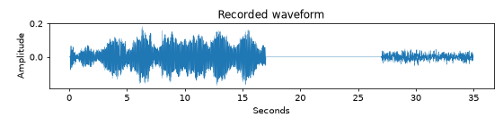

<!-- SPDX-License-Identifier: GPL-3.0-only -->

# Device stress harness report

Mode: **owner device run**

Commit: ab7ce364e704d2a189717699b903a54daae3d579 · Rate: 48000 Hz · Block: 128 frames
Platform: Linux · CPU: aarch64 · Device: ALSA|pulse

## Protocol and device metrics

| Metric | Value |
|---|---:|
| Acknowledged commands | 317 |
| Ack p50/p95/p99 (ms) | 0.206 / 0.858 / 7.602 |
| CPU max (%) | 13.022212028503418 |
| Dropouts (latest counter) | 0 |
| Refused replies | 0 |
| Status/telemetry pushes | 351 / 1003 |

## Recorded signal

| RMS | Peak | DC | Clicks | Dropouts |
|---:|---:|---:|---:|---:|
| 0.04210017 | 0.185119629 | 0.000191156 | 24 | 0 |

## Per-step audio metrics

| Time (s) | Action | RMS | Peak | DC | Clicks | Dropouts |
|---:|---|---:|---:|---:|---:|---:|
| 0.0 | load_patch | 0.04025 | 0.12808 | -0.00001 | 0 | 0 |
| 4.0001 | setModAmount | 0.06412 | 0.14313 | 0.00129 | 0 | 0 |
| 4.1001 | setModAmount | 0.06328 | 0.14825 | 0.00181 | 0 | 0 |
| 4.2001 | setModAmount | 0.05768 | 0.13211 | -0.00524 | 0 | 0 |
| 4.3001 | setModAmount | 0.06187 | 0.14835 | 0.00583 | 0 | 0 |
| 4.4001 | setModAmount | 0.05910 | 0.13095 | -0.00449 | 0 | 0 |
| 4.5001 | setModAmount | 0.05586 | 0.11700 | 0.00199 | 0 | 0 |
| 4.6001 | setModAmount | 0.05306 | 0.11029 | 0.00023 | 0 | 0 |
| 4.7001 | setModAmount | 0.04806 | 0.10153 | 0.00208 | 0 | 0 |
| 4.8001 | setModAmount | 0.04566 | 0.10413 | 0.00685 | 0 | 0 |
| 4.9001 | setModAmount | 0.04226 | 0.09204 | 0.00016 | 0 | 0 |
| 5.0001 | setModAmount | 0.06513 | 0.18512 | 0.00068 | 24 | 0 |
| 8.0001 | setParam | 0.08391 | 0.16006 | 0.00141 | 0 | 0 |
| 8.0501 | setParam | 0.06546 | 0.16415 | 0.00075 | 0 | 0 |
| 12.0001 | setParam | 0.02539 | 0.03619 | 0.00759 | 0 | 0 |
| 12.0005 | setParam | 0.03094 | 0.03629 | 0.00589 | 0 | 0 |
| 12.0008 | setParam | 0.03981 | 0.08270 | -0.00185 | 0 | 0 |
| 12.0201 | setParam | 0.04406 | 0.06635 | -0.03934 | 0 | 0 |
| 12.0204 | setParam | 0.03811 | 0.05289 | -0.03555 | 0 | 0 |
| 12.0207 | setParam | 0.03770 | 0.07819 | 0.00313 | 0 | 0 |
| 12.0401 | setParam | 0.05188 | 0.07431 | 0.03128 | 0 | 0 |
| 12.0404 | setParam | 0.05333 | 0.07587 | 0.03101 | 0 | 0 |
| 12.0407 | setParam | 0.03993 | 0.08179 | 0.00495 | 0 | 0 |
| 12.0601 | setParam | 0.01042 | 0.01450 | 0.00075 | 0 | 0 |
| 12.0604 | setParam | 0.01535 | 0.02045 | 0.00282 | 0 | 0 |
| 12.0607 | setParam | 0.04224 | 0.08545 | 0.00082 | 0 | 0 |
| 12.0801 | setParam | 0.04854 | 0.07034 | -0.02776 | 0 | 0 |
| 12.0804 | setParam | 0.05050 | 0.07153 | -0.03349 | 0 | 0 |
| 12.0807 | setParam | 0.03987 | 0.07489 | -0.00689 | 0 | 0 |
| 12.1001 | setParam | 0.03805 | 0.05679 | 0.01583 | 0 | 0 |
| 12.1004 | setParam | 0.04382 | 0.06808 | 0.02503 | 0 | 0 |
| 12.1013 | setParam | 0.04059 | 0.07593 | 0.00310 | 0 | 0 |
| 12.1201 | setParam | 0.01353 | 0.02032 | 0.01226 | 0 | 0 |
| 12.1204 | setParam | 0.01070 | 0.01370 | 0.01062 | 0 | 0 |
| 12.1206 | setParam | 0.03940 | 0.07504 | 0.00279 | 0 | 0 |
| 12.1401 | setParam | 0.05503 | 0.07452 | -0.02050 | 0 | 0 |
| 12.1404 | setParam | 0.05811 | 0.07983 | -0.02498 | 0 | 0 |
| 12.1407 | setParam | 0.04965 | 0.09027 | -0.00997 | 0 | 0 |
| 12.1601 | setParam | 0.05595 | 0.07556 | -0.05100 | 0 | 0 |
| 12.1604 | setParam | 0.05217 | 0.07379 | -0.04309 | 0 | 0 |
| 12.1608 | setParam | 0.04388 | 0.08212 | 0.00096 | 0 | 0 |
| 12.1801 | setParam | 0.04013 | 0.05750 | 0.03129 | 0 | 0 |
| 12.1804 | setParam | 0.03766 | 0.05447 | 0.03236 | 0 | 0 |
| 12.1807 | setParam | 0.04315 | 0.08850 | 0.00542 | 0 | 0 |
| 12.2001 | setParam | 0.03956 | 0.05371 | 0.01820 | 0 | 0 |
| 12.2004 | setParam | 0.04019 | 0.05264 | 0.01162 | 0 | 0 |
| 12.2007 | setParam | 0.05314 | 0.09515 | -0.00989 | 0 | 0 |
| 12.2201 | setParam | 0.07293 | 0.07874 | -0.07288 | 0 | 0 |
| 12.2204 | setParam | 0.07782 | 0.08850 | -0.07745 | 0 | 0 |
| 12.2207 | setParam | 0.05992 | 0.10361 | -0.00511 | 0 | 0 |
| 12.2401 | setParam | 0.07385 | 0.10495 | 0.05415 | 0 | 0 |
| 12.2404 | setParam | 0.07370 | 0.10489 | 0.06000 | 0 | 0 |
| 12.2413 | setParam | 0.05899 | 0.10541 | 0.00648 | 0 | 0 |
| 12.2601 | setParam | 0.03841 | 0.05457 | 0.02685 | 0 | 0 |
| 12.2604 | setParam | 0.03858 | 0.05447 | 0.02241 | 0 | 0 |
| 12.2606 | setParam | 0.05604 | 0.10425 | -0.00403 | 0 | 0 |
| 12.2801 | setParam | 0.05360 | 0.07312 | -0.04893 | 0 | 0 |
| 12.2804 | setParam | 0.05906 | 0.07465 | -0.05637 | 0 | 0 |
| 12.2806 | setParam | 0.06029 | 0.10678 | -0.01287 | 0 | 0 |
| 12.3001 | setParam | 0.04213 | 0.05167 | 0.00720 | 0 | 0 |
| 12.3004 | setParam | 0.04203 | 0.05826 | 0.01558 | 0 | 0 |
| 12.3006 | setParam | 0.05768 | 0.10300 | 0.01180 | 0 | 0 |
| 12.3201 | setParam | 0.05212 | 0.07108 | 0.04644 | 0 | 0 |
| 12.3204 | setParam | 0.05046 | 0.07043 | 0.04182 | 0 | 0 |
| 12.3206 | setParam | 0.05179 | 0.10275 | 0.00026 | 0 | 0 |
| 12.3401 | setParam | 0.04180 | 0.05856 | -0.03362 | 0 | 0 |
| 12.3404 | setParam | 0.04273 | 0.05862 | -0.03800 | 0 | 0 |
| 12.3414 | setParam | 0.05927 | 0.10272 | -0.01091 | 0 | 0 |
| 12.3601 | setParam | 0.05663 | 0.08533 | -0.03897 | 0 | 0 |
| 12.3604 | setParam | 0.05116 | 0.07422 | -0.02896 | 0 | 0 |
| 12.3606 | setParam | 0.06198 | 0.10440 | 0.01106 | 0 | 0 |
| 12.3801 | setParam | 0.08703 | 0.09860 | 0.08651 | 0 | 0 |
| 12.3804 | setParam | 0.08509 | 0.09964 | 0.08358 | 0 | 0 |
| 12.3807 | setParam | 0.06413 | 0.10742 | 0.00550 | 0 | 0 |
| 12.4001 | setParam | 0.05735 | 0.08258 | -0.03723 | 0 | 0 |
| 12.4004 | setParam | 0.06012 | 0.08640 | -0.04539 | 0 | 0 |
| 12.4007 | setParam | 0.06525 | 0.10922 | -0.01116 | 0 | 0 |
| 12.4201 | setParam | 0.06826 | 0.09283 | -0.06097 | 0 | 0 |
| 12.4204 | setParam | 0.06560 | 0.09058 | -0.05668 | 0 | 0 |
| 12.4207 | setParam | 0.06489 | 0.11411 | 0.00393 | 0 | 0 |
| 12.4401 | setParam | 0.09388 | 0.10486 | 0.09318 | 0 | 0 |
| 12.4404 | setParam | 0.09957 | 0.10526 | 0.09939 | 0 | 0 |
| 12.4407 | setParam | 0.07053 | 0.11899 | 0.01523 | 0 | 0 |
| 12.4601 | setParam | 0.04991 | 0.07349 | -0.02307 | 0 | 0 |
| 12.4604 | setParam | 0.05547 | 0.08163 | -0.03424 | 0 | 0 |
| 12.4607 | setParam | 0.07453 | 0.11942 | -0.01344 | 0 | 0 |
| 12.4801 | setParam | 0.05958 | 0.06821 | -0.05895 | 0 | 0 |
| 12.4804 | setParam | 0.05753 | 0.07080 | -0.05589 | 0 | 0 |
| 12.4807 | setParam | 0.07215 | 0.11685 | 0.00037 | 0 | 0 |
| 12.5001 | setParam | 0.08430 | 0.11606 | 0.07250 | 0 | 0 |
| 12.5004 | setParam | 0.08774 | 0.11612 | 0.07993 | 0 | 0 |
| 12.5007 | setParam | 0.08204 | 0.12814 | 0.02050 | 0 | 0 |
| 12.5201 | setParam | 0.05106 | 0.08008 | 0.03726 | 0 | 0 |
| 12.5205 | setParam | 0.03972 | 0.06015 | 0.00336 | 0 | 0 |
| 12.5213 | setParam | 0.07890 | 0.12894 | -0.01287 | 0 | 0 |
| 12.5401 | setParam | 0.09173 | 0.10150 | -0.09150 | 0 | 0 |
| 12.5404 | setParam | 0.08336 | 0.09216 | -0.08322 | 0 | 0 |
| 12.5407 | setParam | 0.07065 | 0.11545 | -0.00538 | 0 | 0 |
| 12.5601 | setParam | 0.05589 | 0.08246 | 0.03050 | 0 | 0 |
| 12.5604 | setParam | 0.06248 | 0.09286 | 0.04251 | 0 | 0 |
| 12.5607 | setParam | 0.08416 | 0.12744 | 0.02015 | 0 | 0 |
| 12.5801 | setParam | 0.08724 | 0.10654 | 0.08480 | 0 | 0 |
| 12.5804 | setParam | 0.07859 | 0.10196 | 0.07438 | 0 | 0 |
| 12.5807 | setParam | 0.08055 | 0.13388 | -0.00589 | 0 | 0 |
| 12.6001 | setParam | 0.11420 | 0.12997 | -0.11296 | 0 | 0 |
| 12.6004 | setParam | 0.11438 | 0.12848 | -0.11358 | 0 | 0 |
| 12.6007 | setParam | 0.07962 | 0.12744 | -0.01126 | 0 | 0 |
| 12.6201 | setParam | 0.03935 | 0.05237 | 0.00443 | 0 | 0 |
| 12.6204 | setParam | 0.04616 | 0.06247 | 0.01433 | 0 | 0 |
| 12.6207 | setParam | 0.08237 | 0.13019 | 0.01671 | 0 | 0 |
| 12.6401 | setParam | 0.10934 | 0.11514 | 0.10931 | 0 | 0 |
| 12.6404 | setParam | 0.10402 | 0.11023 | 0.10384 | 0 | 0 |
| 12.6407 | setParam | 0.08459 | 0.14471 | 0.00482 | 0 | 0 |
| 12.6601 | setParam | 0.10540 | 0.13898 | -0.09904 | 0 | 0 |
| 12.6605 | setParam | 0.12133 | 0.15079 | -0.11808 | 0 | 0 |
| 12.6613 | setParam | 0.09277 | 0.15585 | -0.01738 | 0 | 0 |
| 12.6801 | setParam | 0.02861 | 0.04385 | -0.02364 | 0 | 0 |
| 12.6804 | setParam | 0.02468 | 0.03589 | -0.01234 | 0 | 0 |
| 12.6807 | setParam | 0.09042 | 0.16119 | 0.01427 | 0 | 0 |
| 12.7001 | setParam | 0.10970 | 0.13269 | 0.10717 | 0 | 0 |
| 12.7004 | setParam | 0.10997 | 0.12827 | 0.10843 | 0 | 0 |
| 12.7007 | setParam | 0.08962 | 0.16327 | 0.01298 | 0 | 0 |
| 12.7201 | setParam | 0.07498 | 0.11404 | -0.05559 | 0 | 0 |
| 12.7204 | setParam | 0.08684 | 0.12772 | -0.06964 | 0 | 0 |
| 12.7207 | setParam | 0.10339 | 0.17004 | -0.02502 | 0 | 0 |
| 12.7401 | setParam | 0.07845 | 0.09650 | -0.07739 | 0 | 0 |
| 12.7404 | setParam | 0.06182 | 0.08023 | -0.06005 | 0 | 0 |
| 12.7407 | setParam | 0.09386 | 0.16895 | 0.01026 | 0 | 0 |
| 12.7601 | setParam | 0.11947 | 0.15836 | 0.10903 | 0 | 0 |
| 12.7604 | setParam | 0.12126 | 0.15765 | 0.11330 | 0 | 0 |
| 12.7607 | setParam | 0.09551 | 0.16635 | 0.01758 | 0 | 0 |
| 12.7801 | setParam | 0.04668 | 0.06747 | 0.01021 | 0 | 0 |
| 12.7804 | setParam | 0.04718 | 0.06744 | -0.01343 | 0 | 0 |
| 12.7807 | setParam | 0.10192 | 0.16901 | -0.02198 | 0 | 0 |
| 12.8001 | setParam | 0.13276 | 0.14462 | -0.13253 | 0 | 0 |
| 12.8004 | setParam | 0.11547 | 0.13095 | -0.11501 | 0 | 0 |
| 12.8012 | setParam | 0.09464 | 0.16806 | 0.00210 | 0 | 0 |
| 12.8201 | setParam | 0.11621 | 0.15182 | 0.10998 | 0 | 0 |
| 12.8204 | setParam | 0.12180 | 0.15845 | 0.11488 | 0 | 0 |
| 12.8206 | setParam | 0.10001 | 0.16232 | 0.02137 | 0 | 0 |
| 12.8401 | setParam | 0.05592 | 0.07437 | 0.05148 | 0 | 0 |
| 12.8404 | setParam | 0.04987 | 0.07047 | 0.04293 | 0 | 0 |
| 12.8407 | setParam | 0.09605 | 0.16180 | -0.01346 | 0 | 0 |
| 12.8601 | setParam | 0.13416 | 0.15695 | -0.13237 | 0 | 0 |
| 12.8604 | setParam | 0.13370 | 0.15146 | -0.13263 | 0 | 0 |
| 12.8607 | setParam | 0.09674 | 0.16650 | -0.01445 | 0 | 0 |
| 12.8801 | setParam | 0.07528 | 0.10529 | 0.06918 | 0 | 0 |
| 12.8804 | setParam | 0.09182 | 0.12415 | 0.08731 | 0 | 0 |
| 12.8807 | setParam | 0.10315 | 0.16766 | 0.02400 | 0 | 0 |
| 12.9001 | setParam | 0.07856 | 0.08487 | 0.07843 | 0 | 0 |
| 12.9004 | setParam | 0.06458 | 0.07593 | 0.06377 | 0 | 0 |
| 12.9007 | setParam | 0.09177 | 0.16730 | -0.00590 | 0 | 0 |
| 12.9201 | setParam | 0.10912 | 0.13864 | -0.10448 | 0 | 0 |
| 12.9204 | setParam | 0.11253 | 0.14050 | -0.10826 | 0 | 0 |
| 12.9207 | setParam | 0.09822 | 0.16440 | -0.02170 | 0 | 0 |
| 12.9401 | setParam | 0.02598 | 0.04105 | -0.01150 | 0 | 0 |
| 12.9404 | setParam | 0.04347 | 0.08734 | 0.02706 | 0 | 0 |
| 12.9412 | setParam | 0.10098 | 0.16589 | 0.02232 | 0 | 0 |
| 12.9601 | setParam | 0.11346 | 0.13400 | 0.11206 | 0 | 0 |
| 12.9604 | setParam | 0.10698 | 0.12405 | 0.10609 | 0 | 0 |
| 12.9607 | setParam | 0.08801 | 0.16031 | 0.00229 | 0 | 0 |
| 12.9801 | setParam | 0.08160 | 0.11502 | -0.07518 | 0 | 0 |
| 12.9804 | setParam | 0.09421 | 0.12344 | -0.08886 | 0 | 0 |
| 12.9807 | setParam | 0.09589 | 0.15976 | -0.02254 | 0 | 0 |
| 13.0001 | setParam | 0.07436 | 0.09802 | -0.07136 | 0 | 0 |
| 13.0004 | setParam | 0.05144 | 0.07675 | -0.04738 | 0 | 0 |
| 13.0007 | setParam | 0.09018 | 0.15710 | 0.01311 | 0 | 0 |
| 13.0201 | setParam | 0.13571 | 0.15552 | 0.13464 | 0 | 0 |
| 13.0204 | setParam | 0.13371 | 0.15262 | 0.13274 | 0 | 0 |
| 13.0207 | setParam | 0.08784 | 0.15869 | 0.01206 | 0 | 0 |
| 13.0401 | setParam | 0.05899 | 0.08701 | -0.05295 | 0 | 0 |
| 13.0404 | setParam | 0.06929 | 0.09290 | -0.06438 | 0 | 0 |
| 13.0407 | setParam | 0.09223 | 0.15671 | -0.02072 | 0 | 0 |
| 13.0601 | setParam | 0.09300 | 0.09940 | -0.09290 | 0 | 0 |
| 13.0604 | setParam | 0.08796 | 0.09131 | -0.08795 | 0 | 0 |
| 13.0607 | setParam | 0.08414 | 0.15686 | 0.00211 | 0 | 0 |
| 13.0801 | setParam | 0.12344 | 0.14975 | 0.12116 | 0 | 0 |
| 13.0804 | setParam | 0.12746 | 0.14963 | 0.12607 | 0 | 0 |
| 13.0812 | setParam | 0.09215 | 0.15820 | 0.01697 | 0 | 0 |
| 13.1001 | setParam | 0.01194 | 0.02448 | -0.00120 | 0 | 0 |
| 13.1004 | setParam | 0.02430 | 0.04102 | -0.01768 | 0 | 0 |
| 13.1007 | setParam | 0.09010 | 0.15839 | -0.01988 | 0 | 0 |
| 13.1201 | setParam | 0.10548 | 0.12521 | -0.10417 | 0 | 0 |
| 13.1204 | setParam | 0.09773 | 0.11475 | -0.09690 | 0 | 0 |
| 13.1207 | setParam | 0.08314 | 0.16098 | -0.00482 | 0 | 0 |
| 13.1401 | setParam | 0.07577 | 0.10248 | 0.07165 | 0 | 0 |
| 13.1404 | setParam | 0.08308 | 0.10718 | 0.07986 | 0 | 0 |
| 13.1407 | setParam | 0.09448 | 0.15991 | 0.02419 | 0 | 0 |
| 13.1601 | setParam | 0.05102 | 0.06097 | 0.05059 | 0 | 0 |
| 13.1604 | setParam | 0.02057 | 0.04132 | 0.01425 | 0 | 0 |
| 13.1613 | setParam | 0.08777 | 0.15439 | -0.01547 | 0 | 0 |
| 13.1801 | setParam | 0.11051 | 0.13461 | -0.10784 | 0 | 0 |
| 13.1804 | setParam | 0.10940 | 0.13129 | -0.10662 | 0 | 0 |
| 13.1807 | setParam | 0.08192 | 0.15057 | -0.01064 | 0 | 0 |
| 13.2001 | setParam | 0.03006 | 0.05026 | 0.02674 | 0 | 0 |
| 13.2004 | setParam | 0.04410 | 0.06552 | 0.03927 | 0 | 0 |
| 13.2006 | setParam | 0.08957 | 0.14862 | 0.02076 | 0 | 0 |
| 13.2201 | setParam | 0.11075 | 0.12662 | 0.11019 | 0 | 0 |
| 13.2204 | setParam | 0.07835 | 0.11124 | 0.07650 | 0 | 0 |
| 13.2212 | setParam | 0.08142 | 0.14835 | -0.00772 | 0 | 0 |
| 13.2401 | setParam | 0.11549 | 0.14172 | -0.11219 | 0 | 0 |
| 13.2404 | setParam | 0.11846 | 0.14456 | -0.11505 | 0 | 0 |
| 13.2406 | setParam | 0.08404 | 0.15515 | -0.01610 | 0 | 0 |
| 13.2601 | setParam | 0.01637 | 0.03317 | 0.01205 | 0 | 0 |
| 13.2604 | setParam | 0.03644 | 0.06808 | 0.03322 | 0 | 0 |
| 13.2614 | setParam | 0.08529 | 0.16168 | 0.01576 | 0 | 0 |
| 13.2801 | setParam | 0.11139 | 0.13141 | 0.10945 | 0 | 0 |
| 13.2804 | setParam | 0.11317 | 0.13074 | 0.11178 | 0 | 0 |
| 13.2807 | setParam | 0.07905 | 0.16296 | 0.00478 | 0 | 0 |
| 13.3001 | setParam | 0.09002 | 0.12198 | -0.08584 | 0 | 0 |
| 13.3005 | setParam | 0.10241 | 0.12921 | -0.09856 | 0 | 0 |
| 13.3008 | setParam | 0.08818 | 0.16147 | -0.02096 | 0 | 0 |
| 13.3201 | setParam | 0.03187 | 0.04233 | -0.03135 | 0 | 0 |
| 13.3204 | setParam | 0.02070 | 0.02701 | -0.02019 | 0 | 0 |
| 13.3207 | setParam | 0.07850 | 0.15747 | 0.01307 | 0 | 0 |
| 13.3401 | setParam | 0.10058 | 0.12628 | 0.09626 | 0 | 0 |
| 13.3405 | setParam | 0.10366 | 0.12650 | 0.10048 | 0 | 0 |
| 13.3407 | setParam | 0.07859 | 0.15738 | 0.01200 | 0 | 0 |
| 13.3601 | setParam | 0.03590 | 0.05090 | -0.03414 | 0 | 0 |
| 13.3604 | setParam | 0.06053 | 0.09674 | -0.05759 | 0 | 0 |
| 13.3613 | setParam | 0.08709 | 0.15485 | -0.01985 | 0 | 0 |
| 13.3801 | setParam | 0.08365 | 0.10400 | -0.08240 | 0 | 0 |
| 13.3804 | setParam | 0.06466 | 0.08301 | -0.06251 | 0 | 0 |
| 13.3807 | setParam | 0.07428 | 0.14734 | 0.00704 | 0 | 0 |
| 13.4001 | setParam | 0.09303 | 0.11493 | 0.09079 | 0 | 0 |
| 13.4004 | setParam | 0.09339 | 0.11673 | 0.09051 | 0 | 0 |
| 13.4007 | setParam | 0.07733 | 0.14905 | 0.01480 | 0 | 0 |
| 13.4201 | setParam | 0.00807 | 0.01562 | 0.00535 | 0 | 0 |
| 13.4204 | setParam | 0.00520 | 0.00836 | -0.00400 | 0 | 0 |
| 13.4206 | setParam | 0.07744 | 0.14487 | -0.01566 | 0 | 0 |
| 13.4401 | setParam | 0.11445 | 0.13953 | -0.11135 | 0 | 0 |
| 13.4404 | setParam | 0.10641 | 0.12643 | -0.10464 | 0 | 0 |
| 13.4406 | setParam | 0.07115 | 0.14017 | -0.00186 | 0 | 0 |
| 13.4601 | setParam | 0.08385 | 0.10797 | 0.08107 | 0 | 0 |
| 13.4605 | setParam | 0.09268 | 0.11658 | 0.08981 | 0 | 0 |
| 13.4608 | setParam | 0.07738 | 0.13669 | 0.01800 | 0 | 0 |
| 13.4801 | setParam | 0.03749 | 0.05518 | 0.03587 | 0 | 0 |
| 13.4804 | setParam | 0.02645 | 0.03839 | 0.02500 | 0 | 0 |
| 13.4807 | setParam | 0.07056 | 0.13358 | -0.00879 | 0 | 0 |
| 13.5001 | setParam | 0.10434 | 0.13239 | -0.10001 | 0 | 0 |
| 13.5004 | setParam | 0.10647 | 0.13474 | -0.10182 | 0 | 0 |
| 13.5012 | setParam | 0.07182 | 0.13586 | -0.00745 | 0 | 0 |
| 13.5201 | setParam | 0.04119 | 0.06116 | 0.03881 | 0 | 0 |
| 13.5204 | setParam | 0.05469 | 0.07709 | 0.05127 | 0 | 0 |
| 13.5207 | setParam | 0.07821 | 0.13766 | 0.02029 | 0 | 0 |
| 13.5401 | setParam | 0.06105 | 0.08347 | 0.05680 | 0 | 0 |
| 13.5404 | setParam | 0.05464 | 0.07446 | 0.05057 | 0 | 0 |
| 13.5407 | setParam | 0.06557 | 0.13675 | -0.00348 | 0 | 0 |
| 13.5601 | setParam | 0.07748 | 0.10370 | -0.07451 | 0 | 0 |
| 13.5604 | setParam | 0.08768 | 0.11075 | -0.08441 | 0 | 0 |
| 13.5607 | setParam | 0.06965 | 0.13504 | -0.01379 | 0 | 0 |
| 13.5801 | setParam | 0.00887 | 0.02029 | -0.00686 | 0 | 0 |
| 13.5804 | setParam | 0.00766 | 0.01505 | 0.00645 | 0 | 0 |
| 13.5807 | setParam | 0.07132 | 0.13617 | 0.01572 | 0 | 0 |
| 13.6001 | setParam | 0.09917 | 0.11874 | 0.09765 | 0 | 0 |
| 13.6004 | setParam | 0.08495 | 0.10358 | 0.08343 | 0 | 0 |
| 13.6007 | setParam | 0.06359 | 0.13547 | 0.00272 | 0 | 0 |
| 13.6201 | setParam | 0.05824 | 0.06793 | -0.05781 | 0 | 0 |
| 13.6204 | setParam | 0.05930 | 0.06622 | -0.05903 | 0 | 0 |
| 13.6207 | setParam | 0.06921 | 0.13452 | -0.01431 | 0 | 0 |
| 13.6401 | setParam | 0.04686 | 0.07251 | -0.03847 | 0 | 0 |
| 13.6404 | setParam | 0.03167 | 0.05807 | -0.02180 | 0 | 0 |
| 13.6412 | setParam | 0.06236 | 0.13281 | 0.00918 | 0 | 0 |
| 13.6601 | setParam | 0.10477 | 0.13132 | 0.10043 | 0 | 0 |
| 13.6604 | setParam | 0.10359 | 0.13098 | 0.10038 | 0 | 0 |
| 13.6607 | setParam | 0.06013 | 0.12766 | 0.00932 | 0 | 0 |
| 13.6801 | setParam | 0.03054 | 0.03833 | -0.03023 | 0 | 0 |
| 13.6804 | setParam | 0.03623 | 0.04092 | -0.03607 | 0 | 0 |
| 13.6806 | setParam | 0.06086 | 0.12531 | -0.01358 | 0 | 0 |
| 13.7001 | setParam | 0.06081 | 0.08472 | -0.05218 | 0 | 0 |
| 13.7004 | setParam | 0.05804 | 0.08344 | -0.04969 | 0 | 0 |
| 13.7007 | setParam | 0.05356 | 0.12381 | 0.00138 | 0 | 0 |
| 13.7201 | setParam | 0.05838 | 0.08560 | 0.05265 | 0 | 0 |
| 13.7204 | setParam | 0.06972 | 0.09891 | 0.06260 | 0 | 0 |
| 13.7207 | setParam | 0.05939 | 0.12384 | 0.01328 | 0 | 0 |
| 13.7401 | setParam | 0.01347 | 0.02338 | 0.00770 | 0 | 0 |
| 13.7404 | setParam | 0.00763 | 0.01141 | -0.00194 | 0 | 0 |
| 13.7407 | setParam | 0.05587 | 0.12091 | -0.01129 | 0 | 0 |
| 13.7601 | setParam | 0.06153 | 0.07706 | -0.05870 | 0 | 0 |
| 13.7604 | setParam | 0.05539 | 0.07764 | -0.04902 | 0 | 0 |
| 13.7607 | setParam | 0.04845 | 0.11462 | -0.00261 | 0 | 0 |
| 13.7801 | setParam | 0.02996 | 0.04114 | 0.02956 | 0 | 0 |
| 13.7804 | setParam | 0.04122 | 0.06567 | 0.03855 | 0 | 0 |
| 13.7812 | setParam | 0.05334 | 0.11090 | 0.01052 | 0 | 0 |
| 13.8001 | setParam | 0.04821 | 0.08087 | 0.04062 | 0 | 0 |
| 13.8005 | setParam | 0.03503 | 0.05554 | 0.02993 | 0 | 0 |
| 13.8008 | setParam | 0.04626 | 0.09937 | -0.00595 | 0 | 0 |
| 13.8201 | setParam | 0.07627 | 0.09662 | -0.07374 | 0 | 0 |
| 13.8204 | setParam | 0.07826 | 0.09833 | -0.07631 | 0 | 0 |
| 13.8207 | setParam | 0.04522 | 0.09576 | -0.00616 | 0 | 0 |
| 13.8401 | setParam | 0.02144 | 0.03082 | 0.01347 | 0 | 0 |
| 13.8404 | setParam | 0.02225 | 0.03107 | 0.01807 | 0 | 0 |
| 13.8407 | setParam | 0.04502 | 0.09225 | 0.00847 | 0 | 0 |
| 13.8601 | setParam | 0.05675 | 0.08179 | 0.04299 | 0 | 0 |
| 13.8604 | setParam | 0.05377 | 0.07904 | 0.03975 | 0 | 0 |
| 13.8607 | setParam | 0.04121 | 0.08969 | 0.00047 | 0 | 0 |
| 13.8801 | setParam | 0.04265 | 0.06024 | -0.04089 | 0 | 0 |
| 13.8804 | setParam | 0.05263 | 0.06879 | -0.05042 | 0 | 0 |
| 13.8807 | setParam | 0.04476 | 0.08746 | -0.00937 | 0 | 0 |
| 13.9001 | setParam | 0.02497 | 0.03384 | -0.00646 | 0 | 0 |
| 13.9004 | setParam | 0.02232 | 0.02524 | -0.00183 | 0 | 0 |
| 13.9007 | setParam | 0.03885 | 0.08282 | 0.00615 | 0 | 0 |
| 13.9201 | setParam | 0.05195 | 0.07730 | 0.03432 | 0 | 0 |
| 13.9204 | setParam | 0.05178 | 0.07733 | 0.03612 | 0 | 0 |
| 13.9213 | setParam | 0.03595 | 0.07983 | 0.00229 | 0 | 0 |
| 13.9401 | setParam | 0.01506 | 0.02652 | -0.01367 | 0 | 0 |
| 13.9404 | setParam | 0.02380 | 0.03571 | -0.02137 | 0 | 0 |
| 13.9406 | setParam | 0.03892 | 0.08093 | -0.00814 | 0 | 0 |
| 13.9601 | setParam | 0.04131 | 0.06360 | -0.03115 | 0 | 0 |
| 13.9604 | setParam | 0.03853 | 0.05734 | -0.02855 | 0 | 0 |
| 13.9606 | setParam | 0.03685 | 0.08191 | 0.00265 | 0 | 0 |
| 13.9801 | setParam | 0.03994 | 0.05453 | 0.03842 | 0 | 0 |
| 13.9804 | setParam | 0.03558 | 0.04718 | 0.03301 | 0 | 0 |
| 13.9807 | setParam | 0.05614 | 0.18292 | 0.00009 | 0 | 0 |
| 17.0001 | patch_switch | 0.00194 | 0.06296 | -0.00002 | 0 | 0 |
| 23.0001 | panic | 0.00000 | 0.00000 | 0.00000 | 0 | 0 |
| 27.0001 | patch_switch | 0.01660 | 0.07703 | 0.00001 | 0 | 0 |

