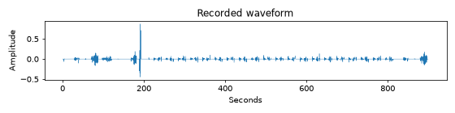

<!-- SPDX-License-Identifier: GPL-3.0-only -->

# Device stress harness report

Mode: **owner device run**

Commit: 156af4b84ee52665f379a3d56222eda330ebcb96 · Rate: 48000 Hz · Block: 128 frames
Platform: Windows · CPU: Intel64 Family 6 Model 183 Stepping 1, GenuineIntel · Device: MME|Speakers (Realtek(R) Audio)

## Protocol and device metrics

| Metric | Value |
|---|---:|
| Acknowledged commands | 27179 |
| Ack p50/p95/p99 (ms) | 0.000 / 0.000 / 16.000 |
| CPU max (%) | 63.974998474121094 |
| Dropouts (latest counter) | 0 |
| Refused replies | 0 |
| Status/telemetry pushes | 9014 / 25160 |

## Recorded signal

| RMS | Peak | DC | Clicks | Dropouts |
|---:|---:|---:|---:|---:|
| 0.032068171 | 0.986577749 | 3.2363e-05 | 152 | 22 |

## Per-step audio metrics

| Time (s) | Action | RMS | Peak | DC | Clicks | Dropouts |
|---:|---|---:|---:|---:|---:|---:|
| ... | Remaining per-step metrics in analysis.json | ... | ... | ... | ... | ... |
| 0.0 | load_patch | 0.00000 | 0.00000 | 0.00000 | 0 | 0 |
| 2.0 | noteOn | 0.00000 | 0.00000 | 0.00000 | 0 | 0 |
| 2.0 | noteOn | 0.00000 | 0.00000 | 0.00000 | 0 | 0 |
| 2.016 | noteOn | 0.00618 | 0.01648 | -0.00116 | 0 | 0 |
| 2.032 | noteOn | 0.00000 | 0.00000 | 0.00000 | 0 | 0 |
| 2.032 | noteOn | 0.00000 | 0.00000 | 0.00000 | 0 | 0 |
| 2.032 | noteOn | 0.00000 | 0.00000 | 0.00000 | 0 | 0 |
| 2.032 | noteOn | 0.02898 | 0.05649 | -0.00090 | 0 | 0 |
| 2.047 | noteOn | 0.00000 | 0.00000 | 0.00000 | 0 | 0 |
| 2.047 | noteOn | 0.04906 | 0.07883 | -0.00133 | 0 | 0 |
| 2.063 | noteOn | 0.00000 | 0.00000 | 0.00000 | 0 | 0 |
| 2.063 | noteOn | 0.00000 | 0.00000 | 0.00000 | 0 | 0 |
| 2.063 | noteOn | 0.05629 | 0.08591 | 0.00555 | 0 | 0 |
| 2.079 | noteOn | 0.00000 | 0.00000 | 0.00000 | 0 | 0 |
| 2.079 | noteOn | 0.05261 | 0.07968 | 0.00069 | 0 | 0 |
| 2.094 | noteOn | 0.00000 | 0.00000 | 0.00000 | 0 | 0 |
| 2.094 | noteOn | 0.05407 | 0.15311 | -0.00007 | 0 | 0 |
| 2.344 | noteOff | 0.02861 | 0.06207 | -0.00124 | 0 | 0 |
| 2.36 | noteOff | 0.00000 | 0.00000 | 0.00000 | 0 | 0 |
| 2.36 | noteOff | 0.03646 | 0.06854 | -0.00038 | 0 | 0 |
| 2.375 | noteOff | 0.00000 | 0.00000 | 0.00000 | 0 | 0 |
| 2.375 | noteOff | 0.05644 | 0.09616 | 0.00363 | 0 | 0 |
| 2.391 | noteOff | 0.00000 | 0.00000 | 0.00000 | 0 | 0 |
| 2.391 | noteOff | 0.00000 | 0.00000 | 0.00000 | 0 | 0 |
| 2.391 | noteOff | 0.03979 | 0.07535 | -0.00395 | 0 | 0 |
| 2.407 | noteOff | 0.00000 | 0.00000 | 0.00000 | 0 | 0 |
| 2.407 | noteOff | 0.00000 | 0.00000 | 0.00000 | 0 | 0 |
| 2.407 | noteOff | 0.02988 | 0.05475 | 0.00319 | 0 | 0 |
| 2.422 | noteOff | 0.00000 | 0.00000 | 0.00000 | 0 | 0 |
| 2.422 | noteOff | 0.00000 | 0.00000 | 0.00000 | 0 | 0 |
| 2.422 | noteOff | 0.02947 | 0.05792 | -0.00054 | 0 | 0 |
| 2.438 | noteOff | 0.04779 | 0.07764 | -0.00343 | 0 | 0 |
| 2.454 | noteOff | 0.03069 | 0.06808 | 0.00013 | 0 | 0 |
| 2.641 | noteOn | 0.03673 | 0.06122 | 0.00112 | 0 | 0 |
| 2.657 | noteOn | 0.01540 | 0.02905 | -0.00139 | 0 | 0 |
| 2.672 | noteOn | 0.00000 | 0.00000 | 0.00000 | 0 | 0 |
| 2.672 | noteOn | 0.00000 | 0.00000 | 0.00000 | 0 | 0 |
| 2.672 | noteOn | 0.01866 | 0.04208 | -0.00005 | 0 | 0 |
| 2.688 | noteOn | 0.00000 | 0.00000 | 0.00000 | 0 | 0 |
| 2.688 | noteOn | 0.00000 | 0.00000 | 0.00000 | 0 | 0 |
| 2.688 | noteOn | 0.04894 | 0.10623 | -0.00513 | 0 | 0 |
| 2.704 | noteOn | 0.00000 | 0.00000 | 0.00000 | 0 | 0 |
| 2.704 | noteOn | 0.00000 | 0.00000 | 0.00000 | 0 | 0 |
| 2.704 | noteOn | 0.07637 | 0.12039 | 0.00260 | 0 | 0 |
| 2.719 | noteOn | 0.00000 | 0.00000 | 0.00000 | 0 | 0 |
| 2.719 | noteOn | 0.08681 | 0.14273 | -0.00093 | 0 | 0 |
| 2.735 | noteOn | 0.00000 | 0.00000 | 0.00000 | 0 | 0 |
| 2.735 | noteOn | 0.00000 | 0.00000 | 0.00000 | 0 | 0 |
| 2.735 | noteOn | 0.05774 | 0.15002 | 0.00026 | 0 | 0 |
| 3.0 | noteOff | 0.02089 | 0.03949 | 0.00078 | 0 | 0 |
| 3.016 | noteOff | 0.00000 | 0.00000 | 0.00000 | 0 | 0 |
| 3.016 | noteOff | 0.00000 | 0.00000 | 0.00000 | 0 | 0 |
| 3.016 | noteOff | 0.04461 | 0.10428 | -0.00124 | 0 | 0 |
| 3.032 | noteOff | 0.00000 | 0.00000 | 0.00000 | 0 | 0 |
| 3.032 | noteOff | 0.00000 | 0.00000 | 0.00000 | 0 | 0 |
| 3.032 | noteOff | 0.05042 | 0.10764 | 0.00199 | 0 | 0 |
| 3.047 | noteOff | 0.00000 | 0.00000 | 0.00000 | 0 | 0 |
| 3.047 | noteOff | 0.02399 | 0.04639 | -0.00147 | 0 | 0 |
| 3.063 | noteOff | 0.00000 | 0.00000 | 0.00000 | 0 | 0 |
| 3.063 | noteOff | 0.00000 | 0.00000 | 0.00000 | 0 | 0 |
| 3.063 | noteOff | 0.04352 | 0.08926 | 0.00203 | 0 | 0 |
| 3.079 | noteOff | 0.00000 | 0.00000 | 0.00000 | 0 | 0 |
| 3.079 | noteOff | 0.00000 | 0.00000 | 0.00000 | 0 | 0 |
| 3.079 | noteOff | 0.04189 | 0.08716 | -0.00305 | 0 | 0 |
| 3.094 | noteOff | 0.03057 | 0.07593 | 0.00008 | 0 | 0 |
| 3.313 | noteOn | 0.00000 | 0.00000 | 0.00000 | 0 | 0 |
| 3.313 | noteOn | 0.00000 | 0.00000 | 0.00000 | 0 | 0 |
| 3.313 | noteOn | 0.00000 | 0.00000 | 0.00000 | 0 | 0 |
| 3.313 | noteOn | 0.02703 | 0.05078 | 0.00011 | 0 | 0 |
| 3.329 | noteOn | 0.00000 | 0.00000 | 0.00000 | 0 | 0 |
| 3.329 | noteOn | 0.02531 | 0.05246 | 0.00083 | 0 | 0 |
| 3.344 | noteOn | 0.00000 | 0.00000 | 0.00000 | 0 | 0 |
| 3.344 | noteOn | 0.00000 | 0.00000 | 0.00000 | 0 | 0 |
| 3.344 | noteOn | 0.02832 | 0.06082 | -0.00009 | 0 | 0 |
| 3.36 | noteOn | 0.00000 | 0.00000 | 0.00000 | 0 | 0 |
| 3.36 | noteOn | 0.00000 | 0.00000 | 0.00000 | 0 | 0 |
| 3.36 | noteOn | 0.04294 | 0.09433 | 0.00217 | 0 | 0 |
| 3.375 | noteOn | 0.00000 | 0.00000 | 0.00000 | 0 | 0 |
| 3.375 | noteOn | 0.04610 | 0.10858 | -0.00563 | 0 | 0 |
| 3.391 | noteOn | 0.00000 | 0.00000 | 0.00000 | 0 | 0 |
| 3.391 | noteOn | 0.05630 | 0.15726 | 0.00016 | 0 | 0 |
| 3.657 | noteOff | 0.00000 | 0.00000 | 0.00000 | 0 | 0 |
| 3.657 | noteOff | 0.00000 | 0.00000 | 0.00000 | 0 | 0 |
| 3.657 | noteOff | 0.03576 | 0.06949 | -0.00115 | 0 | 0 |
| 3.672 | noteOff | 0.00000 | 0.00000 | 0.00000 | 0 | 0 |
| 3.672 | noteOff | 0.00000 | 0.00000 | 0.00000 | 0 | 0 |
| 3.672 | noteOff | 0.04390 | 0.10269 | 0.00218 | 0 | 0 |
| 3.688 | noteOff | 0.04051 | 0.10144 | -0.00191 | 0 | 0 |
| 3.704 | noteOff | 0.00000 | 0.00000 | 0.00000 | 0 | 0 |
| 3.704 | noteOff | 0.00000 | 0.00000 | 0.00000 | 0 | 0 |
| 3.704 | noteOff | 0.00000 | 0.00000 | 0.00000 | 0 | 0 |
| 3.704 | noteOff | 0.03156 | 0.08676 | -0.00120 | 0 | 0 |
| 3.719 | noteOff | 0.00000 | 0.00000 | 0.00000 | 0 | 0 |
| 3.719 | noteOff | 0.04683 | 0.10306 | 0.00162 | 0 | 0 |
| 3.735 | noteOff | 0.00000 | 0.00000 | 0.00000 | 0 | 0 |
| 3.735 | noteOff | 0.00000 | 0.00000 | 0.00000 | 0 | 0 |
| 3.735 | noteOff | 0.02369 | 0.10306 | -0.00001 | 0 | 0 |
| 4.204 | unheld-note-off | 0.00044 | 0.00742 | -0.00000 | 0 | 0 |
| 6.0 | setParam | 0.00000 | 0.00000 | 0.00000 | 0 | 0 |
| 6.063 | setParam | 0.00000 | 0.00000 | 0.00000 | 0 | 0 |
| 8.0 | setParam | 0.00000 | 0.00000 | 0.00000 | 0 | 0 |
| 8.0 | setParam | 0.00000 | 0.00000 | 0.00000 | 0 | 0 |
| 8.016 | setParam | 0.00000 | 0.00000 | 0.00000 | 0 | 0 |
| 8.016 | setParam | 0.00000 | 0.00000 | 0.00000 | 0 | 0 |
| 8.016 | setParam | 0.00000 | 0.00000 | 0.00000 | 0 | 0 |
| 8.032 | setParam | 0.00000 | 0.00000 | 0.00000 | 0 | 0 |
| 8.032 | setParam | 0.00000 | 0.00000 | 0.00000 | 0 | 0 |
| 8.032 | setParam | 0.00000 | 0.00000 | 0.00000 | 0 | 0 |
| 8.047 | setParam | 0.00000 | 0.00000 | 0.00000 | 0 | 0 |
| 8.047 | setParam | 0.00000 | 0.00000 | 0.00000 | 0 | 0 |
| 8.047 | setParam | 0.00000 | 0.00000 | 0.00000 | 0 | 0 |
| 12.0 | setParam | 0.00000 | 0.00000 | 0.00000 | 0 | 0 |
| 12.0 | setParam | 0.00000 | 0.00000 | 0.00000 | 0 | 0 |
| 12.0 | setParam | 0.00000 | 0.00000 | 0.00000 | 0 | 0 |
| 12.0 | setParam | 0.00000 | 0.00000 | 0.00000 | 0 | 0 |
| 12.032 | setParam | 0.00000 | 0.00000 | 0.00000 | 0 | 0 |
| 12.032 | setParam | 0.00000 | 0.00000 | 0.00000 | 0 | 0 |
| 12.032 | setParam | 0.00000 | 0.00000 | 0.00000 | 0 | 0 |
| 12.032 | setParam | 0.00000 | 0.00000 | 0.00000 | 0 | 0 |
| 12.047 | setParam | 0.00000 | 0.00000 | 0.00000 | 0 | 0 |
| 12.047 | setParam | 0.00000 | 0.00000 | 0.00000 | 0 | 0 |
| 12.063 | setParam | 0.00000 | 0.00000 | 0.00000 | 0 | 0 |
| 12.063 | setParam | 0.00000 | 0.00000 | 0.00000 | 0 | 0 |
| 12.063 | setParam | 0.00000 | 0.00000 | 0.00000 | 0 | 0 |
| 12.079 | setParam | 0.00000 | 0.00000 | 0.00000 | 0 | 0 |
| 12.079 | setParam | 0.00000 | 0.00000 | 0.00000 | 0 | 0 |
| 12.079 | setParam | 0.00000 | 0.00000 | 0.00000 | 0 | 0 |
| 12.094 | setParam | 0.00000 | 0.00000 | 0.00000 | 0 | 0 |
| 12.11 | setParam | 0.00000 | 0.00000 | 0.00000 | 0 | 0 |
| 12.11 | setParam | 0.00000 | 0.00000 | 0.00000 | 0 | 0 |
| 12.11 | setParam | 0.00000 | 0.00000 | 0.00000 | 0 | 0 |
| 12.125 | setParam | 0.00000 | 0.00000 | 0.00000 | 0 | 0 |
| 12.125 | setParam | 0.00000 | 0.00000 | 0.00000 | 0 | 0 |
| 12.125 | setParam | 0.00000 | 0.00000 | 0.00000 | 0 | 0 |
| 12.125 | setParam | 0.00000 | 0.00000 | 0.00000 | 0 | 0 |
| 12.141 | setParam | 0.00000 | 0.00000 | 0.00000 | 0 | 0 |
| 12.157 | setParam | 0.00000 | 0.00000 | 0.00000 | 0 | 0 |
| 12.157 | setParam | 0.00000 | 0.00000 | 0.00000 | 0 | 0 |
| 12.157 | setParam | 0.00000 | 0.00000 | 0.00000 | 0 | 0 |
| 12.172 | setParam | 0.00000 | 0.00000 | 0.00000 | 0 | 0 |
| 12.188 | setParam | 0.00000 | 0.00000 | 0.00000 | 0 | 0 |
| 12.188 | setParam | 0.00000 | 0.00000 | 0.00000 | 0 | 0 |
| 12.188 | setParam | 0.00000 | 0.00000 | 0.00000 | 0 | 0 |
| 12.204 | setParam | 0.00000 | 0.00000 | 0.00000 | 0 | 0 |
| 12.204 | setParam | 0.00000 | 0.00000 | 0.00000 | 0 | 0 |
| 12.204 | setParam | 0.00000 | 0.00000 | 0.00000 | 0 | 0 |
| 12.204 | setParam | 0.00000 | 0.00000 | 0.00000 | 0 | 0 |
| 12.219 | setParam | 0.00000 | 0.00000 | 0.00000 | 0 | 0 |
| 12.235 | setParam | 0.00000 | 0.00000 | 0.00000 | 0 | 0 |
| 12.235 | setParam | 0.00000 | 0.00000 | 0.00000 | 0 | 0 |
| 12.235 | setParam | 0.00000 | 0.00000 | 0.00000 | 0 | 0 |
| 12.25 | setParam | 0.00000 | 0.00000 | 0.00000 | 0 | 0 |
| 12.25 | setParam | 0.00000 | 0.00000 | 0.00000 | 0 | 0 |
| 12.25 | setParam | 0.00000 | 0.00000 | 0.00000 | 0 | 0 |
| 12.25 | setParam | 0.00000 | 0.00000 | 0.00000 | 0 | 0 |
| 12.282 | setParam | 0.00000 | 0.00000 | 0.00000 | 0 | 0 |
| 12.282 | setParam | 0.00000 | 0.00000 | 0.00000 | 0 | 0 |
| 12.282 | setParam | 0.00000 | 0.00000 | 0.00000 | 0 | 0 |
| 12.282 | setParam | 0.00000 | 0.00000 | 0.00000 | 0 | 0 |
| 12.297 | setParam | 0.00000 | 0.00000 | 0.00000 | 0 | 0 |
| 12.297 | setParam | 0.00000 | 0.00000 | 0.00000 | 0 | 0 |
| 12.297 | setParam | 0.00000 | 0.00000 | 0.00000 | 0 | 0 |
| 12.313 | setParam | 0.00000 | 0.00000 | 0.00000 | 0 | 0 |
| 12.313 | setParam | 0.00000 | 0.00000 | 0.00000 | 0 | 0 |
| 12.329 | setParam | 0.00000 | 0.00000 | 0.00000 | 0 | 0 |
| 12.329 | setParam | 0.00000 | 0.00000 | 0.00000 | 0 | 0 |
| 12.329 | setParam | 0.00000 | 0.00000 | 0.00000 | 0 | 0 |
| 12.36 | setParam | 0.00000 | 0.00000 | 0.00000 | 0 | 0 |
| 12.36 | setParam | 0.00000 | 0.00000 | 0.00000 | 0 | 0 |
| 12.36 | setParam | 0.00000 | 0.00000 | 0.00000 | 0 | 0 |
| 12.36 | setParam | 0.00000 | 0.00000 | 0.00000 | 0 | 0 |
| 12.375 | setParam | 0.00000 | 0.00000 | 0.00000 | 0 | 0 |
| 12.375 | setParam | 0.00000 | 0.00000 | 0.00000 | 0 | 0 |
| 12.375 | setParam | 0.00000 | 0.00000 | 0.00000 | 0 | 0 |
| 12.375 | setParam | 0.00000 | 0.00000 | 0.00000 | 0 | 0 |
| 12.407 | setParam | 0.00000 | 0.00000 | 0.00000 | 0 | 0 |
| 12.407 | setParam | 0.00000 | 0.00000 | 0.00000 | 0 | 0 |
| 12.407 | setParam | 0.00000 | 0.00000 | 0.00000 | 0 | 0 |
| 12.407 | setParam | 0.00000 | 0.00000 | 0.00000 | 0 | 0 |
| 12.422 | setParam | 0.00000 | 0.00000 | 0.00000 | 0 | 0 |
| 12.422 | setParam | 0.00000 | 0.00000 | 0.00000 | 0 | 0 |
| 12.422 | setParam | 0.00000 | 0.00000 | 0.00000 | 0 | 0 |
| 12.438 | setParam | 0.00000 | 0.00000 | 0.00000 | 0 | 0 |
| 12.438 | setParam | 0.00000 | 0.00000 | 0.00000 | 0 | 0 |
| 12.454 | setParam | 0.00000 | 0.00000 | 0.00000 | 0 | 0 |
| 12.454 | setParam | 0.00000 | 0.00000 | 0.00000 | 0 | 0 |
| 12.454 | setParam | 0.00000 | 0.00000 | 0.00000 | 0 | 0 |
| 12.485 | setParam | 0.00000 | 0.00000 | 0.00000 | 0 | 0 |
| 12.485 | setParam | 0.00000 | 0.00000 | 0.00000 | 0 | 0 |
| 12.485 | setParam | 0.00000 | 0.00000 | 0.00000 | 0 | 0 |
| 12.485 | setParam | 0.00000 | 0.00000 | 0.00000 | 0 | 0 |
| 12.5 | setParam | 0.00000 | 0.00000 | 0.00000 | 0 | 0 |
| 12.5 | setParam | 0.00000 | 0.00000 | 0.00000 | 0 | 0 |
| 12.5 | setParam | 0.00000 | 0.00000 | 0.00000 | 0 | 0 |
| 12.5 | setParam | 0.00000 | 0.00000 | 0.00000 | 0 | 0 |
| 12.532 | setParam | 0.00000 | 0.00000 | 0.00000 | 0 | 0 |
| 12.532 | setParam | 0.00000 | 0.00000 | 0.00000 | 0 | 0 |
| 12.532 | setParam | 0.00000 | 0.00000 | 0.00000 | 0 | 0 |
| 12.532 | setParam | 0.00000 | 0.00000 | 0.00000 | 0 | 0 |
| 12.547 | setParam | 0.00000 | 0.00000 | 0.00000 | 0 | 0 |
| 12.547 | setParam | 0.00000 | 0.00000 | 0.00000 | 0 | 0 |
| 12.547 | setParam | 0.00000 | 0.00000 | 0.00000 | 0 | 0 |
| 12.563 | setParam | 0.00000 | 0.00000 | 0.00000 | 0 | 0 |
| 12.563 | setParam | 0.00000 | 0.00000 | 0.00000 | 0 | 0 |
| 12.579 | setParam | 0.00000 | 0.00000 | 0.00000 | 0 | 0 |
| 12.579 | setParam | 0.00000 | 0.00000 | 0.00000 | 0 | 0 |
| 12.579 | setParam | 0.00000 | 0.00000 | 0.00000 | 0 | 0 |
| 12.61 | setParam | 0.00000 | 0.00000 | 0.00000 | 0 | 0 |
| 12.61 | setParam | 0.00000 | 0.00000 | 0.00000 | 0 | 0 |
| 12.61 | setParam | 0.00000 | 0.00000 | 0.00000 | 0 | 0 |
| 12.61 | setParam | 0.00000 | 0.00000 | 0.00000 | 0 | 0 |
| 12.625 | setParam | 0.00000 | 0.00000 | 0.00000 | 0 | 0 |
| 12.625 | setParam | 0.00000 | 0.00000 | 0.00000 | 0 | 0 |
| 12.625 | setParam | 0.00000 | 0.00000 | 0.00000 | 0 | 0 |
| 12.625 | setParam | 0.00000 | 0.00000 | 0.00000 | 0 | 0 |
| 12.641 | setParam | 0.00000 | 0.00000 | 0.00000 | 0 | 0 |
| 12.657 | setParam | 0.00000 | 0.00000 | 0.00000 | 0 | 0 |
| 12.657 | setParam | 0.00000 | 0.00000 | 0.00000 | 0 | 0 |
| 12.657 | setParam | 0.00000 | 0.00000 | 0.00000 | 0 | 0 |
| 12.672 | setParam | 0.00000 | 0.00000 | 0.00000 | 0 | 0 |
| 12.688 | setParam | 0.00000 | 0.00000 | 0.00000 | 0 | 0 |
| 12.688 | setParam | 0.00000 | 0.00000 | 0.00000 | 0 | 0 |
| 12.688 | setParam | 0.00000 | 0.00000 | 0.00000 | 0 | 0 |
| 12.704 | setParam | 0.00000 | 0.00000 | 0.00000 | 0 | 0 |
| 12.704 | setParam | 0.00000 | 0.00000 | 0.00000 | 0 | 0 |
| 12.704 | setParam | 0.00000 | 0.00000 | 0.00000 | 0 | 0 |
| 12.704 | setParam | 0.00000 | 0.00000 | 0.00000 | 0 | 0 |
| 12.719 | setParam | 0.00000 | 0.00000 | 0.00000 | 0 | 0 |
| 12.735 | setParam | 0.00000 | 0.00000 | 0.00000 | 0 | 0 |
| 12.735 | setParam | 0.00000 | 0.00000 | 0.00000 | 0 | 0 |
| 12.735 | setParam | 0.00000 | 0.00000 | 0.00000 | 0 | 0 |
| 12.75 | setParam | 0.00000 | 0.00000 | 0.00000 | 0 | 0 |
| 12.75 | setParam | 0.00000 | 0.00000 | 0.00000 | 0 | 0 |
| 12.75 | setParam | 0.00000 | 0.00000 | 0.00000 | 0 | 0 |
| 12.75 | setParam | 0.00000 | 0.00000 | 0.00000 | 0 | 0 |
| 12.782 | setParam | 0.00000 | 0.00000 | 0.00000 | 0 | 0 |
| 12.782 | setParam | 0.00000 | 0.00000 | 0.00000 | 0 | 0 |
| 12.782 | setParam | 0.00000 | 0.00000 | 0.00000 | 0 | 0 |
| 12.782 | setParam | 0.00000 | 0.00000 | 0.00000 | 0 | 0 |
| 12.813 | setParam | 0.00000 | 0.00000 | 0.00000 | 0 | 0 |
| 12.813 | setParam | 0.00000 | 0.00000 | 0.00000 | 0 | 0 |
| 12.813 | setParam | 0.00000 | 0.00000 | 0.00000 | 0 | 0 |
| 12.813 | setParam | 0.00000 | 0.00000 | 0.00000 | 0 | 0 |
| 12.829 | setParam | 0.00000 | 0.00000 | 0.00000 | 0 | 0 |
| 12.829 | setParam | 0.00000 | 0.00000 | 0.00000 | 0 | 0 |
| 12.829 | setParam | 0.00000 | 0.00000 | 0.00000 | 0 | 0 |
| 12.829 | setParam | 0.00000 | 0.00000 | 0.00000 | 0 | 0 |
| 12.844 | setParam | 0.00000 | 0.00000 | 0.00000 | 0 | 0 |
| 12.86 | setParam | 0.00000 | 0.00000 | 0.00000 | 0 | 0 |
| 12.86 | setParam | 0.00000 | 0.00000 | 0.00000 | 0 | 0 |
| 12.86 | setParam | 0.00000 | 0.00000 | 0.00000 | 0 | 0 |
| 12.875 | setParam | 0.00000 | 0.00000 | 0.00000 | 0 | 0 |
| 12.875 | setParam | 0.00000 | 0.00000 | 0.00000 | 0 | 0 |
| 12.875 | setParam | 0.00000 | 0.00000 | 0.00000 | 0 | 0 |
| 12.875 | setParam | 0.00000 | 0.00000 | 0.00000 | 0 | 0 |
| 12.907 | setParam | 0.00000 | 0.00000 | 0.00000 | 0 | 0 |
| 12.907 | setParam | 0.00000 | 0.00000 | 0.00000 | 0 | 0 |
| 12.907 | setParam | 0.00000 | 0.00000 | 0.00000 | 0 | 0 |
| 12.907 | setParam | 0.00000 | 0.00000 | 0.00000 | 0 | 0 |
| 12.922 | setParam | 0.00000 | 0.00000 | 0.00000 | 0 | 0 |
| 12.922 | setParam | 0.00000 | 0.00000 | 0.00000 | 0 | 0 |
| 12.938 | setParam | 0.00000 | 0.00000 | 0.00000 | 0 | 0 |
| 12.938 | setParam | 0.00000 | 0.00000 | 0.00000 | 0 | 0 |
| 12.954 | setParam | 0.00000 | 0.00000 | 0.00000 | 0 | 0 |
| 12.954 | setParam | 0.00000 | 0.00000 | 0.00000 | 0 | 0 |
| 12.954 | setParam | 0.00000 | 0.00000 | 0.00000 | 0 | 0 |
| 12.954 | setParam | 0.00000 | 0.00000 | 0.00000 | 0 | 0 |
| 12.969 | setParam | 0.00000 | 0.00000 | 0.00000 | 0 | 0 |
| 12.985 | setParam | 0.00000 | 0.00000 | 0.00000 | 0 | 0 |
| 12.985 | setParam | 0.00000 | 0.00000 | 0.00000 | 0 | 0 |
| 12.985 | setParam | 0.00000 | 0.00000 | 0.00000 | 0 | 0 |
| 13.0 | setParam | 0.00000 | 0.00000 | 0.00000 | 0 | 0 |
| 13.0 | setParam | 0.00000 | 0.00000 | 0.00000 | 0 | 0 |
| 13.0 | setParam | 0.00000 | 0.00000 | 0.00000 | 0 | 0 |
| 13.0 | setParam | 0.00000 | 0.00000 | 0.00000 | 0 | 0 |
| 13.032 | setParam | 0.00000 | 0.00000 | 0.00000 | 0 | 0 |
| 13.032 | setParam | 0.00000 | 0.00000 | 0.00000 | 0 | 0 |
| 13.032 | setParam | 0.00000 | 0.00000 | 0.00000 | 0 | 0 |
| 13.032 | setParam | 0.00000 | 0.00000 | 0.00000 | 0 | 0 |
| 13.047 | setParam | 0.00000 | 0.00000 | 0.00000 | 0 | 0 |
| 13.063 | setParam | 0.00000 | 0.00000 | 0.00000 | 0 | 0 |
| 13.063 | setParam | 0.00000 | 0.00000 | 0.00000 | 0 | 0 |
| 13.063 | setParam | 0.00000 | 0.00000 | 0.00000 | 0 | 0 |
| 13.079 | setParam | 0.00000 | 0.00000 | 0.00000 | 0 | 0 |
| 13.079 | setParam | 0.00000 | 0.00000 | 0.00000 | 0 | 0 |
| 13.079 | setParam | 0.00000 | 0.00000 | 0.00000 | 0 | 0 |
| 13.079 | setParam | 0.00000 | 0.00000 | 0.00000 | 0 | 0 |
| 13.094 | setParam | 0.00000 | 0.00000 | 0.00000 | 0 | 0 |
| 13.11 | setParam | 0.00000 | 0.00000 | 0.00000 | 0 | 0 |
| 13.11 | setParam | 0.00000 | 0.00000 | 0.00000 | 0 | 0 |
| 13.11 | setParam | 0.00000 | 0.00000 | 0.00000 | 0 | 0 |
| 13.125 | setParam | 0.00000 | 0.00000 | 0.00000 | 0 | 0 |
| 13.125 | setParam | 0.00000 | 0.00000 | 0.00000 | 0 | 0 |
| 13.125 | setParam | 0.00000 | 0.00000 | 0.00000 | 0 | 0 |
| 13.125 | setParam | 0.00000 | 0.00000 | 0.00000 | 0 | 0 |
| 13.157 | setParam | 0.00000 | 0.00000 | 0.00000 | 0 | 0 |
| 13.157 | setParam | 0.00000 | 0.00000 | 0.00000 | 0 | 0 |
| 13.157 | setParam | 0.00000 | 0.00000 | 0.00000 | 0 | 0 |
| 13.157 | setParam | 0.00000 | 0.00000 | 0.00000 | 0 | 0 |
| 13.172 | setParam | 0.00000 | 0.00000 | 0.00000 | 0 | 0 |
| 13.172 | setParam | 0.00000 | 0.00000 | 0.00000 | 0 | 0 |
| 13.172 | setParam | 0.00000 | 0.00000 | 0.00000 | 0 | 0 |
| 13.188 | setParam | 0.00000 | 0.00000 | 0.00000 | 0 | 0 |
| 13.204 | setParam | 0.00000 | 0.00000 | 0.00000 | 0 | 0 |
| 13.204 | setParam | 0.00000 | 0.00000 | 0.00000 | 0 | 0 |
| 13.204 | setParam | 0.00000 | 0.00000 | 0.00000 | 0 | 0 |
| 13.204 | setParam | 0.00000 | 0.00000 | 0.00000 | 0 | 0 |
| 13.219 | setParam | 0.00000 | 0.00000 | 0.00000 | 0 | 0 |
| 13.219 | setParam | 0.00000 | 0.00000 | 0.00000 | 0 | 0 |
| 13.235 | setParam | 0.00000 | 0.00000 | 0.00000 | 0 | 0 |
| 13.235 | setParam | 0.00000 | 0.00000 | 0.00000 | 0 | 0 |
| 13.25 | setParam | 0.00000 | 0.00000 | 0.00000 | 0 | 0 |
| 13.25 | setParam | 0.00000 | 0.00000 | 0.00000 | 0 | 0 |
| 13.25 | setParam | 0.00000 | 0.00000 | 0.00000 | 0 | 0 |
| 13.25 | setParam | 0.00000 | 0.00000 | 0.00000 | 0 | 0 |
| 13.282 | setParam | 0.00000 | 0.00000 | 0.00000 | 0 | 0 |
| 13.282 | setParam | 0.00000 | 0.00000 | 0.00000 | 0 | 0 |
| 13.282 | setParam | 0.00000 | 0.00000 | 0.00000 | 0 | 0 |
| 13.282 | setParam | 0.00000 | 0.00000 | 0.00000 | 0 | 0 |
| 13.297 | setParam | 0.00000 | 0.00000 | 0.00000 | 0 | 0 |
| 13.297 | setParam | 0.00000 | 0.00000 | 0.00000 | 0 | 0 |
| 13.297 | setParam | 0.00000 | 0.00000 | 0.00000 | 0 | 0 |
| 13.313 | setParam | 0.00000 | 0.00000 | 0.00000 | 0 | 0 |
| 13.329 | setParam | 0.00000 | 0.00000 | 0.00000 | 0 | 0 |
| 13.329 | setParam | 0.00000 | 0.00000 | 0.00000 | 0 | 0 |
| 13.329 | setParam | 0.00000 | 0.00000 | 0.00000 | 0 | 0 |
| 13.329 | setParam | 0.00000 | 0.00000 | 0.00000 | 0 | 0 |
| 13.344 | setParam | 0.00000 | 0.00000 | 0.00000 | 0 | 0 |
| 13.36 | setParam | 0.00000 | 0.00000 | 0.00000 | 0 | 0 |
| 13.36 | setParam | 0.00000 | 0.00000 | 0.00000 | 0 | 0 |
| 13.36 | setParam | 0.00000 | 0.00000 | 0.00000 | 0 | 0 |
| 13.375 | setParam | 0.00000 | 0.00000 | 0.00000 | 0 | 0 |
| 13.375 | setParam | 0.00000 | 0.00000 | 0.00000 | 0 | 0 |
| 13.375 | setParam | 0.00000 | 0.00000 | 0.00000 | 0 | 0 |
| 13.375 | setParam | 0.00000 | 0.00000 | 0.00000 | 0 | 0 |
| 13.391 | setParam | 0.00000 | 0.00000 | 0.00000 | 0 | 0 |
| 13.407 | setParam | 0.00000 | 0.00000 | 0.00000 | 0 | 0 |
| 13.407 | setParam | 0.00000 | 0.00000 | 0.00000 | 0 | 0 |
| 13.407 | setParam | 0.00000 | 0.00000 | 0.00000 | 0 | 0 |
| 13.422 | setParam | 0.00000 | 0.00000 | 0.00000 | 0 | 0 |
| 13.438 | setParam | 0.00000 | 0.00000 | 0.00000 | 0 | 0 |
| 13.438 | setParam | 0.00000 | 0.00000 | 0.00000 | 0 | 0 |
| 13.438 | setParam | 0.00000 | 0.00000 | 0.00000 | 0 | 0 |
| 13.454 | setParam | 0.00000 | 0.00000 | 0.00000 | 0 | 0 |
| 13.454 | setParam | 0.00000 | 0.00000 | 0.00000 | 0 | 0 |
| 13.454 | setParam | 0.00000 | 0.00000 | 0.00000 | 0 | 0 |
| 13.454 | setParam | 0.00000 | 0.00000 | 0.00000 | 0 | 0 |
| 13.469 | setParam | 0.00000 | 0.00000 | 0.00000 | 0 | 0 |
| 13.485 | setParam | 0.00000 | 0.00000 | 0.00000 | 0 | 0 |
| 13.485 | setParam | 0.00000 | 0.00000 | 0.00000 | 0 | 0 |
| 13.485 | setParam | 0.00000 | 0.00000 | 0.00000 | 0 | 0 |
| 13.5 | setParam | 0.00000 | 0.00000 | 0.00000 | 0 | 0 |
| 13.5 | setParam | 0.00000 | 0.00000 | 0.00000 | 0 | 0 |
| 13.5 | setParam | 0.00000 | 0.00000 | 0.00000 | 0 | 0 |
| 13.5 | setParam | 0.00000 | 0.00000 | 0.00000 | 0 | 0 |
| 13.532 | setParam | 0.00000 | 0.00000 | 0.00000 | 0 | 0 |
| 13.532 | setParam | 0.00000 | 0.00000 | 0.00000 | 0 | 0 |
| 13.532 | setParam | 0.00000 | 0.00000 | 0.00000 | 0 | 0 |
| 13.532 | setParam | 0.00000 | 0.00000 | 0.00000 | 0 | 0 |
| 13.547 | setParam | 0.00000 | 0.00000 | 0.00000 | 0 | 0 |
| 13.547 | setParam | 0.00000 | 0.00000 | 0.00000 | 0 | 0 |
| 13.563 | setParam | 0.00000 | 0.00000 | 0.00000 | 0 | 0 |
| 13.563 | setParam | 0.00000 | 0.00000 | 0.00000 | 0 | 0 |
| 13.579 | setParam | 0.00000 | 0.00000 | 0.00000 | 0 | 0 |
| 13.579 | setParam | 0.00000 | 0.00000 | 0.00000 | 0 | 0 |
| 13.579 | setParam | 0.00000 | 0.00000 | 0.00000 | 0 | 0 |
| 13.579 | setParam | 0.00000 | 0.00000 | 0.00000 | 0 | 0 |
| 13.594 | setParam | 0.00000 | 0.00000 | 0.00000 | 0 | 0 |
| 13.61 | setParam | 0.00000 | 0.00000 | 0.00000 | 0 | 0 |
| 13.61 | setParam | 0.00000 | 0.00000 | 0.00000 | 0 | 0 |
| 13.61 | setParam | 0.00000 | 0.00000 | 0.00000 | 0 | 0 |
| 13.625 | setParam | 0.00000 | 0.00000 | 0.00000 | 0 | 0 |
| 13.625 | setParam | 0.00000 | 0.00000 | 0.00000 | 0 | 0 |
| 13.625 | setParam | 0.00000 | 0.00000 | 0.00000 | 0 | 0 |
| 13.625 | setParam | 0.00000 | 0.00000 | 0.00000 | 0 | 0 |
| 13.657 | setParam | 0.00000 | 0.00000 | 0.00000 | 0 | 0 |
| 13.657 | setParam | 0.00000 | 0.00000 | 0.00000 | 0 | 0 |
| 13.657 | setParam | 0.00000 | 0.00000 | 0.00000 | 0 | 0 |
| 13.657 | setParam | 0.00000 | 0.00000 | 0.00000 | 0 | 0 |
| 13.672 | setParam | 0.00000 | 0.00000 | 0.00000 | 0 | 0 |
| 13.672 | setParam | 0.00000 | 0.00000 | 0.00000 | 0 | 0 |
| 13.688 | setParam | 0.00000 | 0.00000 | 0.00000 | 0 | 0 |
| 13.688 | setParam | 0.00000 | 0.00000 | 0.00000 | 0 | 0 |
| 13.704 | setParam | 0.00000 | 0.00000 | 0.00000 | 0 | 0 |
| 13.704 | setParam | 0.00000 | 0.00000 | 0.00000 | 0 | 0 |
| 13.704 | setParam | 0.00000 | 0.00000 | 0.00000 | 0 | 0 |
| 13.704 | setParam | 0.00000 | 0.00000 | 0.00000 | 0 | 0 |
| 13.719 | setParam | 0.00000 | 0.00000 | 0.00000 | 0 | 0 |
| 13.735 | setParam | 0.00000 | 0.00000 | 0.00000 | 0 | 0 |
| 13.735 | setParam | 0.00000 | 0.00000 | 0.00000 | 0 | 0 |
| 13.735 | setParam | 0.00000 | 0.00000 | 0.00000 | 0 | 0 |
| 13.75 | setParam | 0.00000 | 0.00000 | 0.00000 | 0 | 0 |
| 13.75 | setParam | 0.00000 | 0.00000 | 0.00000 | 0 | 0 |
| 13.75 | setParam | 0.00000 | 0.00000 | 0.00000 | 0 | 0 |
| 13.75 | setParam | 0.00000 | 0.00000 | 0.00000 | 0 | 0 |
| 13.766 | setParam | 0.00000 | 0.00000 | 0.00000 | 0 | 0 |
| 13.782 | setParam | 0.00000 | 0.00000 | 0.00000 | 0 | 0 |
| 13.782 | setParam | 0.00000 | 0.00000 | 0.00000 | 0 | 0 |
| 13.782 | setParam | 0.00000 | 0.00000 | 0.00000 | 0 | 0 |
| 13.797 | setParam | 0.00000 | 0.00000 | 0.00000 | 0 | 0 |
| 13.813 | setParam | 0.00000 | 0.00000 | 0.00000 | 0 | 0 |
| 13.813 | setParam | 0.00000 | 0.00000 | 0.00000 | 0 | 0 |
| 13.813 | setParam | 0.00000 | 0.00000 | 0.00000 | 0 | 0 |
| 13.813 | setParam | 0.00000 | 0.00000 | 0.00000 | 0 | 0 |
| 13.829 | setParam | 0.00000 | 0.00000 | 0.00000 | 0 | 0 |
| 13.829 | setParam | 0.00000 | 0.00000 | 0.00000 | 0 | 0 |
| 13.829 | setParam | 0.00000 | 0.00000 | 0.00000 | 0 | 0 |
| 13.86 | setParam | 0.00000 | 0.00000 | 0.00000 | 0 | 0 |
| 13.86 | setParam | 0.00000 | 0.00000 | 0.00000 | 0 | 0 |
| 13.86 | setParam | 0.00000 | 0.00000 | 0.00000 | 0 | 0 |
| 13.86 | setParam | 0.00000 | 0.00000 | 0.00000 | 0 | 0 |
| 13.875 | setParam | 0.00000 | 0.00000 | 0.00000 | 0 | 0 |
| 13.875 | setParam | 0.00000 | 0.00000 | 0.00000 | 0 | 0 |
| 13.875 | setParam | 0.00000 | 0.00000 | 0.00000 | 0 | 0 |
| 13.875 | setParam | 0.00000 | 0.00000 | 0.00000 | 0 | 0 |
| 13.907 | setParam | 0.00000 | 0.00000 | 0.00000 | 0 | 0 |
| 13.907 | setParam | 0.00000 | 0.00000 | 0.00000 | 0 | 0 |
| 13.907 | setParam | 0.00000 | 0.00000 | 0.00000 | 0 | 0 |
| 13.907 | setParam | 0.00000 | 0.00000 | 0.00000 | 0 | 0 |
| 13.922 | setParam | 0.00000 | 0.00000 | 0.00000 | 0 | 0 |
| 13.922 | setParam | 0.00000 | 0.00000 | 0.00000 | 0 | 0 |
| 13.922 | setParam | 0.00000 | 0.00000 | 0.00000 | 0 | 0 |
| 13.938 | setParam | 0.00000 | 0.00000 | 0.00000 | 0 | 0 |
| 13.938 | setParam | 0.00000 | 0.00000 | 0.00000 | 0 | 0 |
| 13.954 | setParam | 0.00000 | 0.00000 | 0.00000 | 0 | 0 |
| 13.954 | setParam | 0.00000 | 0.00000 | 0.00000 | 0 | 0 |
| 13.954 | setParam | 0.00000 | 0.00000 | 0.00000 | 0 | 0 |
| 13.985 | setParam | 0.00000 | 0.00000 | 0.00000 | 0 | 0 |
| 13.985 | setParam | 0.00000 | 0.00000 | 0.00000 | 0 | 0 |
| 13.985 | setParam | 0.00000 | 0.00000 | 0.00000 | 0 | 0 |
| 13.985 | setParam | 0.00000 | 0.00000 | 0.00000 | 0 | 0 |
| 16.0 | disconnect | 0.00000 | 0.00000 | 0.00000 | 0 | 0 |
| 16.172 | connect | 0.00000 | 0.00000 | 0.00000 | 0 | 0 |
| 20.0 | addModule | 0.00000 | 0.00000 | 0.00000 | 0 | 0 |
| 20.25 | removeModule | 0.00000 | 0.00000 | 0.00000 | 0 | 0 |
| 24.0 | setBufferFrames | 0.00000 | 0.00000 | 0.00000 | 0 | 0 |
| 27.016 | panic | 0.00000 | 0.00000 | 0.00000 | 0 | 0 |
| 29.0 | noteOn | 0.00000 | 0.00000 | 0.00000 | 0 | 0 |
| 29.0 | noteOn | 0.00000 | 0.00000 | 0.00000 | 0 | 0 |
| 29.016 | noteOn | 0.00000 | 0.00000 | 0.00000 | 0 | 0 |
| 29.016 | noteOn | 0.00008 | 0.00040 | 0.00000 | 0 | 0 |
| 29.032 | noteOn | 0.00000 | 0.00000 | 0.00000 | 0 | 0 |
| 29.032 | noteOn | 0.00000 | 0.00000 | 0.00000 | 0 | 0 |
| 29.032 | noteOn | 0.00038 | 0.00104 | -0.00000 | 0 | 0 |
| 29.047 | noteOn | 0.00000 | 0.00000 | 0.00000 | 0 | 0 |
| 29.047 | noteOn | 0.00000 | 0.00000 | 0.00000 | 0 | 0 |
| 29.047 | noteOn | 0.00082 | 0.00223 | -0.00000 | 0 | 0 |
| 29.063 | noteOn | 0.00000 | 0.00000 | 0.00000 | 0 | 0 |
| 29.063 | noteOn | 0.00000 | 0.00000 | 0.00000 | 0 | 0 |
| 29.063 | noteOn | 0.00129 | 0.00357 | 0.00000 | 0 | 0 |
| 29.079 | noteOn | 0.00000 | 0.00000 | 0.00000 | 0 | 0 |
| 29.079 | noteOn | 0.00180 | 0.00488 | -0.00000 | 0 | 0 |
| 29.094 | noteOn | 0.01502 | 0.03418 | 0.00000 | 0 | 0 |
| 29.469 | noteOff | 0.02512 | 0.03665 | -0.00001 | 0 | 0 |
| 29.5 | noteOff | 0.00000 | 0.00000 | 0.00000 | 0 | 0 |
| 29.5 | noteOff | 0.00000 | 0.00000 | 0.00000 | 0 | 0 |
| 29.5 | noteOff | 0.00000 | 0.00000 | 0.00000 | 0 | 0 |
| 29.5 | noteOff | 0.02637 | 0.03787 | -0.00003 | 0 | 0 |
| 29.516 | noteOff | 0.00000 | 0.00000 | 0.00000 | 0 | 0 |
| 29.516 | noteOff | 0.00000 | 0.00000 | 0.00000 | 0 | 0 |
| 29.516 | noteOff | 0.02749 | 0.03918 | 0.00004 | 0 | 0 |
| 29.532 | noteOff | 0.00000 | 0.00000 | 0.00000 | 0 | 0 |
| 29.532 | noteOff | 0.02785 | 0.04031 | -0.00003 | 0 | 0 |
| 29.547 | noteOff | 0.00000 | 0.00000 | 0.00000 | 0 | 0 |
| 29.547 | noteOff | 0.00000 | 0.00000 | 0.00000 | 0 | 0 |
| 29.547 | noteOff | 0.02917 | 0.04166 | 0.00004 | 0 | 0 |
| 29.563 | noteOff | 0.00000 | 0.00000 | 0.00000 | 0 | 0 |
| 29.563 | noteOff | 0.02996 | 0.04288 | -0.00004 | 0 | 0 |
| 29.579 | noteOff | 0.03096 | 0.04407 | -0.00000 | 0 | 0 |
| 29.797 | unheld-note-off | 0.02709 | 0.04364 | 0.00000 | 0 | 0 |
| 35.0 | load_patch | 0.00267 | 0.03271 | -0.00000 | 0 | 0 |
| 37.0 | noteOn | 0.00000 | 0.00000 | 0.00000 | 0 | 0 |
| 37.016 | noteOn | 0.00000 | 0.00000 | 0.00000 | 0 | 0 |
| 37.016 | noteOn | 0.00000 | 0.00000 | 0.00000 | 0 | 0 |
| 37.016 | noteOn | 0.00008 | 0.00018 | 0.00004 | 0 | 0 |
| 37.032 | noteOn | 0.00000 | 0.00000 | 0.00000 | 0 | 0 |
| 37.032 | noteOn | 0.00000 | 0.00000 | 0.00000 | 0 | 0 |
| 37.032 | noteOn | 0.00070 | 0.00143 | 0.00018 | 0 | 0 |
| 37.047 | noteOn | 0.00000 | 0.00000 | 0.00000 | 0 | 0 |
| 37.047 | noteOn | 0.00000 | 0.00000 | 0.00000 | 0 | 0 |
| 37.047 | noteOn | 0.00178 | 0.00360 | 0.00006 | 0 | 0 |
| 37.063 | noteOn | 0.00272 | 0.00446 | -0.00043 | 0 | 0 |
| 37.079 | noteOn | 0.00000 | 0.00000 | 0.00000 | 0 | 0 |
| 37.079 | noteOn | 0.00000 | 0.00000 | 0.00000 | 0 | 0 |
| 37.079 | noteOn | 0.00000 | 0.00000 | 0.00000 | 0 | 0 |
| 37.079 | noteOn | 0.00284 | 0.00491 | 0.00022 | 0 | 0 |
| 37.094 | noteOn | 0.01565 | 0.04910 | 0.00005 | 0 | 0 |
| 37.485 | noteOff | 0.00000 | 0.00000 | 0.00000 | 0 | 0 |
| 37.485 | noteOff | 0.00000 | 0.00000 | 0.00000 | 0 | 0 |
| 37.485 | noteOff | 0.02539 | 0.04233 | -0.00064 | 0 | 0 |
| 37.5 | noteOff | 0.00000 | 0.00000 | 0.00000 | 0 | 0 |
| 37.5 | noteOn | 0.00000 | 0.00000 | 0.00000 | 0 | 0 |
| 37.5 | noteOff | 0.02985 | 0.05655 | -0.00246 | 0 | 0 |
| 37.516 | noteOn | 0.00000 | 0.00000 | 0.00000 | 0 | 0 |
| 37.516 | noteOff | 0.00000 | 0.00000 | 0.00000 | 0 | 0 |
| 37.516 | noteOn | 0.00000 | 0.00000 | 0.00000 | 0 | 0 |
| 37.516 | noteOff | 0.00000 | 0.00000 | 0.00000 | 0 | 0 |
| 37.516 | noteOn | 0.04426 | 0.07401 | -0.00217 | 0 | 0 |
| 37.532 | noteOff | 0.00000 | 0.00000 | 0.00000 | 0 | 0 |
| 37.532 | noteOn | 0.00000 | 0.00000 | 0.00000 | 0 | 0 |

