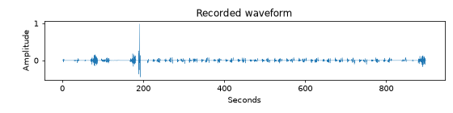

<!-- SPDX-License-Identifier: GPL-3.0-only -->

# Device stress harness report

Mode: **owner device run**

Commit: 156af4b84ee52665f379a3d56222eda330ebcb96 · Rate: 48000 Hz · Block: 256 frames
Platform: Windows · CPU: Intel64 Family 6 Model 183 Stepping 1, GenuineIntel · Device: MME|Speakers (Realtek(R) Audio)

## Protocol and device metrics

| Metric | Value |
|---|---:|
| Acknowledged commands | 27179 |
| Ack p50/p95/p99 (ms) | 0.000 / 0.000 / 16.000 |
| CPU max (%) | 81.45562744140625 |
| Dropouts (latest counter) | 25 |
| Refused replies | 0 |
| Status/telemetry pushes | 9062 / 25341 |

## Recorded signal

| RMS | Peak | DC | Clicks | Dropouts |
|---:|---:|---:|---:|---:|
| 0.031782378 | 0.986308336 | 3.193e-05 | 154 | 18 |

## Per-step audio metrics

| Time (s) | Action | RMS | Peak | DC | Clicks | Dropouts |
|---:|---|---:|---:|---:|---:|---:|
| ... | Remaining per-step metrics in analysis.json | ... | ... | ... | ... | ... |
| 0.0 | load_patch | 0.00000 | 0.00000 | 0.00000 | 0 | 0 |
| 2.0 | noteOn | 0.00000 | 0.00000 | 0.00000 | 0 | 0 |
| 2.015 | noteOn | 0.00000 | 0.00000 | 0.00000 | 0 | 0 |
| 2.015 | noteOn | 0.00000 | 0.00000 | 0.00000 | 0 | 0 |
| 2.015 | noteOn | 0.00000 | 0.00000 | 0.00000 | 0 | 0 |
| 2.031 | noteOn | 0.00000 | 0.00000 | 0.00000 | 0 | 0 |
| 2.031 | noteOn | 0.01093 | 0.02539 | -0.00238 | 0 | 0 |
| 2.047 | noteOn | 0.00000 | 0.00000 | 0.00000 | 0 | 0 |
| 2.047 | noteOn | 0.00000 | 0.00000 | 0.00000 | 0 | 0 |
| 2.047 | noteOn | 0.00000 | 0.00000 | 0.00000 | 0 | 0 |
| 2.047 | noteOn | 0.04249 | 0.07303 | 0.00022 | 0 | 0 |
| 2.062 | noteOn | 0.00000 | 0.00000 | 0.00000 | 0 | 0 |
| 2.062 | noteOn | 0.03133 | 0.07144 | 0.00297 | 0 | 0 |
| 2.078 | noteOn | 0.00000 | 0.00000 | 0.00000 | 0 | 0 |
| 2.078 | noteOn | 0.00000 | 0.00000 | 0.00000 | 0 | 0 |
| 2.078 | noteOn | 0.02202 | 0.04123 | -0.00135 | 0 | 0 |
| 2.094 | noteOn | 0.05490 | 0.17398 | -0.00014 | 0 | 0 |
| 2.344 | noteOff | 0.03824 | 0.05966 | 0.00329 | 0 | 0 |
| 2.359 | noteOff | 0.05782 | 0.09332 | -0.00406 | 0 | 0 |
| 2.375 | noteOff | 0.00000 | 0.00000 | 0.00000 | 0 | 0 |
| 2.375 | noteOff | 0.00000 | 0.00000 | 0.00000 | 0 | 0 |
| 2.375 | noteOff | 0.00000 | 0.00000 | 0.00000 | 0 | 0 |
| 2.375 | noteOff | 0.03868 | 0.06247 | 0.00048 | 0 | 0 |
| 2.39 | noteOff | 0.00000 | 0.00000 | 0.00000 | 0 | 0 |
| 2.39 | noteOff | 0.00000 | 0.00000 | 0.00000 | 0 | 0 |
| 2.39 | noteOff | 0.02547 | 0.05521 | 0.00075 | 0 | 0 |
| 2.406 | noteOff | 0.00000 | 0.00000 | 0.00000 | 0 | 0 |
| 2.406 | noteOff | 0.03959 | 0.06277 | -0.00068 | 0 | 0 |
| 2.422 | noteOff | 0.00000 | 0.00000 | 0.00000 | 0 | 0 |
| 2.422 | noteOff | 0.04444 | 0.07019 | 0.00169 | 0 | 0 |
| 2.437 | noteOff | 0.00000 | 0.00000 | 0.00000 | 0 | 0 |
| 2.437 | noteOff | 0.00000 | 0.00000 | 0.00000 | 0 | 0 |
| 2.437 | noteOff | 0.03067 | 0.06619 | 0.00006 | 0 | 0 |
| 2.656 | noteOn | 0.00000 | 0.00000 | 0.00000 | 0 | 0 |
| 2.656 | noteOn | 0.00000 | 0.00000 | 0.00000 | 0 | 0 |
| 2.656 | noteOn | 0.01663 | 0.04398 | -0.00065 | 0 | 0 |
| 2.672 | noteOn | 0.00000 | 0.00000 | 0.00000 | 0 | 0 |
| 2.672 | noteOn | 0.01843 | 0.04977 | 0.00242 | 0 | 0 |
| 2.687 | noteOn | 0.00000 | 0.00000 | 0.00000 | 0 | 0 |
| 2.687 | noteOn | 0.00000 | 0.00000 | 0.00000 | 0 | 0 |
| 2.687 | noteOn | 0.03642 | 0.06824 | -0.00463 | 0 | 0 |
| 2.703 | noteOn | 0.00000 | 0.00000 | 0.00000 | 0 | 0 |
| 2.703 | noteOn | 0.05054 | 0.08319 | 0.00305 | 0 | 0 |
| 2.719 | noteOn | 0.00000 | 0.00000 | 0.00000 | 0 | 0 |
| 2.719 | noteOn | 0.00000 | 0.00000 | 0.00000 | 0 | 0 |
| 2.719 | noteOn | 0.06105 | 0.10440 | -0.00153 | 0 | 0 |
| 2.734 | noteOn | 0.00000 | 0.00000 | 0.00000 | 0 | 0 |
| 2.734 | noteOn | 0.04479 | 0.12332 | 0.00191 | 0 | 0 |
| 2.75 | noteOn | 0.05439 | 0.14618 | 0.00002 | 0 | 0 |
| 3.0 | noteOff | 0.03471 | 0.09644 | -0.00021 | 0 | 0 |
| 3.015 | noteOff | 0.00000 | 0.00000 | 0.00000 | 0 | 0 |
| 3.015 | noteOff | 0.00000 | 0.00000 | 0.00000 | 0 | 0 |
| 3.015 | noteOff | 0.06250 | 0.12006 | -0.00066 | 0 | 0 |
| 3.031 | noteOff | 0.00000 | 0.00000 | 0.00000 | 0 | 0 |
| 3.031 | noteOff | 0.00000 | 0.00000 | 0.00000 | 0 | 0 |
| 3.031 | noteOff | 0.01594 | 0.03864 | -0.00103 | 0 | 0 |
| 3.047 | noteOff | 0.00000 | 0.00000 | 0.00000 | 0 | 0 |
| 3.047 | noteOff | 0.03758 | 0.09854 | -0.00096 | 0 | 0 |
| 3.062 | noteOff | 0.00000 | 0.00000 | 0.00000 | 0 | 0 |
| 3.062 | noteOff | 0.00000 | 0.00000 | 0.00000 | 0 | 0 |
| 3.062 | noteOff | 0.05273 | 0.10901 | 0.00135 | 0 | 0 |
| 3.078 | noteOff | 0.00000 | 0.00000 | 0.00000 | 0 | 0 |
| 3.078 | noteOff | 0.00000 | 0.00000 | 0.00000 | 0 | 0 |
| 3.078 | noteOff | 0.01806 | 0.03818 | 0.00128 | 0 | 0 |
| 3.094 | noteOff | 0.03132 | 0.09851 | -0.00009 | 0 | 0 |
| 3.297 | noteOn | 0.02695 | 0.04691 | 0.00023 | 0 | 0 |
| 3.312 | noteOn | 0.00000 | 0.00000 | 0.00000 | 0 | 0 |
| 3.312 | noteOn | 0.00000 | 0.00000 | 0.00000 | 0 | 0 |
| 3.312 | noteOn | 0.02040 | 0.03876 | 0.00063 | 0 | 0 |
| 3.328 | noteOn | 0.00000 | 0.00000 | 0.00000 | 0 | 0 |
| 3.328 | noteOn | 0.02761 | 0.06882 | -0.00119 | 0 | 0 |
| 3.344 | noteOn | 0.00000 | 0.00000 | 0.00000 | 0 | 0 |
| 3.344 | noteOn | 0.00000 | 0.00000 | 0.00000 | 0 | 0 |
| 3.344 | noteOn | 0.05551 | 0.11224 | 0.00563 | 0 | 0 |
| 3.359 | noteOn | 0.00000 | 0.00000 | 0.00000 | 0 | 0 |
| 3.359 | noteOn | 0.05460 | 0.12094 | -0.00752 | 0 | 0 |
| 3.375 | noteOn | 0.00000 | 0.00000 | 0.00000 | 0 | 0 |
| 3.375 | noteOn | 0.00000 | 0.00000 | 0.00000 | 0 | 0 |
| 3.375 | noteOn | 0.06226 | 0.11438 | 0.00253 | 0 | 0 |
| 3.39 | noteOn | 0.00000 | 0.00000 | 0.00000 | 0 | 0 |
| 3.39 | noteOn | 0.05281 | 0.14236 | 0.00012 | 0 | 0 |
| 3.656 | noteOff | 0.00000 | 0.00000 | 0.00000 | 0 | 0 |
| 3.656 | noteOff | 0.05093 | 0.10745 | -0.00174 | 0 | 0 |
| 3.672 | noteOff | 0.00000 | 0.00000 | 0.00000 | 0 | 0 |
| 3.672 | noteOff | 0.00000 | 0.00000 | 0.00000 | 0 | 0 |
| 3.672 | noteOff | 0.03467 | 0.09558 | 0.00089 | 0 | 0 |
| 3.687 | noteOff | 0.00000 | 0.00000 | 0.00000 | 0 | 0 |
| 3.687 | noteOff | 0.03899 | 0.10471 | 0.00213 | 0 | 0 |
| 3.703 | noteOff | 0.00000 | 0.00000 | 0.00000 | 0 | 0 |
| 3.703 | noteOff | 0.00000 | 0.00000 | 0.00000 | 0 | 0 |
| 3.703 | noteOff | 0.04278 | 0.10773 | -0.00219 | 0 | 0 |
| 3.719 | noteOff | 0.00000 | 0.00000 | 0.00000 | 0 | 0 |
| 3.719 | noteOff | 0.00000 | 0.00000 | 0.00000 | 0 | 0 |
| 3.719 | noteOff | 0.02324 | 0.07443 | 0.00016 | 0 | 0 |
| 3.734 | noteOff | 0.00000 | 0.00000 | 0.00000 | 0 | 0 |
| 3.734 | noteOff | 0.04961 | 0.10486 | 0.00034 | 0 | 0 |
| 3.75 | noteOff | 0.02311 | 0.10147 | -0.00001 | 0 | 0 |
| 4.203 | unheld-note-off | 0.00048 | 0.00772 | -0.00000 | 0 | 0 |
| 6.0 | setParam | 0.00000 | 0.00000 | 0.00000 | 0 | 0 |
| 6.047 | setParam | 0.00000 | 0.00000 | 0.00000 | 0 | 0 |
| 8.0 | setParam | 0.00000 | 0.00000 | 0.00000 | 0 | 0 |
| 8.015 | setParam | 0.00000 | 0.00000 | 0.00000 | 0 | 0 |
| 8.015 | setParam | 0.00000 | 0.00000 | 0.00000 | 0 | 0 |
| 8.015 | setParam | 0.00000 | 0.00000 | 0.00000 | 0 | 0 |
| 8.031 | setParam | 0.00000 | 0.00000 | 0.00000 | 0 | 0 |
| 8.031 | setParam | 0.00000 | 0.00000 | 0.00000 | 0 | 0 |
| 8.031 | setParam | 0.00000 | 0.00000 | 0.00000 | 0 | 0 |
| 8.031 | setParam | 0.00000 | 0.00000 | 0.00000 | 0 | 0 |
| 8.047 | setParam | 0.00000 | 0.00000 | 0.00000 | 0 | 0 |
| 8.047 | setParam | 0.00000 | 0.00000 | 0.00000 | 0 | 0 |
| 8.047 | setParam | 0.00000 | 0.00000 | 0.00000 | 0 | 0 |
| 12.0 | setParam | 0.00000 | 0.00000 | 0.00000 | 0 | 0 |
| 12.0 | setParam | 0.00000 | 0.00000 | 0.00000 | 0 | 0 |
| 12.015 | setParam | 0.00000 | 0.00000 | 0.00000 | 0 | 0 |
| 12.015 | setParam | 0.00000 | 0.00000 | 0.00000 | 0 | 0 |
| 12.015 | setParam | 0.00000 | 0.00000 | 0.00000 | 0 | 0 |
| 12.031 | setParam | 0.00000 | 0.00000 | 0.00000 | 0 | 0 |
| 12.031 | setParam | 0.00000 | 0.00000 | 0.00000 | 0 | 0 |
| 12.031 | setParam | 0.00000 | 0.00000 | 0.00000 | 0 | 0 |
| 12.047 | setParam | 0.00000 | 0.00000 | 0.00000 | 0 | 0 |
| 12.062 | setParam | 0.00000 | 0.00000 | 0.00000 | 0 | 0 |
| 12.062 | setParam | 0.00000 | 0.00000 | 0.00000 | 0 | 0 |
| 12.062 | setParam | 0.00000 | 0.00000 | 0.00000 | 0 | 0 |
| 12.078 | setParam | 0.00000 | 0.00000 | 0.00000 | 0 | 0 |
| 12.078 | setParam | 0.00000 | 0.00000 | 0.00000 | 0 | 0 |
| 12.078 | setParam | 0.00000 | 0.00000 | 0.00000 | 0 | 0 |
| 12.078 | setParam | 0.00000 | 0.00000 | 0.00000 | 0 | 0 |
| 12.094 | setParam | 0.00000 | 0.00000 | 0.00000 | 0 | 0 |
| 12.109 | setParam | 0.00000 | 0.00000 | 0.00000 | 0 | 0 |
| 12.109 | setParam | 0.00000 | 0.00000 | 0.00000 | 0 | 0 |
| 12.109 | setParam | 0.00000 | 0.00000 | 0.00000 | 0 | 0 |
| 12.125 | setParam | 0.00000 | 0.00000 | 0.00000 | 0 | 0 |
| 12.125 | setParam | 0.00000 | 0.00000 | 0.00000 | 0 | 0 |
| 12.125 | setParam | 0.00000 | 0.00000 | 0.00000 | 0 | 0 |
| 12.125 | setParam | 0.00000 | 0.00000 | 0.00000 | 0 | 0 |
| 12.156 | setParam | 0.00000 | 0.00000 | 0.00000 | 0 | 0 |
| 12.156 | setParam | 0.00000 | 0.00000 | 0.00000 | 0 | 0 |
| 12.156 | setParam | 0.00000 | 0.00000 | 0.00000 | 0 | 0 |
| 12.156 | setParam | 0.00000 | 0.00000 | 0.00000 | 0 | 0 |
| 12.172 | setParam | 0.00000 | 0.00000 | 0.00000 | 0 | 0 |
| 12.187 | setParam | 0.00000 | 0.00000 | 0.00000 | 0 | 0 |
| 12.187 | setParam | 0.00000 | 0.00000 | 0.00000 | 0 | 0 |
| 12.187 | setParam | 0.00000 | 0.00000 | 0.00000 | 0 | 0 |
| 12.203 | setParam | 0.00000 | 0.00000 | 0.00000 | 0 | 0 |
| 12.203 | setParam | 0.00000 | 0.00000 | 0.00000 | 0 | 0 |
| 12.203 | setParam | 0.00000 | 0.00000 | 0.00000 | 0 | 0 |
| 12.203 | setParam | 0.00000 | 0.00000 | 0.00000 | 0 | 0 |
| 12.219 | setParam | 0.00000 | 0.00000 | 0.00000 | 0 | 0 |
| 12.234 | setParam | 0.00000 | 0.00000 | 0.00000 | 0 | 0 |
| 12.234 | setParam | 0.00000 | 0.00000 | 0.00000 | 0 | 0 |
| 12.234 | setParam | 0.00000 | 0.00000 | 0.00000 | 0 | 0 |
| 12.25 | setParam | 0.00000 | 0.00000 | 0.00000 | 0 | 0 |
| 12.25 | setParam | 0.00000 | 0.00000 | 0.00000 | 0 | 0 |
| 12.25 | setParam | 0.00000 | 0.00000 | 0.00000 | 0 | 0 |
| 12.25 | setParam | 0.00000 | 0.00000 | 0.00000 | 0 | 0 |
| 12.281 | setParam | 0.00000 | 0.00000 | 0.00000 | 0 | 0 |
| 12.281 | setParam | 0.00000 | 0.00000 | 0.00000 | 0 | 0 |
| 12.281 | setParam | 0.00000 | 0.00000 | 0.00000 | 0 | 0 |
| 12.281 | setParam | 0.00000 | 0.00000 | 0.00000 | 0 | 0 |
| 12.297 | setParam | 0.00000 | 0.00000 | 0.00000 | 0 | 0 |
| 12.297 | setParam | 0.00000 | 0.00000 | 0.00000 | 0 | 0 |
| 12.312 | setParam | 0.00000 | 0.00000 | 0.00000 | 0 | 0 |
| 12.312 | setParam | 0.00000 | 0.00000 | 0.00000 | 0 | 0 |
| 12.328 | setParam | 0.00000 | 0.00000 | 0.00000 | 0 | 0 |
| 12.328 | setParam | 0.00000 | 0.00000 | 0.00000 | 0 | 0 |
| 12.328 | setParam | 0.00000 | 0.00000 | 0.00000 | 0 | 0 |
| 12.328 | setParam | 0.00000 | 0.00000 | 0.00000 | 0 | 0 |
| 12.344 | setParam | 0.00000 | 0.00000 | 0.00000 | 0 | 0 |
| 12.359 | setParam | 0.00000 | 0.00000 | 0.00000 | 0 | 0 |
| 12.359 | setParam | 0.00000 | 0.00000 | 0.00000 | 0 | 0 |
| 12.359 | setParam | 0.00000 | 0.00000 | 0.00000 | 0 | 0 |
| 12.375 | setParam | 0.00000 | 0.00000 | 0.00000 | 0 | 0 |
| 12.375 | setParam | 0.00000 | 0.00000 | 0.00000 | 0 | 0 |
| 12.375 | setParam | 0.00000 | 0.00000 | 0.00000 | 0 | 0 |
| 12.375 | setParam | 0.00000 | 0.00000 | 0.00000 | 0 | 0 |
| 12.406 | setParam | 0.00000 | 0.00000 | 0.00000 | 0 | 0 |
| 12.406 | setParam | 0.00000 | 0.00000 | 0.00000 | 0 | 0 |
| 12.406 | setParam | 0.00000 | 0.00000 | 0.00000 | 0 | 0 |
| 12.406 | setParam | 0.00000 | 0.00000 | 0.00000 | 0 | 0 |
| 12.422 | setParam | 0.00000 | 0.00000 | 0.00000 | 0 | 0 |
| 12.437 | setParam | 0.00000 | 0.00000 | 0.00000 | 0 | 0 |
| 12.437 | setParam | 0.00000 | 0.00000 | 0.00000 | 0 | 0 |
| 12.437 | setParam | 0.00000 | 0.00000 | 0.00000 | 0 | 0 |
| 12.437 | setParam | 0.00000 | 0.00000 | 0.00000 | 0 | 0 |
| 12.453 | setParam | 0.00000 | 0.00000 | 0.00000 | 0 | 0 |
| 12.453 | setParam | 0.00000 | 0.00000 | 0.00000 | 0 | 0 |
| 12.453 | setParam | 0.00000 | 0.00000 | 0.00000 | 0 | 0 |
| 12.469 | setParam | 0.00000 | 0.00000 | 0.00000 | 0 | 0 |
| 12.469 | setParam | 0.00000 | 0.00000 | 0.00000 | 0 | 0 |
| 12.484 | setParam | 0.00000 | 0.00000 | 0.00000 | 0 | 0 |
| 12.484 | setParam | 0.00000 | 0.00000 | 0.00000 | 0 | 0 |
| 12.5 | setParam | 0.00000 | 0.00000 | 0.00000 | 0 | 0 |
| 12.5 | setParam | 0.00000 | 0.00000 | 0.00000 | 0 | 0 |
| 12.5 | setParam | 0.00000 | 0.00000 | 0.00000 | 0 | 0 |
| 12.5 | setParam | 0.00000 | 0.00000 | 0.00000 | 0 | 0 |
| 12.531 | setParam | 0.00000 | 0.00000 | 0.00000 | 0 | 0 |
| 12.531 | setParam | 0.00000 | 0.00000 | 0.00000 | 0 | 0 |
| 12.531 | setParam | 0.00000 | 0.00000 | 0.00000 | 0 | 0 |
| 12.531 | setParam | 0.00000 | 0.00000 | 0.00000 | 0 | 0 |
| 12.547 | setParam | 0.00000 | 0.00000 | 0.00000 | 0 | 0 |
| 12.547 | setParam | 0.00000 | 0.00000 | 0.00000 | 0 | 0 |
| 12.562 | setParam | 0.00000 | 0.00000 | 0.00000 | 0 | 0 |
| 12.562 | setParam | 0.00000 | 0.00000 | 0.00000 | 0 | 0 |
| 12.578 | setParam | 0.00000 | 0.00000 | 0.00000 | 0 | 0 |
| 12.578 | setParam | 0.00000 | 0.00000 | 0.00000 | 0 | 0 |
| 12.578 | setParam | 0.00000 | 0.00000 | 0.00000 | 0 | 0 |
| 12.578 | setParam | 0.00000 | 0.00000 | 0.00000 | 0 | 0 |
| 12.594 | setParam | 0.00000 | 0.00000 | 0.00000 | 0 | 0 |
| 12.609 | setParam | 0.00000 | 0.00000 | 0.00000 | 0 | 0 |
| 12.609 | setParam | 0.00000 | 0.00000 | 0.00000 | 0 | 0 |
| 12.609 | setParam | 0.00000 | 0.00000 | 0.00000 | 0 | 0 |
| 12.625 | setParam | 0.00000 | 0.00000 | 0.00000 | 0 | 0 |
| 12.625 | setParam | 0.00000 | 0.00000 | 0.00000 | 0 | 0 |
| 12.625 | setParam | 0.00000 | 0.00000 | 0.00000 | 0 | 0 |
| 12.625 | setParam | 0.00000 | 0.00000 | 0.00000 | 0 | 0 |
| 12.656 | setParam | 0.00000 | 0.00000 | 0.00000 | 0 | 0 |
| 12.656 | setParam | 0.00000 | 0.00000 | 0.00000 | 0 | 0 |
| 12.656 | setParam | 0.00000 | 0.00000 | 0.00000 | 0 | 0 |
| 12.656 | setParam | 0.00000 | 0.00000 | 0.00000 | 0 | 0 |
| 12.672 | setParam | 0.00000 | 0.00000 | 0.00000 | 0 | 0 |
| 12.687 | setParam | 0.00000 | 0.00000 | 0.00000 | 0 | 0 |
| 12.687 | setParam | 0.00000 | 0.00000 | 0.00000 | 0 | 0 |
| 12.687 | setParam | 0.00000 | 0.00000 | 0.00000 | 0 | 0 |
| 12.703 | setParam | 0.00000 | 0.00000 | 0.00000 | 0 | 0 |
| 12.703 | setParam | 0.00000 | 0.00000 | 0.00000 | 0 | 0 |
| 12.703 | setParam | 0.00000 | 0.00000 | 0.00000 | 0 | 0 |
| 12.703 | setParam | 0.00000 | 0.00000 | 0.00000 | 0 | 0 |
| 12.719 | setParam | 0.00000 | 0.00000 | 0.00000 | 0 | 0 |
| 12.734 | setParam | 0.00000 | 0.00000 | 0.00000 | 0 | 0 |
| 12.734 | setParam | 0.00000 | 0.00000 | 0.00000 | 0 | 0 |
| 12.734 | setParam | 0.00000 | 0.00000 | 0.00000 | 0 | 0 |
| 12.75 | setParam | 0.00000 | 0.00000 | 0.00000 | 0 | 0 |
| 12.75 | setParam | 0.00000 | 0.00000 | 0.00000 | 0 | 0 |
| 12.75 | setParam | 0.00000 | 0.00000 | 0.00000 | 0 | 0 |
| 12.75 | setParam | 0.00000 | 0.00000 | 0.00000 | 0 | 0 |
| 12.781 | setParam | 0.00000 | 0.00000 | 0.00000 | 0 | 0 |
| 12.781 | setParam | 0.00000 | 0.00000 | 0.00000 | 0 | 0 |
| 12.781 | setParam | 0.00000 | 0.00000 | 0.00000 | 0 | 0 |
| 12.781 | setParam | 0.00000 | 0.00000 | 0.00000 | 0 | 0 |
| 12.797 | setParam | 0.00000 | 0.00000 | 0.00000 | 0 | 0 |
| 12.797 | setParam | 0.00000 | 0.00000 | 0.00000 | 0 | 0 |
| 12.812 | setParam | 0.00000 | 0.00000 | 0.00000 | 0 | 0 |
| 12.812 | setParam | 0.00000 | 0.00000 | 0.00000 | 0 | 0 |
| 12.828 | setParam | 0.00000 | 0.00000 | 0.00000 | 0 | 0 |
| 12.828 | setParam | 0.00000 | 0.00000 | 0.00000 | 0 | 0 |
| 12.828 | setParam | 0.00000 | 0.00000 | 0.00000 | 0 | 0 |
| 12.828 | setParam | 0.00000 | 0.00000 | 0.00000 | 0 | 0 |
| 12.844 | setParam | 0.00000 | 0.00000 | 0.00000 | 0 | 0 |
| 12.859 | setParam | 0.00000 | 0.00000 | 0.00000 | 0 | 0 |
| 12.859 | setParam | 0.00000 | 0.00000 | 0.00000 | 0 | 0 |
| 12.859 | setParam | 0.00000 | 0.00000 | 0.00000 | 0 | 0 |
| 12.875 | setParam | 0.00000 | 0.00000 | 0.00000 | 0 | 0 |
| 12.875 | setParam | 0.00000 | 0.00000 | 0.00000 | 0 | 0 |
| 12.875 | setParam | 0.00000 | 0.00000 | 0.00000 | 0 | 0 |
| 12.875 | setParam | 0.00000 | 0.00000 | 0.00000 | 0 | 0 |
| 12.906 | setParam | 0.00000 | 0.00000 | 0.00000 | 0 | 0 |
| 12.906 | setParam | 0.00000 | 0.00000 | 0.00000 | 0 | 0 |
| 12.906 | setParam | 0.00000 | 0.00000 | 0.00000 | 0 | 0 |
| 12.906 | setParam | 0.00000 | 0.00000 | 0.00000 | 0 | 0 |
| 12.937 | setParam | 0.00000 | 0.00000 | 0.00000 | 0 | 0 |
| 12.937 | setParam | 0.00000 | 0.00000 | 0.00000 | 0 | 0 |
| 12.937 | setParam | 0.00000 | 0.00000 | 0.00000 | 0 | 0 |
| 12.937 | setParam | 0.00000 | 0.00000 | 0.00000 | 0 | 0 |
| 12.953 | setParam | 0.00000 | 0.00000 | 0.00000 | 0 | 0 |
| 12.953 | setParam | 0.00000 | 0.00000 | 0.00000 | 0 | 0 |
| 12.953 | setParam | 0.00000 | 0.00000 | 0.00000 | 0 | 0 |
| 12.953 | setParam | 0.00000 | 0.00000 | 0.00000 | 0 | 0 |
| 12.984 | setParam | 0.00000 | 0.00000 | 0.00000 | 0 | 0 |
| 12.984 | setParam | 0.00000 | 0.00000 | 0.00000 | 0 | 0 |
| 12.984 | setParam | 0.00000 | 0.00000 | 0.00000 | 0 | 0 |
| 12.984 | setParam | 0.00000 | 0.00000 | 0.00000 | 0 | 0 |
| 13.0 | setParam | 0.00000 | 0.00000 | 0.00000 | 0 | 0 |
| 13.0 | setParam | 0.00000 | 0.00000 | 0.00000 | 0 | 0 |
| 13.0 | setParam | 0.00000 | 0.00000 | 0.00000 | 0 | 0 |
| 13.0 | setParam | 0.00000 | 0.00000 | 0.00000 | 0 | 0 |
| 13.031 | setParam | 0.00000 | 0.00000 | 0.00000 | 0 | 0 |
| 13.031 | setParam | 0.00000 | 0.00000 | 0.00000 | 0 | 0 |
| 13.031 | setParam | 0.00000 | 0.00000 | 0.00000 | 0 | 0 |
| 13.031 | setParam | 0.00000 | 0.00000 | 0.00000 | 0 | 0 |
| 13.047 | setParam | 0.00000 | 0.00000 | 0.00000 | 0 | 0 |
| 13.062 | setParam | 0.00000 | 0.00000 | 0.00000 | 0 | 0 |
| 13.062 | setParam | 0.00000 | 0.00000 | 0.00000 | 0 | 0 |
| 13.062 | setParam | 0.00000 | 0.00000 | 0.00000 | 0 | 0 |
| 13.078 | setParam | 0.00000 | 0.00000 | 0.00000 | 0 | 0 |
| 13.078 | setParam | 0.00000 | 0.00000 | 0.00000 | 0 | 0 |
| 13.078 | setParam | 0.00000 | 0.00000 | 0.00000 | 0 | 0 |
| 13.078 | setParam | 0.00000 | 0.00000 | 0.00000 | 0 | 0 |
| 13.109 | setParam | 0.00000 | 0.00000 | 0.00000 | 0 | 0 |
| 13.109 | setParam | 0.00000 | 0.00000 | 0.00000 | 0 | 0 |
| 13.109 | setParam | 0.00000 | 0.00000 | 0.00000 | 0 | 0 |
| 13.109 | setParam | 0.00000 | 0.00000 | 0.00000 | 0 | 0 |
| 13.125 | setParam | 0.00000 | 0.00000 | 0.00000 | 0 | 0 |
| 13.125 | setParam | 0.00000 | 0.00000 | 0.00000 | 0 | 0 |
| 13.125 | setParam | 0.00000 | 0.00000 | 0.00000 | 0 | 0 |
| 13.125 | setParam | 0.00000 | 0.00000 | 0.00000 | 0 | 0 |
| 13.156 | setParam | 0.00000 | 0.00000 | 0.00000 | 0 | 0 |
| 13.156 | setParam | 0.00000 | 0.00000 | 0.00000 | 0 | 0 |
| 13.156 | setParam | 0.00000 | 0.00000 | 0.00000 | 0 | 0 |
| 13.156 | setParam | 0.00000 | 0.00000 | 0.00000 | 0 | 0 |
| 13.187 | setParam | 0.00000 | 0.00000 | 0.00000 | 0 | 0 |
| 13.187 | setParam | 0.00000 | 0.00000 | 0.00000 | 0 | 0 |
| 13.187 | setParam | 0.00000 | 0.00000 | 0.00000 | 0 | 0 |
| 13.187 | setParam | 0.00000 | 0.00000 | 0.00000 | 0 | 0 |
| 13.203 | setParam | 0.00000 | 0.00000 | 0.00000 | 0 | 0 |
| 13.203 | setParam | 0.00000 | 0.00000 | 0.00000 | 0 | 0 |
| 13.203 | setParam | 0.00000 | 0.00000 | 0.00000 | 0 | 0 |
| 13.203 | setParam | 0.00000 | 0.00000 | 0.00000 | 0 | 0 |
| 13.234 | setParam | 0.00000 | 0.00000 | 0.00000 | 0 | 0 |
| 13.234 | setParam | 0.00000 | 0.00000 | 0.00000 | 0 | 0 |
| 13.234 | setParam | 0.00000 | 0.00000 | 0.00000 | 0 | 0 |
| 13.234 | setParam | 0.00000 | 0.00000 | 0.00000 | 0 | 0 |
| 13.25 | setParam | 0.00000 | 0.00000 | 0.00000 | 0 | 0 |
| 13.25 | setParam | 0.00000 | 0.00000 | 0.00000 | 0 | 0 |
| 13.25 | setParam | 0.00000 | 0.00000 | 0.00000 | 0 | 0 |
| 13.25 | setParam | 0.00000 | 0.00000 | 0.00000 | 0 | 0 |
| 13.281 | setParam | 0.00000 | 0.00000 | 0.00000 | 0 | 0 |
| 13.281 | setParam | 0.00000 | 0.00000 | 0.00000 | 0 | 0 |
| 13.281 | setParam | 0.00000 | 0.00000 | 0.00000 | 0 | 0 |
| 13.281 | setParam | 0.00000 | 0.00000 | 0.00000 | 0 | 0 |
| 13.312 | setParam | 0.00000 | 0.00000 | 0.00000 | 0 | 0 |
| 13.312 | setParam | 0.00000 | 0.00000 | 0.00000 | 0 | 0 |
| 13.312 | setParam | 0.00000 | 0.00000 | 0.00000 | 0 | 0 |
| 13.312 | setParam | 0.00000 | 0.00000 | 0.00000 | 0 | 0 |
| 13.328 | setParam | 0.00000 | 0.00000 | 0.00000 | 0 | 0 |
| 13.328 | setParam | 0.00000 | 0.00000 | 0.00000 | 0 | 0 |
| 13.328 | setParam | 0.00000 | 0.00000 | 0.00000 | 0 | 0 |
| 13.328 | setParam | 0.00000 | 0.00000 | 0.00000 | 0 | 0 |
| 13.359 | setParam | 0.00000 | 0.00000 | 0.00000 | 0 | 0 |
| 13.359 | setParam | 0.00000 | 0.00000 | 0.00000 | 0 | 0 |
| 13.359 | setParam | 0.00000 | 0.00000 | 0.00000 | 0 | 0 |
| 13.359 | setParam | 0.00000 | 0.00000 | 0.00000 | 0 | 0 |
| 13.375 | setParam | 0.00000 | 0.00000 | 0.00000 | 0 | 0 |
| 13.375 | setParam | 0.00000 | 0.00000 | 0.00000 | 0 | 0 |
| 13.375 | setParam | 0.00000 | 0.00000 | 0.00000 | 0 | 0 |
| 13.375 | setParam | 0.00000 | 0.00000 | 0.00000 | 0 | 0 |
| 13.406 | setParam | 0.00000 | 0.00000 | 0.00000 | 0 | 0 |
| 13.406 | setParam | 0.00000 | 0.00000 | 0.00000 | 0 | 0 |
| 13.406 | setParam | 0.00000 | 0.00000 | 0.00000 | 0 | 0 |
| 13.406 | setParam | 0.00000 | 0.00000 | 0.00000 | 0 | 0 |
| 13.437 | setParam | 0.00000 | 0.00000 | 0.00000 | 0 | 0 |
| 13.437 | setParam | 0.00000 | 0.00000 | 0.00000 | 0 | 0 |
| 13.437 | setParam | 0.00000 | 0.00000 | 0.00000 | 0 | 0 |
| 13.437 | setParam | 0.00000 | 0.00000 | 0.00000 | 0 | 0 |
| 13.453 | setParam | 0.00000 | 0.00000 | 0.00000 | 0 | 0 |
| 13.453 | setParam | 0.00000 | 0.00000 | 0.00000 | 0 | 0 |
| 13.453 | setParam | 0.00000 | 0.00000 | 0.00000 | 0 | 0 |
| 13.453 | setParam | 0.00000 | 0.00000 | 0.00000 | 0 | 0 |
| 13.469 | setParam | 0.00000 | 0.00000 | 0.00000 | 0 | 0 |
| 13.484 | setParam | 0.00000 | 0.00000 | 0.00000 | 0 | 0 |
| 13.484 | setParam | 0.00000 | 0.00000 | 0.00000 | 0 | 0 |
| 13.484 | setParam | 0.00000 | 0.00000 | 0.00000 | 0 | 0 |
| 13.5 | setParam | 0.00000 | 0.00000 | 0.00000 | 0 | 0 |
| 13.5 | setParam | 0.00000 | 0.00000 | 0.00000 | 0 | 0 |
| 13.5 | setParam | 0.00000 | 0.00000 | 0.00000 | 0 | 0 |
| 13.5 | setParam | 0.00000 | 0.00000 | 0.00000 | 0 | 0 |
| 13.531 | setParam | 0.00000 | 0.00000 | 0.00000 | 0 | 0 |
| 13.531 | setParam | 0.00000 | 0.00000 | 0.00000 | 0 | 0 |
| 13.531 | setParam | 0.00000 | 0.00000 | 0.00000 | 0 | 0 |
| 13.531 | setParam | 0.00000 | 0.00000 | 0.00000 | 0 | 0 |
| 13.562 | setParam | 0.00000 | 0.00000 | 0.00000 | 0 | 0 |
| 13.562 | setParam | 0.00000 | 0.00000 | 0.00000 | 0 | 0 |
| 13.562 | setParam | 0.00000 | 0.00000 | 0.00000 | 0 | 0 |
| 13.562 | setParam | 0.00000 | 0.00000 | 0.00000 | 0 | 0 |
| 13.578 | setParam | 0.00000 | 0.00000 | 0.00000 | 0 | 0 |
| 13.578 | setParam | 0.00000 | 0.00000 | 0.00000 | 0 | 0 |
| 13.578 | setParam | 0.00000 | 0.00000 | 0.00000 | 0 | 0 |
| 13.578 | setParam | 0.00000 | 0.00000 | 0.00000 | 0 | 0 |
| 13.594 | setParam | 0.00000 | 0.00000 | 0.00000 | 0 | 0 |
| 13.609 | setParam | 0.00000 | 0.00000 | 0.00000 | 0 | 0 |
| 13.609 | setParam | 0.00000 | 0.00000 | 0.00000 | 0 | 0 |
| 13.609 | setParam | 0.00000 | 0.00000 | 0.00000 | 0 | 0 |
| 13.625 | setParam | 0.00000 | 0.00000 | 0.00000 | 0 | 0 |
| 13.625 | setParam | 0.00000 | 0.00000 | 0.00000 | 0 | 0 |
| 13.625 | setParam | 0.00000 | 0.00000 | 0.00000 | 0 | 0 |
| 13.625 | setParam | 0.00000 | 0.00000 | 0.00000 | 0 | 0 |
| 13.656 | setParam | 0.00000 | 0.00000 | 0.00000 | 0 | 0 |
| 13.656 | setParam | 0.00000 | 0.00000 | 0.00000 | 0 | 0 |
| 13.656 | setParam | 0.00000 | 0.00000 | 0.00000 | 0 | 0 |
| 13.656 | setParam | 0.00000 | 0.00000 | 0.00000 | 0 | 0 |
| 13.672 | setParam | 0.00000 | 0.00000 | 0.00000 | 0 | 0 |
| 13.687 | setParam | 0.00000 | 0.00000 | 0.00000 | 0 | 0 |
| 13.687 | setParam | 0.00000 | 0.00000 | 0.00000 | 0 | 0 |
| 13.687 | setParam | 0.00000 | 0.00000 | 0.00000 | 0 | 0 |
| 13.703 | setParam | 0.00000 | 0.00000 | 0.00000 | 0 | 0 |
| 13.703 | setParam | 0.00000 | 0.00000 | 0.00000 | 0 | 0 |
| 13.703 | setParam | 0.00000 | 0.00000 | 0.00000 | 0 | 0 |
| 13.703 | setParam | 0.00000 | 0.00000 | 0.00000 | 0 | 0 |
| 13.734 | setParam | 0.00000 | 0.00000 | 0.00000 | 0 | 0 |
| 13.734 | setParam | 0.00000 | 0.00000 | 0.00000 | 0 | 0 |
| 13.734 | setParam | 0.00000 | 0.00000 | 0.00000 | 0 | 0 |
| 13.734 | setParam | 0.00000 | 0.00000 | 0.00000 | 0 | 0 |
| 13.75 | setParam | 0.00000 | 0.00000 | 0.00000 | 0 | 0 |
| 13.75 | setParam | 0.00000 | 0.00000 | 0.00000 | 0 | 0 |
| 13.75 | setParam | 0.00000 | 0.00000 | 0.00000 | 0 | 0 |
| 13.75 | setParam | 0.00000 | 0.00000 | 0.00000 | 0 | 0 |
| 13.781 | setParam | 0.00000 | 0.00000 | 0.00000 | 0 | 0 |
| 13.781 | setParam | 0.00000 | 0.00000 | 0.00000 | 0 | 0 |
| 13.781 | setParam | 0.00000 | 0.00000 | 0.00000 | 0 | 0 |
| 13.781 | setParam | 0.00000 | 0.00000 | 0.00000 | 0 | 0 |
| 13.797 | setParam | 0.00000 | 0.00000 | 0.00000 | 0 | 0 |
| 13.812 | setParam | 0.00000 | 0.00000 | 0.00000 | 0 | 0 |
| 13.812 | setParam | 0.00000 | 0.00000 | 0.00000 | 0 | 0 |
| 13.812 | setParam | 0.00000 | 0.00000 | 0.00000 | 0 | 0 |
| 13.828 | setParam | 0.00000 | 0.00000 | 0.00000 | 0 | 0 |
| 13.828 | setParam | 0.00000 | 0.00000 | 0.00000 | 0 | 0 |
| 13.828 | setParam | 0.00000 | 0.00000 | 0.00000 | 0 | 0 |
| 13.828 | setParam | 0.00000 | 0.00000 | 0.00000 | 0 | 0 |
| 13.844 | setParam | 0.00000 | 0.00000 | 0.00000 | 0 | 0 |
| 13.859 | setParam | 0.00000 | 0.00000 | 0.00000 | 0 | 0 |
| 13.859 | setParam | 0.00000 | 0.00000 | 0.00000 | 0 | 0 |
| 13.859 | setParam | 0.00000 | 0.00000 | 0.00000 | 0 | 0 |
| 13.875 | setParam | 0.00000 | 0.00000 | 0.00000 | 0 | 0 |
| 13.875 | setParam | 0.00000 | 0.00000 | 0.00000 | 0 | 0 |
| 13.875 | setParam | 0.00000 | 0.00000 | 0.00000 | 0 | 0 |
| 13.875 | setParam | 0.00000 | 0.00000 | 0.00000 | 0 | 0 |
| 13.906 | setParam | 0.00000 | 0.00000 | 0.00000 | 0 | 0 |
| 13.906 | setParam | 0.00000 | 0.00000 | 0.00000 | 0 | 0 |
| 13.906 | setParam | 0.00000 | 0.00000 | 0.00000 | 0 | 0 |
| 13.906 | setParam | 0.00000 | 0.00000 | 0.00000 | 0 | 0 |
| 13.937 | setParam | 0.00000 | 0.00000 | 0.00000 | 0 | 0 |
| 13.937 | setParam | 0.00000 | 0.00000 | 0.00000 | 0 | 0 |
| 13.937 | setParam | 0.00000 | 0.00000 | 0.00000 | 0 | 0 |
| 13.937 | setParam | 0.00000 | 0.00000 | 0.00000 | 0 | 0 |
| 13.953 | setParam | 0.00000 | 0.00000 | 0.00000 | 0 | 0 |
| 13.953 | setParam | 0.00000 | 0.00000 | 0.00000 | 0 | 0 |
| 13.953 | setParam | 0.00000 | 0.00000 | 0.00000 | 0 | 0 |
| 13.953 | setParam | 0.00000 | 0.00000 | 0.00000 | 0 | 0 |
| 13.984 | setParam | 0.00000 | 0.00000 | 0.00000 | 0 | 0 |
| 13.984 | setParam | 0.00000 | 0.00000 | 0.00000 | 0 | 0 |
| 13.984 | setParam | 0.00000 | 0.00000 | 0.00000 | 0 | 0 |
| 13.984 | setParam | 0.00000 | 0.00000 | 0.00000 | 0 | 0 |
| 16.0 | disconnect | 0.00000 | 0.00000 | 0.00000 | 0 | 0 |
| 16.156 | connect | 0.00000 | 0.00000 | 0.00000 | 0 | 0 |
| 20.0 | addModule | 0.00000 | 0.00000 | 0.00000 | 0 | 0 |
| 20.25 | removeModule | 0.00000 | 0.00000 | 0.00000 | 0 | 0 |
| 24.0 | setBufferFrames | 0.00000 | 0.00000 | 0.00000 | 0 | 0 |
| 27.0 | panic | 0.00075 | 0.00705 | 0.00000 | 0 | 0 |
| 29.0 | noteOn | 0.00430 | 0.00629 | -0.00000 | 0 | 0 |
| 29.015 | noteOn | 0.00000 | 0.00000 | 0.00000 | 0 | 0 |
| 29.015 | noteOn | 0.00000 | 0.00000 | 0.00000 | 0 | 0 |
| 29.015 | noteOn | 0.00460 | 0.00681 | 0.00000 | 0 | 0 |
| 29.031 | noteOn | 0.00000 | 0.00000 | 0.00000 | 0 | 0 |
| 29.031 | noteOn | 0.00000 | 0.00000 | 0.00000 | 0 | 0 |
| 29.031 | noteOn | 0.00505 | 0.00735 | -0.00001 | 0 | 0 |
| 29.047 | noteOn | 0.00000 | 0.00000 | 0.00000 | 0 | 0 |
| 29.047 | noteOn | 0.00536 | 0.00784 | 0.00000 | 0 | 0 |
| 29.062 | noteOn | 0.00000 | 0.00000 | 0.00000 | 0 | 0 |
| 29.062 | noteOn | 0.00000 | 0.00000 | 0.00000 | 0 | 0 |
| 29.062 | noteOn | 0.00571 | 0.00836 | -0.00001 | 0 | 0 |
| 29.078 | noteOn | 0.00000 | 0.00000 | 0.00000 | 0 | 0 |
| 29.078 | noteOn | 0.00616 | 0.00891 | 0.00001 | 0 | 0 |
| 29.094 | noteOn | 0.00000 | 0.00000 | 0.00000 | 0 | 0 |
| 29.094 | noteOn | 0.01054 | 0.01770 | -0.00000 | 0 | 0 |
| 29.484 | noteOff | 0.00000 | 0.00000 | 0.00000 | 0 | 0 |
| 29.484 | noteOff | 0.01238 | 0.01746 | 0.00002 | 0 | 0 |
| 29.5 | noteOff | 0.00000 | 0.00000 | 0.00000 | 0 | 0 |
| 29.5 | noteOff | 0.00000 | 0.00000 | 0.00000 | 0 | 0 |
| 29.5 | noteOff | 0.01237 | 0.01746 | -0.00001 | 0 | 0 |
| 29.515 | noteOff | 0.00000 | 0.00000 | 0.00000 | 0 | 0 |
| 29.515 | noteOff | 0.01221 | 0.01746 | 0.00000 | 0 | 0 |
| 29.531 | noteOff | 0.00000 | 0.00000 | 0.00000 | 0 | 0 |
| 29.531 | noteOff | 0.00000 | 0.00000 | 0.00000 | 0 | 0 |
| 29.531 | noteOff | 0.01241 | 0.01743 | -0.00002 | 0 | 0 |
| 29.547 | noteOff | 0.00000 | 0.00000 | 0.00000 | 0 | 0 |
| 29.547 | noteOff | 0.00000 | 0.00000 | 0.00000 | 0 | 0 |
| 29.547 | noteOff | 0.01225 | 0.01743 | 0.00001 | 0 | 0 |
| 29.562 | noteOff | 0.00000 | 0.00000 | 0.00000 | 0 | 0 |
| 29.562 | noteOff | 0.01225 | 0.01740 | -0.00001 | 0 | 0 |
| 29.578 | noteOff | 0.01223 | 0.01740 | 0.00000 | 0 | 0 |
| 29.797 | unheld-note-off | 0.01052 | 0.01721 | 0.00000 | 0 | 0 |
| 35.0 | load_patch | 0.00172 | 0.01602 | -0.00000 | 0 | 0 |
| 37.0 | noteOn | 0.00000 | 0.00000 | 0.00000 | 0 | 0 |
| 37.0 | noteOn | 0.00634 | 0.01660 | 0.00137 | 0 | 0 |
| 37.015 | noteOn | 0.00000 | 0.00000 | 0.00000 | 0 | 0 |
| 37.015 | noteOn | 0.01837 | 0.03384 | -0.00050 | 0 | 0 |
| 37.031 | noteOn | 0.00000 | 0.00000 | 0.00000 | 0 | 0 |
| 37.031 | noteOn | 0.02107 | 0.03415 | -0.00206 | 0 | 0 |
| 37.047 | noteOn | 0.00000 | 0.00000 | 0.00000 | 0 | 0 |
| 37.047 | noteOn | 0.00000 | 0.00000 | 0.00000 | 0 | 0 |
| 37.047 | noteOn | 0.00000 | 0.00000 | 0.00000 | 0 | 0 |
| 37.047 | noteOn | 0.01177 | 0.02240 | 0.00082 | 0 | 0 |
| 37.062 | noteOn | 0.00000 | 0.00000 | 0.00000 | 0 | 0 |
| 37.062 | noteOn | 0.00942 | 0.01608 | 0.00013 | 0 | 0 |
| 37.078 | noteOn | 0.00000 | 0.00000 | 0.00000 | 0 | 0 |
| 37.078 | noteOn | 0.00000 | 0.00000 | 0.00000 | 0 | 0 |
| 37.078 | noteOn | 0.00601 | 0.01288 | 0.00061 | 0 | 0 |
| 37.094 | noteOn | 0.02789 | 0.09964 | -0.00003 | 0 | 0 |
| 37.469 | noteOff | 0.01014 | 0.02502 | 0.00031 | 0 | 0 |
| 37.484 | noteOff | 0.01691 | 0.04736 | 0.00180 | 0 | 0 |
| 37.5 | noteOff | 0.00000 | 0.00000 | 0.00000 | 0 | 0 |
| 37.5 | noteOff | 0.00000 | 0.00000 | 0.00000 | 0 | 0 |
| 37.5 | noteOn | 0.00000 | 0.00000 | 0.00000 | 0 | 0 |
| 37.5 | noteOff | 0.00000 | 0.00000 | 0.00000 | 0 | 0 |
| 37.5 | noteOn | 0.02364 | 0.04199 | -0.00046 | 0 | 0 |
| 37.515 | noteOff | 0.00000 | 0.00000 | 0.00000 | 0 | 0 |
| 37.515 | noteOn | 0.00000 | 0.00000 | 0.00000 | 0 | 0 |
| 37.515 | noteOff | 0.00000 | 0.00000 | 0.00000 | 0 | 0 |
| 37.515 | noteOn | 0.03451 | 0.08276 | -0.00455 | 0 | 0 |
| 37.531 | noteOff | 0.00000 | 0.00000 | 0.00000 | 0 | 0 |
| 37.531 | noteOn | 0.00000 | 0.00000 | 0.00000 | 0 | 0 |

